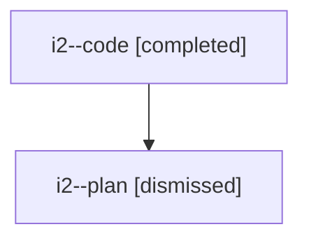

# Session: i2

[Agent Hoods](../README.md) / [bbugyi200](../users/bbugyi200/README.md) / [athena](../users/bbugyi200/machines/athena/README.md) / [i2](../users/bbugyi200/machines/athena/hoods/i2/README.md) / i2

Owner: `bbugyi200.athena` · Hood: `i2` · Members: 2

## Lineage

The diagram is an optional enhancement; the ordered table below contains the same lineage in accessible text.

| Role | Agent | State | Model / provider | Timing | Commits | Prompt | Chat |
|---|---|---|---|---|---:|---|---|
| code | i2--code | completed | gpt-5.6-sol / codex | 2026-07-22T13:18:19.138177+00:00 | [1](../agents/bbugyi200.athena.i2--code/README.md#commits) | — | [Chat](../agents/bbugyi200.athena.i2--code/chat.md) |
| plan | i2--plan | dismissed | opus / claude | 2026-07-22T08:50:12.502064 → 2026-07-22T09:50:42.209911 | 0 | [Prompt](../agents/bbugyi200.athena.i2--plan/prompt.md) | [Chat](../agents/bbugyi200.athena.i2--plan/chat.md) |

## Commits

| Role | Repo | Commit | Subject | Committed |
|---|---|---|---|---|
| code | — | `7c71edf` | feat(ace): show applied commits in post-update toast | 2026-07-22 09:50:28 EDT |
