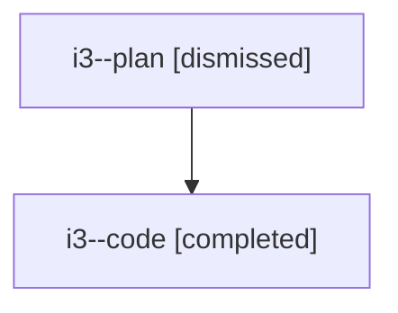

# Session: i3

[Agent Hoods](../README.md) / [bbugyi200](../users/bbugyi200/README.md) / [athena](../users/bbugyi200/machines/athena/README.md) / [i3](../users/bbugyi200/machines/athena/hoods/i3/README.md) / i3

Owner: `bbugyi200.athena` · Hood: `i3` · Members: 2

## Lineage

The diagram is an optional enhancement; the ordered table below contains the same lineage in accessible text.

| Role | Agent | State | Model / provider | Timing | Commits | Prompt | Chat |
|---|---|---|---|---|---:|---|---|
| plan | i3--plan | dismissed | gpt-5.6-sol / codex | 2026-07-22T09:01:36.790897 → 2026-07-22T09:33:09.975472 | 0 | [Prompt](../agents/bbugyi200.athena.i3--plan/prompt.md) | [Chat](../agents/bbugyi200.athena.i3--plan/chat.md) |
| code | i3--code | completed | gpt-5.6-sol / codex | 2026-07-22T13:18:26.980248+00:00 | [1](../agents/bbugyi200.athena.i3--code/README.md#commits) | — | [Chat](../agents/bbugyi200.athena.i3--code/chat.md) |

## Commits

| Role | Repo | Commit | Subject | Committed |
|---|---|---|---|---|
| code | — | `3543cd2` | fix(tui): align TODO annotations with running gold | 2026-07-22 09:32:56 EDT |

## Neighbors

| Agent | Relation | State |
|---|---|---|
| [i3.f0](bbugyi200.athena.i3.f0.md) (session · 2) | descendant | completed 1, dismissed 1 |
