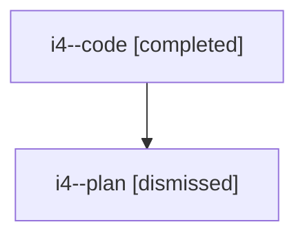

# Session: i4

[Agent Hoods](../README.md) / [bbugyi200](../users/bbugyi200/README.md) / [athena](../users/bbugyi200/machines/athena/README.md) / [i4](../users/bbugyi200/machines/athena/hoods/i4/README.md) / i4

Owner: `bbugyi200.athena` · Hood: `i4` · Members: 2

## Lineage

The diagram is an optional enhancement; the ordered table below contains the same lineage in accessible text.

| Role | Agent | State | Model / provider | Timing | Commits | Prompt | Chat |
|---|---|---|---|---|---:|---|---|
| code | i4--code | completed | gpt-5.6-sol / codex | 2026-07-22T13:18:37.369651+00:00 | [1](../agents/bbugyi200.athena.i4--code/README.md#commits) | — | [Chat](../agents/bbugyi200.athena.i4--code/chat.md) |
| plan | i4--plan | dismissed | opus / claude | 2026-07-22T09:03:42.990503 → 2026-07-22T09:40:01.993166 | 0 | [Prompt](../agents/bbugyi200.athena.i4--plan/prompt.md) | [Chat](../agents/bbugyi200.athena.i4--plan/chat.md) |

## Commits

| Role | Repo | Commit | Subject | Committed |
|---|---|---|---|---|
| code | — | `679a41b` | fix(ace): restore arrival bell for plan reviews | 2026-07-22 09:39:47 EDT |
