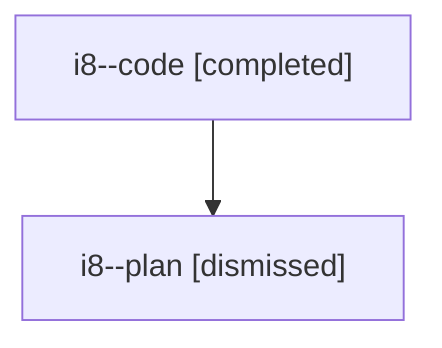

# Session: i8

[Agent Hoods](../README.md) / [bbugyi200](../users/bbugyi200/README.md) / [athena](../users/bbugyi200/machines/athena/README.md) / [i8](../users/bbugyi200/machines/athena/hoods/i8/README.md) / i8

Owner: `bbugyi200.athena` · Hood: `i8` · Members: 2

## Lineage

The diagram is an optional enhancement; the ordered table below contains the same lineage in accessible text.

| Role | Agent | State | Model / provider | Timing | Commits | Prompt | Chat |
|---|---|---|---|---|---:|---|---|
| code | i8--code | completed | gpt-5.6-sol / codex | 2026-07-22T14:36:46.310238+00:00 | [1](../agents/bbugyi200.athena.i8--code/README.md#commits) | — | [Chat](../agents/bbugyi200.athena.i8--code/chat.md) |
| plan | i8--plan | dismissed | gpt-5.6-sol / codex | 2026-07-22T10:28:36.190562 → 2026-07-22T10:51:46.223938 | 0 | [Prompt](../agents/bbugyi200.athena.i8--plan/prompt.md) | [Chat](../agents/bbugyi200.athena.i8--plan/chat.md) |

## Commits

| Role | Repo | Commit | Subject | Committed |
|---|---|---|---|---|
| code | — | `f7e974d` | feat(ace): continue prompt bullets with normal-mode o | 2026-07-22 10:51:33 EDT |
