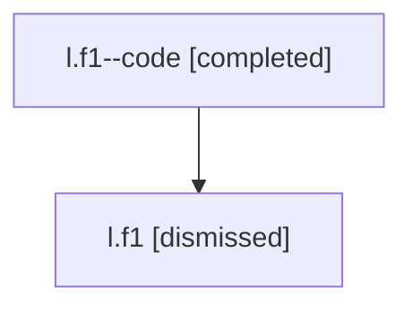

# Session: l.f1

[Agent Hoods](../README.md) / [bbugyi200](../users/bbugyi200/README.md) / [athena](../users/bbugyi200/machines/athena/README.md) / [l](../users/bbugyi200/machines/athena/hoods/l/README.md) / l.f1

Owner: `bbugyi200.athena` · Hood: `l` · Members: 2

## Lineage

The diagram is an optional enhancement; the ordered table below contains the same lineage in accessible text.

| Role | Agent | State | Model / provider | Timing | Commits | Prompt | Chat |
|---|---|---|---|---|---:|---|---|
| code | l.f1--code | completed | gpt-5.5 / codex | 2026-07-06T20:33:37.657620+00:00 | [1](../agents/bbugyi200.athena.l.f1--code/README.md#commits) | — | [Chat](../agents/bbugyi200.athena.l.f1--code/chat.md) |
| root | l.f1 | dismissed | gpt-5.5 / codex | 2026-07-06T16:29:46.442857 → 2026-07-06T16:43:56.521810 | [1](../agents/bbugyi200.athena.l.f1/README.md#commits) | [Prompt](../agents/bbugyi200.athena.l.f1/prompt.md) | [Chat](../agents/bbugyi200.athena.l.f1/chat.md) |

## Commits

| Role | Repo | Commit | Subject | Committed |
|---|---|---|---|---|
| root | — | `e1b2d2e` | chore: Add SDD prompt and plan for generated\_media\_default\_artifacts | 2026-07-06 16:33:36 EDT |
| code | — | `0047ef8` | fix: persist prompt-referenced videos as artifacts | 2026-07-06 16:43:38 EDT |

## Neighbors

| Agent | Relation | State |
|---|---|---|
| [l](bbugyi200.athena.l.md) (session · 2) | ancestor | completed 1, dismissed 1 |
| [l.f1.f1](bbugyi200.athena.l.f1.f1.md) (session · 2) | descendant | completed 1, dismissed 1 |
