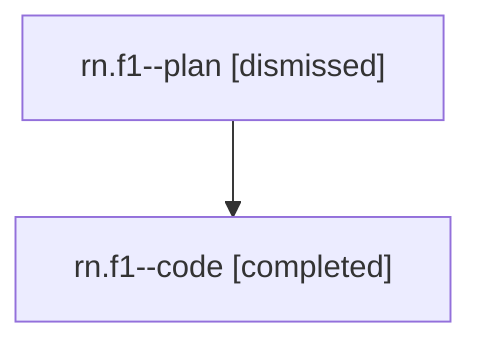

# Session: rn.f1

[Agent Hoods](../README.md) / [bbugyi200](../users/bbugyi200/README.md) / [athena](../users/bbugyi200/machines/athena/README.md) / [rn](../users/bbugyi200/machines/athena/hoods/rn/README.md) / rn.f1

Owner: `bbugyi200.athena` · Hood: `rn` · Members: 2

## Lineage

The diagram is an optional enhancement; the ordered table below contains the same lineage in accessible text.

| Role | Agent | State | Model / provider | Timing | Commits | Prompt | Chat |
|---|---|---|---|---|---:|---|---|
| plan | rn.f1--plan | dismissed | opus / claude | 2026-08-02T07:32:20.899367 → 2026-08-02T09:36:22.433575 | 0 | [Prompt](../agents/bbugyi200.athena.rn.f1--plan/prompt.md) | [Chat](../agents/bbugyi200.athena.rn.f1--plan/chat.md) |
| code | rn.f1--code | completed | gpt-5.6-sol / codex | 2026-08-02T12:14:18.518138+00:00 | [1](../agents/bbugyi200.athena.rn.f1--code/README.md#commits) | — | [Chat](../agents/bbugyi200.athena.rn.f1--code/chat.md) |

## Commits

| Role | Repo | Commit | Subject | Committed |
|---|---|---|---|---|
| code | — | `5143cb9` | fix(stats): expose runner occupancy diagnostics | 2026-08-02 09:23:48 EDT |

## Neighbors

| Agent | Relation | State |
|---|---|---|
| [rn](bbugyi200.athena.rn.md) (session · 2) | ancestor | completed 1, dismissed 1 |
