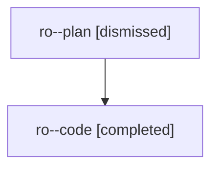

# Session: ro

[Agent Hoods](../README.md) / [bbugyi200](../users/bbugyi200/README.md) / [athena](../users/bbugyi200/machines/athena/README.md) / [ro](../users/bbugyi200/machines/athena/hoods/ro/README.md) / ro

Owner: `bbugyi200.athena` · Hood: `ro` · Members: 2

## Lineage

The diagram is an optional enhancement; the ordered table below contains the same lineage in accessible text.

| Role | Agent | State | Model / provider | Timing | Commits | Prompt | Chat |
|---|---|---|---|---|---:|---|---|
| plan | ro--plan | dismissed | opus / claude | 2026-08-02T06:49:42.277408 → 2026-08-02T07:39:28.135321 | 0 | [Prompt](../agents/bbugyi200.athena.ro--plan/prompt.md) | [Chat](../agents/bbugyi200.athena.ro--plan/chat.md) |
| code | ro--code | completed | gpt-5.6-sol / codex | 2026-08-02T10:59:01.935847+00:00 | [1](../agents/bbugyi200.athena.ro--code/README.md#commits) | — | [Chat](../agents/bbugyi200.athena.ro--code/chat.md) |

## Commits

| Role | Repo | Commit | Subject | Committed |
|---|---|---|---|---|
| code | — | `c081bb6` | feat(tui): show published agent page URLs | 2026-08-02 07:38:35 EDT |
