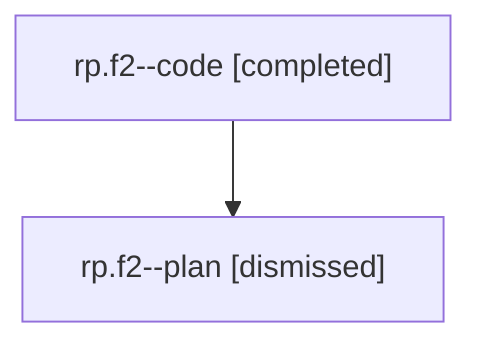

# Session: rp.f2

[Agent Hoods](../README.md) / [bbugyi200](../users/bbugyi200/README.md) / [athena](../users/bbugyi200/machines/athena/README.md) / [rp](../users/bbugyi200/machines/athena/hoods/rp/README.md) / rp.f2

Owner: `bbugyi200.athena` · Hood: `rp` · Members: 2

## Lineage

The diagram is an optional enhancement; the ordered table below contains the same lineage in accessible text.

| Role | Agent | State | Model / provider | Timing | Commits | Prompt | Chat |
|---|---|---|---|---|---:|---|---|
| code | rp.f2--code | completed | gpt-5.6-sol / codex | 2026-08-02T11:41:09.787369+00:00 | [1](../agents/bbugyi200.athena.rp.f2--code/README.md#commits) | — | [Chat](../agents/bbugyi200.athena.rp.f2--code/chat.md) |
| plan | rp.f2--plan | dismissed | gpt-5.6-sol / codex | 2026-08-02T07:31:32.840312 → 2026-08-02T08:23:38.779073 | 0 | [Prompt](../agents/bbugyi200.athena.rp.f2--plan/prompt.md) | [Chat](../agents/bbugyi200.athena.rp.f2--plan/chat.md) |

## Commits

| Role | Repo | Commit | Subject | Committed |
|---|---|---|---|---|
| code | — | `e4c13b3` | feat(llm): add provider-specific coder defaults | 2026-08-02 08:16:50 EDT |

## Neighbors

| Agent | Relation | State |
|---|---|---|
| [rp](bbugyi200.athena.rp.md) (session · 2) | ancestor | completed 1, dismissed 1 |
| [rp.f0](../agents/bbugyi200.athena.rp.f0/README.md) | rp hood | dismissed |
