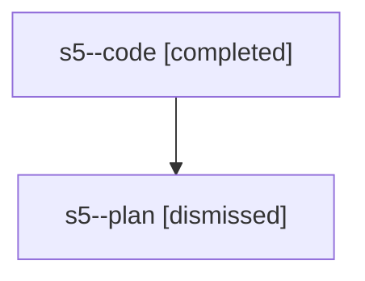

# Session: s5

[Agent Hoods](../README.md) / [bbugyi200](../users/bbugyi200/README.md) / [athena](../users/bbugyi200/machines/athena/README.md) / [s5](../users/bbugyi200/machines/athena/hoods/s5/README.md) / s5

Owner: `bbugyi200.athena` · Hood: `s5` · Members: 2

## Lineage

The diagram is an optional enhancement; the ordered table below contains the same lineage in accessible text.

| Role | Agent | State | Model / provider | Timing | Commits | Prompt | Chat |
|---|---|---|---|---|---:|---|---|
| code | s5--code | completed | gpt-5.5 / codex | 2026-08-02T15:58:43.346359+00:00 | [1](../agents/bbugyi200.athena.s5--code/README.md#commits) | — | [Chat](../agents/bbugyi200.athena.s5--code/chat.md) |
| plan | s5--plan | dismissed | gpt-5.6-sol / codex | 2026-08-02T11:46:41.064816 → 2026-08-02T13:15:47.061429 | 0 | [Prompt](../agents/bbugyi200.athena.s5--plan/prompt.md) | [Chat](../agents/bbugyi200.athena.s5--plan/chat.md) |

## Commits

| Role | Repo | Commit | Subject | Committed |
|---|---|---|---|---|
| code | — | `fa43d2f` | fix(ace): restore app help keymap | 2026-08-02 13:08:48 EDT |
