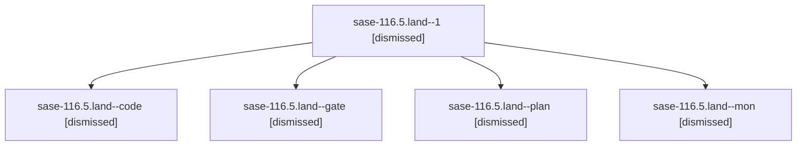

# Session: sase-116.5.land

[Agent Hoods](../README.md) / [bbugyi200](../users/bbugyi200/README.md) / [athena](../users/bbugyi200/machines/athena/README.md) / [sase-116](../users/bbugyi200/machines/athena/hoods/sase-116/README.md) / sase-116.5.land

Owner: `bbugyi200.athena` · Hood: `sase-116` · Members: 5 · Bead: [sase-116.5](https://github.com/sase-org/sase--beads/blob/main/pages/sase-116/sase-116.5.md)

## Lineage

The diagram is an optional enhancement; the ordered table below contains the same lineage in accessible text.

| Role | Agent | State | Model / provider | Timing | Commits | Prompt | Chat |
|---|---|---|---|---|---:|---|---|
| 1 | sase-116.5.land--1 | dismissed | gpt-5.6-sol / codex | 2026-09-15T15:58:44.434470 → 2026-09-15T16:04:42.644310 | 0 | [Prompt](../agents/bbugyi200.athena.sase-116.5.land--1/prompt.md) | [Chat](../agents/bbugyi200.athena.sase-116.5.land--1/chat.md) |
| code | sase-116.5.land--code | dismissed | gpt-5.5 / codex | 2026-09-15T16:06:55.046558 → 2026-09-15T16:35:58.479804 | [1](../agents/bbugyi200.athena.sase-116.5.land--code/README.md#commits) | [Prompt](../agents/bbugyi200.athena.sase-116.5.land--code/prompt.md) | [Chat](../agents/bbugyi200.athena.sase-116.5.land--code/chat.md) |
| gate | sase-116.5.land--gate | dismissed | gpt-5.6-sol / codex | 2026-09-15T16:05:44.753579 → 2026-09-15T16:06:06 | 0 | — | [Chat](../agents/bbugyi200.athena.sase-116.5.land--gate/chat.md) |
| plan | sase-116.5.land--plan | dismissed | gpt-5.6-sol / codex | 2026-09-15T15:23:16.421877 → 2026-09-15T15:29:12.149160 | 0 | [Prompt](../agents/bbugyi200.athena.sase-116.5.land--plan/prompt.md) | [Chat](../agents/bbugyi200.athena.sase-116.5.land--plan/chat.md) |
| mon | sase-116.5.land--mon | dismissed | gpt-5.6-sol / codex | 2026-09-15T15:28:54.469959 → 2026-09-15T15:57:34.243887 | 0 | — | [Chat](../agents/bbugyi200.athena.sase-116.5.land--mon/chat.md) |

## Commits

| Role | Repo | Commit | Subject | Committed |
|---|---|---|---|---|
| code | — | `981004d` | test(bead): patch claimed show read view fixture | 2026-09-15 16:33:20 EDT |

## Neighbors

| Agent | Relation | State |
|---|---|---|
| [sase-116.5.1](../agents/bbugyi200.athena.sase-116.5.1/README.md) | sase-116.5 hood | dismissed |
| [sase-116.5.2](../agents/bbugyi200.athena.sase-116.5.2/README.md) | sase-116.5 hood | dismissed |
| [sase-116.1](../agents/bbugyi200.athena.sase-116.1/README.md) | sase-116 hood | dismissed |
| [sase-116.2](../agents/bbugyi200.athena.sase-116.2/README.md) | sase-116 hood | dismissed |
| [sase-116.3](../agents/bbugyi200.athena.sase-116.3/README.md) | sase-116 hood | dismissed |
| [sase-116.4](../agents/bbugyi200.athena.sase-116.4/README.md) | sase-116 hood | dismissed |
| [sase-116.land](bbugyi200.athena.sase-116.land.md) (session · 3) | sase-116 hood | dismissed 3 |
