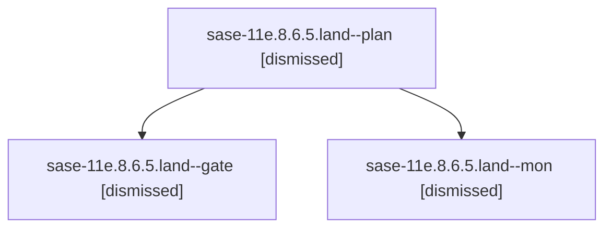

# Session: sase-11e.8.6.5.land

[Agent Hoods](../README.md) / [bbugyi200](../users/bbugyi200/README.md) / [athena](../users/bbugyi200/machines/athena/README.md) / [sase-11e](../users/bbugyi200/machines/athena/hoods/sase-11e/README.md) / sase-11e.8.6.5.land

Owner: `bbugyi200.athena` · Hood: `sase-11e` · Members: 3 · Bead: [sase-11e.8.6.5](https://github.com/sase-org/sase--beads/blob/main/pages/sase-11e/sase-11e.8.6.5.md)

## Lineage

The diagram is an optional enhancement; the ordered table below contains the same lineage in accessible text.

| Role | Agent | State | Model / provider | Timing | Commits | Prompt | Chat |
|---|---|---|---|---|---:|---|---|
| plan | sase-11e.8.6.5.land--plan | dismissed | opus / claude | 2026-09-16T14:35:05.594620 → 2026-09-16T14:58:23.811613 | 0 | [Prompt](../agents/bbugyi200.athena.sase-11e.8.6.5.land--plan/prompt.md) | [Chat](../agents/bbugyi200.athena.sase-11e.8.6.5.land--plan/chat.md) |
| gate | sase-11e.8.6.5.land--gate | dismissed | opus / claude | 2026-09-16T14:55:59.089750 → 2026-09-16T14:58:04 | 0 | — | [Chat](../agents/bbugyi200.athena.sase-11e.8.6.5.land--gate/chat.md) |
| mon | sase-11e.8.6.5.land--mon | dismissed | opus / claude | 2026-09-16T14:58:03.846409 → 2026-09-16T15:01:52.422336 | 0 | — | [Chat](../agents/bbugyi200.athena.sase-11e.8.6.5.land--mon/chat.md) |

## Neighbors

| Agent | Relation | State |
|---|---|---|
| [sase-11e.8.6.5.1](../agents/bbugyi200.athena.sase-11e.8.6.5.1/README.md) | sase-11e.8.6.5 hood | dismissed |
| [sase-11e.8.6.5.2](../agents/bbugyi200.athena.sase-11e.8.6.5.2/README.md) | sase-11e.8.6.5 hood | dismissed |
| [sase-11e.8.6.5.3](../agents/bbugyi200.athena.sase-11e.8.6.5.3/README.md) | sase-11e.8.6.5 hood | dismissed |
| [sase-11e.8.6.5.4.1](../agents/bbugyi200.athena.sase-11e.8.6.5.4.1/README.md) | sase-11e.8.6.5 hood | dismissed |
| [sase-11e.8.6.5.4.2](bbugyi200.athena.sase-11e.8.6.5.4.2.md) (session · 3) | sase-11e.8.6.5 hood | dismissed 3 |
| [sase-11e.8.6.5.4.3](../agents/bbugyi200.athena.sase-11e.8.6.5.4.3/README.md) | sase-11e.8.6.5 hood | dismissed |
| [sase-11e.8.6.5.4.4](../agents/bbugyi200.athena.sase-11e.8.6.5.4.4/README.md) | sase-11e.8.6.5 hood | dismissed |
| [sase-11e.8.6.5.4.5](bbugyi200.athena.sase-11e.8.6.5.4.5.md) (session · 3) | sase-11e.8.6.5 hood | dismissed 3 |
| [sase-11e.8.6.5.4.land](bbugyi200.athena.sase-11e.8.6.5.4.land.md) (session · 3) | sase-11e.8.6.5 hood | completed 1, dismissed 2 |
| [sase-11e.8.6.1](../agents/bbugyi200.athena.sase-11e.8.6.1/README.md) | sase-11e.8.6 hood | dismissed |
| [sase-11e.8.6.2](../agents/bbugyi200.athena.sase-11e.8.6.2/README.md) | sase-11e.8.6 hood | dismissed |
| [sase-11e.8.6.3](../agents/bbugyi200.athena.sase-11e.8.6.3/README.md) | sase-11e.8.6 hood | dismissed |
| [sase-11e.8.6.4](../agents/bbugyi200.athena.sase-11e.8.6.4/README.md) | sase-11e.8.6 hood | dismissed |
| [sase-11e.8.6.land](bbugyi200.athena.sase-11e.8.6.land.md) (session · 3) | sase-11e.8.6 hood | dismissed 3 |
| [sase-11e.8.1](../agents/bbugyi200.athena.sase-11e.8.1/README.md) | sase-11e.8 hood | dismissed |
| [sase-11e.8.2](../agents/bbugyi200.athena.sase-11e.8.2/README.md) | sase-11e.8 hood | dismissed |
| [sase-11e.8.3](../agents/bbugyi200.athena.sase-11e.8.3/README.md) | sase-11e.8 hood | dismissed |
| [sase-11e.8.4](../agents/bbugyi200.athena.sase-11e.8.4/README.md) | sase-11e.8 hood | dismissed |
| [sase-11e.8.5](bbugyi200.athena.sase-11e.8.5.md) (session · 3) | sase-11e.8 hood | dismissed 3 |
| [sase-11e.8.land](bbugyi200.athena.sase-11e.8.land.md) (session · 3) | sase-11e.8 hood | dismissed 3 |
| [sase-11e.1](../agents/bbugyi200.athena.sase-11e.1/README.md) | sase-11e hood | dismissed |
| [sase-11e.2](../agents/bbugyi200.athena.sase-11e.2/README.md) | sase-11e hood | dismissed |
| [sase-11e.3](../agents/bbugyi200.athena.sase-11e.3/README.md) | sase-11e hood | dismissed |
| [sase-11e.4](../agents/bbugyi200.athena.sase-11e.4/README.md) | sase-11e hood | dismissed |
| [sase-11e.5](../agents/bbugyi200.athena.sase-11e.5/README.md) | sase-11e hood | dismissed |
| [sase-11e.6](../agents/bbugyi200.athena.sase-11e.6/README.md) | sase-11e hood | dismissed |
| [sase-11e.7](../agents/bbugyi200.athena.sase-11e.7/README.md) | sase-11e hood | dismissed |
| [sase-11e.land](bbugyi200.athena.sase-11e.land.md) (session · 3) | sase-11e hood | dismissed 3 |
