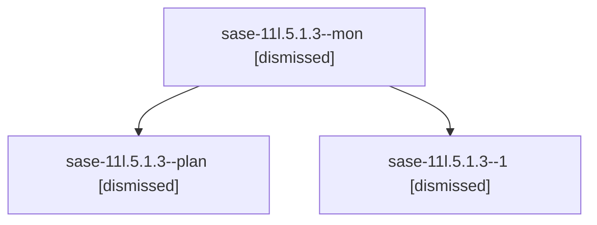

# Session: sase-11l.5.1.3

[Agent Hoods](../README.md) / [bbugyi200](../users/bbugyi200/README.md) / [athena](../users/bbugyi200/machines/athena/README.md) / [sase-11l](../users/bbugyi200/machines/athena/hoods/sase-11l/README.md) / sase-11l.5.1.3

Owner: `bbugyi200.athena` · Hood: `sase-11l` · Members: 3 · Bead: [sase-11l.5.1.3](https://github.com/sase-org/sase--beads/blob/main/pages/sase-11l/sase-11l.5.1.3.md)

## Lineage

The diagram is an optional enhancement; the ordered table below contains the same lineage in accessible text.

| Role | Agent | State | Model / provider | Timing | Commits | Prompt | Chat |
|---|---|---|---|---|---:|---|---|
| mon | sase-11l.5.1.3--mon | dismissed | sonnet / claude | 2026-09-16T17:48:20.289173 → 2026-09-16T18:15:45.016796 | 0 | — | [Chat](../agents/bbugyi200.athena.sase-11l.5.1.3--mon/chat.md) |
| plan | sase-11l.5.1.3--plan | dismissed | sonnet / claude | 2026-09-16T16:01:53.356697 → 2026-09-16T17:49:16.727054 | 0 | [Prompt](../agents/bbugyi200.athena.sase-11l.5.1.3--plan/prompt.md) | [Chat](../agents/bbugyi200.athena.sase-11l.5.1.3--plan/chat.md) |
| 1 | sase-11l.5.1.3--1 | dismissed | sonnet / claude | 2026-09-16T18:17:00.586509 → 2026-09-16T18:41:28.307678 | [1](../agents/bbugyi200.athena.sase-11l.5.1.3--1/README.md#commits) | [Prompt](../agents/bbugyi200.athena.sase-11l.5.1.3--1/prompt.md) | [Chat](../agents/bbugyi200.athena.sase-11l.5.1.3--1/chat.md) |

## Commits

| Role | Repo | Commit | Subject | Committed |
|---|---|---|---|---|
| 1 | — | `43c8721` | feat(agent-hold): preview pending %hold captures and confirm broad holds | 2026-09-16 18:38:38 EDT |

## Neighbors

| Agent | Relation | State |
|---|---|---|
| [sase-11l.5](../agents/bbugyi200.athena.sase-11l.5/README.md) | ancestor | dismissed |
| [sase-11l.5.1.1](bbugyi200.athena.sase-11l.5.1.1.md) (session · 3) | sase-11l.5.1 hood | completed 1, dismissed 2 |
| [sase-11l.5.1.2](bbugyi200.athena.sase-11l.5.1.2.md) (session · 3) | sase-11l.5.1 hood | dismissed 3 |
| [sase-11l.5.1.2.1.1](../agents/bbugyi200.athena.sase-11l.5.1.2.1.1/README.md) | sase-11l.5.1 hood | dismissed |
| [sase-11l.5.1.2.1.2](../agents/bbugyi200.athena.sase-11l.5.1.2.1.2/README.md) | sase-11l.5.1 hood | dismissed |
| [sase-11l.5.1.2.1.3](../agents/bbugyi200.athena.sase-11l.5.1.2.1.3/README.md) | sase-11l.5.1 hood | dismissed |
| [sase-11l.5.1.2.1.4](../agents/bbugyi200.athena.sase-11l.5.1.2.1.4/README.md) | sase-11l.5.1 hood | dismissed |
| [sase-11l.5.1.2.1.land](bbugyi200.athena.sase-11l.5.1.2.1.land.md) (session · 3) | sase-11l.5.1 hood | completed 1, dismissed 2 |
| [sase-11l.5.1.2.1.land](../agents/bbugyi200.athena.sase-11l.5.1.2.1.land/README.md) | sase-11l.5.1 hood | waiting |
| [sase-11l.5.1.land](bbugyi200.athena.sase-11l.5.1.land.md) (session · 3) | sase-11l.5.1 hood | dismissed 3 |
| [sase-11l.1](bbugyi200.athena.sase-11l.1.md) (session · 3) | sase-11l hood | completed 1, dismissed 2 |
| [sase-11l.10](bbugyi200.athena.sase-11l.10.md) (session · 11) | sase-11l hood | completed 4, dismissed 1, failed 6 |
| [sase-11l.11.1](bbugyi200.athena.sase-11l.11.1.md) (session · 7) | sase-11l hood | dismissed 7 |
| [sase-11l.11.2](bbugyi200.athena.sase-11l.11.2.md) (session · 5) | sase-11l hood | dismissed 5 |
| [sase-11l.11.3](bbugyi200.athena.sase-11l.11.3.md) (session · 3) | sase-11l hood | dismissed 3 |
| [sase-11l.11.4](bbugyi200.athena.sase-11l.11.4.md) (session · 5) | sase-11l hood | dismissed 5 |
| [sase-11l.11.5.1](bbugyi200.athena.sase-11l.11.5.1.md) (session · 7) | sase-11l hood | dismissed 7 |
| [sase-11l.11.5.land](bbugyi200.athena.sase-11l.11.5.land.md) (session · 3) | sase-11l hood | dismissed 3 |
| [sase-11l.11.5.land.f0](bbugyi200.athena.sase-11l.11.5.land.f0.md) (session · 3) | sase-11l hood | completed 1, dismissed 1, failed 1 |
| [sase-11l.11.land](bbugyi200.athena.sase-11l.11.land.md) (session · 3) | sase-11l hood | dismissed 3 |
| [sase-11l.2](../agents/bbugyi200.athena.sase-11l.2/README.md) | sase-11l hood | dismissed |
| [sase-11l.3](bbugyi200.athena.sase-11l.3.md) (session · 3) | sase-11l hood | completed 1, dismissed 2 |
| [sase-11l.4](bbugyi200.athena.sase-11l.4.md) (session · 3) | sase-11l hood | completed 1, dismissed 2 |
| [sase-11l.6](../agents/bbugyi200.athena.sase-11l.6/README.md) | sase-11l hood | dismissed |
| [sase-11l.7](../agents/bbugyi200.athena.sase-11l.7/README.md) | sase-11l hood | dismissed |
| [sase-11l.8](../agents/bbugyi200.athena.sase-11l.8/README.md) | sase-11l hood | dismissed |
| [sase-11l.9](../agents/bbugyi200.athena.sase-11l.9/README.md) | sase-11l hood | dismissed |
| [sase-11l.land](bbugyi200.athena.sase-11l.land.md) (session · 3) | sase-11l hood | dismissed 3 |
