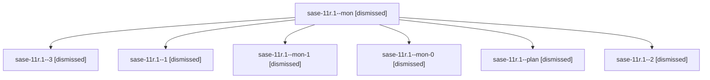

# Session: sase-11r.1

[Agent Hoods](../README.md) / [bbugyi200](../users/bbugyi200/README.md) / [athena](../users/bbugyi200/machines/athena/README.md) / [sase-11r](../users/bbugyi200/machines/athena/hoods/sase-11r/README.md) / sase-11r.1

Owner: `bbugyi200.athena` · Hood: `sase-11r` · Members: 7 · Bead: [sase-11r.1](https://github.com/sase-org/sase--beads/blob/main/pages/sase-11r/sase-11r.1.md)

## Lineage

The diagram is an optional enhancement; the ordered table below contains the same lineage in accessible text.

| Role | Agent | State | Model / provider | Timing | Commits | Prompt | Chat |
|---|---|---|---|---|---:|---|---|
| mon | sase-11r.1--mon | dismissed | sonnet / claude | 2026-09-16T10:35:42.682736 → 2026-09-16T10:37:31.894687 | 0 | — | [Chat](../agents/bbugyi200.athena.sase-11r.1--mon/chat.md) |
| 3 | sase-11r.1--3 | dismissed | sonnet / claude | 2026-09-16T12:56:39.664250 → 2026-09-16T13:08:11.655045 | [1](../agents/bbugyi200.athena.sase-11r.1--3/README.md#commits) | [Prompt](../agents/bbugyi200.athena.sase-11r.1--3/prompt.md) | [Chat](../agents/bbugyi200.athena.sase-11r.1--3/chat.md) |
| 1 | sase-11r.1--1 | dismissed | gpt-5.5 / codex | 2026-09-16T10:39:01.704023 → 2026-09-16T11:18:22.764014 | 0 | [Prompt](../agents/bbugyi200.athena.sase-11r.1--1/prompt.md) | [Chat](../agents/bbugyi200.athena.sase-11r.1--1/chat.md) |
| mon-1 | sase-11r.1--mon-1 | dismissed | sonnet / claude | 2026-09-16T12:17:58.688091 → 2026-09-16T12:54:46.266551 | 0 | — | [Chat](../agents/bbugyi200.athena.sase-11r.1--mon-1/chat.md) |
| mon-0 | sase-11r.1--mon-0 | dismissed | gpt-5.5 / codex | 2026-09-16T11:16:21.530029 → 2026-09-16T12:10:28.892468 | 0 | — | [Chat](../agents/bbugyi200.athena.sase-11r.1--mon-0/chat.md) |
| plan | sase-11r.1--plan | dismissed | sonnet / claude | 2026-09-16T10:09:24.278124 → 2026-09-16T10:36:17.743831 | 0 | [Prompt](../agents/bbugyi200.athena.sase-11r.1--plan/prompt.md) | [Chat](../agents/bbugyi200.athena.sase-11r.1--plan/chat.md) |
| 2 | sase-11r.1--2 | dismissed | sonnet / claude | 2026-09-16T12:11:40.429811 → 2026-09-16T12:18:39.766605 | 0 | [Prompt](../agents/bbugyi200.athena.sase-11r.1--2/prompt.md) | [Chat](../agents/bbugyi200.athena.sase-11r.1--2/chat.md) |

## Commits

| Role | Repo | Commit | Subject | Committed |
|---|---|---|---|---|
| 3 | — | `44f4c44` | fix(monitor): close the monitor-settles-before-starter race | 2026-09-16 13:07:09 EDT |

## Neighbors

| Agent | Relation | State |
|---|---|---|
| [sase-11r.2](../agents/bbugyi200.athena.sase-11r.2/README.md) | sase-11r hood | dismissed |
| [sase-11r.3](../agents/bbugyi200.athena.sase-11r.3/README.md) | sase-11r hood | dismissed |
| [sase-11r.land](../agents/bbugyi200.athena.sase-11r.land/README.md) | sase-11r hood | dismissed |
