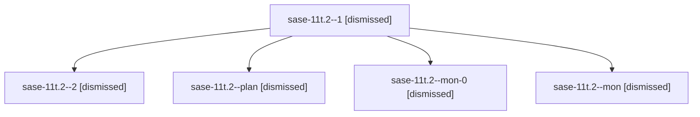

# Session: sase-11t.2

[Agent Hoods](../README.md) / [bbugyi200](../users/bbugyi200/README.md) / [athena](../users/bbugyi200/machines/athena/README.md) / [sase-11t](../users/bbugyi200/machines/athena/hoods/sase-11t/README.md) / sase-11t.2

Owner: `bbugyi200.athena` · Hood: `sase-11t` · Members: 5 · Bead: [sase-11t.2](https://github.com/sase-org/sase--beads/blob/main/pages/sase-11t/sase-11t.2.md)

## Lineage

The diagram is an optional enhancement; the ordered table below contains the same lineage in accessible text.

| Role | Agent | State | Model / provider | Timing | Commits | Prompt | Chat |
|---|---|---|---|---|---:|---|---|
| 1 | sase-11t.2--1 | dismissed | gpt-5.5 / codex | 2026-09-16T13:03:01.944974 → 2026-09-16T13:22:16.683902 | 0 | [Prompt](../agents/bbugyi200.athena.sase-11t.2--1/prompt.md) | [Chat](../agents/bbugyi200.athena.sase-11t.2--1/chat.md) |
| 2 | sase-11t.2--2 | dismissed | sonnet / claude | 2026-09-16T14:38:52.795833 → 2026-09-16T14:49:21.105392 | [1](../agents/bbugyi200.athena.sase-11t.2--2/README.md#commits) | [Prompt](../agents/bbugyi200.athena.sase-11t.2--2/prompt.md) | [Chat](../agents/bbugyi200.athena.sase-11t.2--2/chat.md) |
| plan | sase-11t.2--plan | dismissed | gpt-5.5 / codex | 2026-09-16T10:44:14.377394 → 2026-09-16T11:33:17.929911 | 0 | [Prompt](../agents/bbugyi200.athena.sase-11t.2--plan/prompt.md) | [Chat](../agents/bbugyi200.athena.sase-11t.2--plan/chat.md) |
| mon-0 | sase-11t.2--mon-0 | dismissed | gpt-5.5 / codex | 2026-09-16T13:21:05.402080 → 2026-09-16T14:33:27.045888 | 0 | — | [Chat](../agents/bbugyi200.athena.sase-11t.2--mon-0/chat.md) |
| mon | sase-11t.2--mon | dismissed | gpt-5.5 / codex | 2026-09-16T11:31:45.013740 → 2026-09-16T13:01:47.259685 | 0 | — | [Chat](../agents/bbugyi200.athena.sase-11t.2--mon/chat.md) |

## Commits

| Role | Repo | Commit | Subject | Committed |
|---|---|---|---|---|
| 2 | — | `06a53a0` | fix(llm-provider): detect codex turn-integrity failures on empty-final killed-command turns | 2026-09-16 14:46:18 EDT |

## Neighbors

| Agent | Relation | State |
|---|---|---|
| [sase-11t.1](bbugyi200.athena.sase-11t.1.md) (session · 3) | sase-11t hood | completed 1, dismissed 2 |
| [sase-11t.3](bbugyi200.athena.sase-11t.3.md) (session · 3) | sase-11t hood | dismissed 3 |
| [sase-11t.4](bbugyi200.athena.sase-11t.4.md) (session · 2) | sase-11t hood | dismissed 2 |
| [sase-11t.land](../agents/bbugyi200.athena.sase-11t.land/README.md) | sase-11t hood | dismissed |
