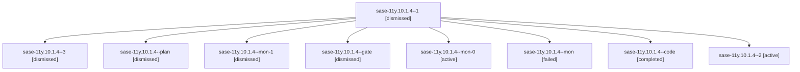

# Session: sase-11y.10.1.4

[Agent Hoods](../README.md) / [bbugyi200](../users/bbugyi200/README.md) / [athena](../users/bbugyi200/machines/athena/README.md) / [sase-11y](../users/bbugyi200/machines/athena/hoods/sase-11y/README.md) / sase-11y.10.1.4

Owner: `bbugyi200.athena` · Hood: `sase-11y` · Members: 9 · Bead: [sase-11y.10.1.4](https://github.com/sase-org/sase--beads/blob/main/pages/sase-11y/sase-11y.10.1.4.md)

## Lineage

The diagram is an optional enhancement; the ordered table below contains the same lineage in accessible text.

| Role | Agent | State | Model / provider | Timing | Commits | Prompt | Chat |
|---|---|---|---|---|---:|---|---|
| 1 | sase-11y.10.1.4--1 | dismissed | muse-spark-1.3-contributor / muse | 2026-09-20T22:03:49.636328 → 2026-09-20T22:13:44.638198 | 0 | [Prompt](../agents/bbugyi200.athena.sase-11y.10.1.4--1/prompt.md) | [Chat](../agents/bbugyi200.athena.sase-11y.10.1.4--1/chat.md) |
| 3 | sase-11y.10.1.4--3 | dismissed | muse-spark-1.3-contributor / muse | 2026-09-20T23:25:17.863488 → 2026-09-21T02:35:04.519970 | [1](../agents/bbugyi200.athena.sase-11y.10.1.4--3/README.md#commits) | [Prompt](../agents/bbugyi200.athena.sase-11y.10.1.4--3/prompt.md) | [Chat](../agents/bbugyi200.athena.sase-11y.10.1.4--3/chat.md) |
| plan | sase-11y.10.1.4--plan | dismissed | opus / claude | 2026-09-20T20:57:59.322416 → 2026-09-20T21:49:07.970971 | 0 | [Prompt](../agents/bbugyi200.athena.sase-11y.10.1.4--plan/prompt.md) | [Chat](../agents/bbugyi200.athena.sase-11y.10.1.4--plan/chat.md) |
| mon-1 | sase-11y.10.1.4--mon-1 | dismissed | muse-spark-1.3-contributor / muse | 2026-09-20T22:34:37.254780 → 2026-09-20T23:23:00.509418 | 0 | — | [Chat](../agents/bbugyi200.athena.sase-11y.10.1.4--mon-1/chat.md) |
| gate | sase-11y.10.1.4--gate | dismissed | opus / claude | 2026-09-20T21:07:47.670473 → 2026-09-20T21:08:54 | 0 | — | [Chat](../agents/bbugyi200.athena.sase-11y.10.1.4--gate/chat.md) |
| mon-0 | sase-11y.10.1.4--mon-0 | active | muse-spark-1.3-contributor / muse | 2026-09-21T02:11:08.215617+00:00 | 0 | — | [Chat](../agents/bbugyi200.athena.sase-11y.10.1.4--mon-0/chat.md) |
| mon | sase-11y.10.1.4--mon | failed | muse-spark-1.3-contributor / muse | 2026-09-21T01:44:12.207855+00:00 → 2026-09-21T01:56:39.312393+00:00 | 0 | — | [Chat](../agents/bbugyi200.athena.sase-11y.10.1.4--mon/chat.md) |
| code | sase-11y.10.1.4--code | completed | muse-spark-1.3-contributor / muse | 2026-09-21T01:11:38.883597+00:00 → 2026-09-21T01:49:00.430230+00:00 | 0 | — | [Chat](../agents/bbugyi200.athena.sase-11y.10.1.4--code/chat.md) |
| 2 | sase-11y.10.1.4--2 | active | muse-spark-1.3-contributor / muse | 2026-09-21T02:21:19.405092+00:00 | 0 | [Prompt](../agents/bbugyi200.athena.sase-11y.10.1.4--2/prompt.md) | [Chat](../agents/bbugyi200.athena.sase-11y.10.1.4--2/chat.md) |

## Commits

| Role | Repo | Commit | Subject | Committed |
|---|---|---|---|---|
| 3 | — | `b27b023` | feat(ace): canonicalize the Services tab id with axe as legacy alias | 2026-09-21 02:29:05 EDT |

## Neighbors

| Agent | Relation | State |
|---|---|---|
| [sase-11y.10](bbugyi200.athena.sase-11y.10.md) (session · 3) | ancestor | dismissed 3 |
| [sase-11y.10.1.1](../agents/bbugyi200.athena.sase-11y.10.1.1/README.md) | sase-11y.10.1 hood | active |
| [sase-11y.10.1.2](bbugyi200.athena.sase-11y.10.1.2.md) (session · 3) | sase-11y.10.1 hood | active 1, completed 1, dismissed 1 |
| [sase-11y.10.1.3](bbugyi200.athena.sase-11y.10.1.3.md) (session · 3) | sase-11y.10.1 hood | active 1, dismissed 2 |
| [sase-11y.10.1.3.1.1](../agents/bbugyi200.athena.sase-11y.10.1.3.1.1/README.md) | sase-11y.10.1 hood | dismissed |
| [sase-11y.10.1.3.1.2](bbugyi200.athena.sase-11y.10.1.3.1.2.md) (session · 3) | sase-11y.10.1 hood | active 1, dismissed 2 |
| [sase-11y.10.1.3.1.3](../agents/bbugyi200.athena.sase-11y.10.1.3.1.3/README.md) | sase-11y.10.1 hood | dismissed |
| [sase-11y.10.1.3.1.4](../agents/bbugyi200.athena.sase-11y.10.1.3.1.4/README.md) | sase-11y.10.1 hood | dismissed |
| [sase-11y.10.1.3.1.5](../agents/bbugyi200.athena.sase-11y.10.1.3.1.5/README.md) | sase-11y.10.1 hood | active |
| [sase-11y.10.1.3.1.land](../agents/bbugyi200.athena.sase-11y.10.1.3.1.land/README.md) | sase-11y.10.1 hood | dismissed |
| [sase-11y.10.1.5](../agents/bbugyi200.athena.sase-11y.10.1.5/README.md) | sase-11y.10.1 hood | dismissed |
| [sase-11y.10.1.6](../agents/bbugyi200.athena.sase-11y.10.1.6/README.md) | sase-11y.10.1 hood | dismissed |
| [sase-11y.10.1.7.1](../agents/bbugyi200.athena.sase-11y.10.1.7.1/README.md) | sase-11y.10.1 hood | dismissed |
| [sase-11y.10.1.7.2](../agents/bbugyi200.athena.sase-11y.10.1.7.2/README.md) | sase-11y.10.1 hood | dismissed |
| [sase-11y.10.1.7.3](../agents/bbugyi200.athena.sase-11y.10.1.7.3/README.md) | sase-11y.10.1 hood | active |
| [sase-11y.10.1.7.4](../agents/bbugyi200.athena.sase-11y.10.1.7.4/README.md) | sase-11y.10.1 hood | dismissed |
| [sase-11y.10.1.7.5](../agents/bbugyi200.athena.sase-11y.10.1.7.5/README.md) | sase-11y.10.1 hood | dismissed |
| [sase-11y.10.1.7.6](../agents/bbugyi200.athena.sase-11y.10.1.7.6/README.md) | sase-11y.10.1 hood | dismissed |
| [sase-11y.10.1.7.land](../agents/bbugyi200.athena.sase-11y.10.1.7.land/README.md) | sase-11y.10.1 hood | active |
| [sase-11y.10.1.land](bbugyi200.athena.sase-11y.10.1.land.md) (session · 3) | sase-11y.10.1 hood | active 2, dismissed 1 |
| [sase-11y.1](../agents/bbugyi200.athena.sase-11y.1/README.md) | sase-11y hood | dismissed |
| [sase-11y.11.1](../agents/bbugyi200.athena.sase-11y.11.1/README.md) | sase-11y hood | dismissed |
| [sase-11y.11.2](../agents/bbugyi200.athena.sase-11y.11.2/README.md) | sase-11y hood | active |
| [sase-11y.11.3](../agents/bbugyi200.athena.sase-11y.11.3/README.md) | sase-11y hood | dismissed |
| [sase-11y.11.4](../agents/bbugyi200.athena.sase-11y.11.4/README.md) | sase-11y hood | dismissed |
| [sase-11y.11.5](../agents/bbugyi200.athena.sase-11y.11.5/README.md) | sase-11y hood | active |
| [sase-11y.11.land](../agents/bbugyi200.athena.sase-11y.11.land/README.md) | sase-11y hood | dismissed |
| [sase-11y.2](bbugyi200.athena.sase-11y.2.md) (session · 3) | sase-11y hood | active 1, dismissed 2 |
| [sase-11y.2.1.1](../agents/bbugyi200.athena.sase-11y.2.1.1/README.md) | sase-11y hood | dismissed |
| [sase-11y.2.1.2](bbugyi200.athena.sase-11y.2.1.2.md) (session · 5) | sase-11y hood | active 2, dismissed 3 |
| [sase-11y.2.1.3](../agents/bbugyi200.athena.sase-11y.2.1.3/README.md) | sase-11y hood | dismissed |
| [sase-11y.2.1.4](../agents/bbugyi200.athena.sase-11y.2.1.4/README.md) | sase-11y hood | dismissed |
| [sase-11y.2.1.5.1](../agents/bbugyi200.athena.sase-11y.2.1.5.1/README.md) | sase-11y hood | dismissed |
| [sase-11y.2.1.5.2](../agents/bbugyi200.athena.sase-11y.2.1.5.2/README.md) | sase-11y hood | dismissed |
| [sase-11y.2.1.5.land](bbugyi200.athena.sase-11y.2.1.5.land.md) (session · 1) | sase-11y hood | dismissed 1 |
| [sase-11y.2.1.land](bbugyi200.athena.sase-11y.2.1.land.md) (session · 3) | sase-11y hood | active 1, dismissed 2 |
| [sase-11y.3](bbugyi200.athena.sase-11y.3.md) (session · 7) | sase-11y hood | active 4, dismissed 3 |
| [sase-11y.4](bbugyi200.athena.sase-11y.4.md) (session · 3) | sase-11y hood | active 1, completed 1, dismissed 1 |
| [sase-11y.5](bbugyi200.athena.sase-11y.5.md) (session · 7) | sase-11y hood | active 1, completed 1, dismissed 4, failed 1 |
| [sase-11y.6](bbugyi200.athena.sase-11y.6.md) (session · 3) | sase-11y hood | completed 1, dismissed 2 |
| [sase-11y.7](bbugyi200.athena.sase-11y.7.md) (session · 12) | sase-11y hood | active 2, completed 5, dismissed 1, failed 4 |
| [sase-11y.7.f0](../agents/bbugyi200.athena.sase-11y.7.f0/README.md) | sase-11y hood | dismissed |
| [sase-11y.7.f1](bbugyi200.athena.sase-11y.7.f1.md) (session · 2) | sase-11y hood | active 2 |
| [sase-11y.8](../agents/bbugyi200.athena.sase-11y.8/README.md) | sase-11y hood | active |
| [sase-11y.9](../agents/bbugyi200.athena.sase-11y.9/README.md) | sase-11y hood | active |
| [sase-11y.land](bbugyi200.athena.sase-11y.land.md) (session · 3) | sase-11y hood | active 1, dismissed 2 |
