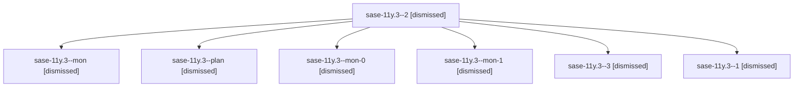

# Session: sase-11y.3

[Agent Hoods](../README.md) / [bbugyi200](../users/bbugyi200/README.md) / [athena](../users/bbugyi200/machines/athena/README.md) / [sase-11y](../users/bbugyi200/machines/athena/hoods/sase-11y/README.md) / sase-11y.3

Owner: `bbugyi200.athena` · Hood: `sase-11y` · Members: 7 · Bead: [sase-11y.3](https://github.com/sase-org/sase--beads/blob/main/pages/sase-11y/sase-11y.3.md)

## Lineage

The diagram is an optional enhancement; the ordered table below contains the same lineage in accessible text.

| Role | Agent | State | Model / provider | Timing | Commits | Prompt | Chat |
|---|---|---|---|---|---:|---|---|
| 2 | sase-11y.3--2 | dismissed | gpt-5.5 / codex | 2026-09-16T17:21:04.483494 → 2026-09-16T17:37:10.393733 | 0 | [Prompt](../agents/bbugyi200.athena.sase-11y.3--2/prompt.md) | [Chat](../agents/bbugyi200.athena.sase-11y.3--2/chat.md) |
| mon | sase-11y.3--mon | dismissed | sonnet / claude | 2026-09-16T15:13:07.667332 → 2026-09-16T15:43:10.277005 | 0 | — | [Chat](../agents/bbugyi200.athena.sase-11y.3--mon/chat.md) |
| plan | sase-11y.3--plan | dismissed | sonnet / claude | 2026-09-16T15:01:28.696214 → 2026-09-16T15:14:10.195864 | 0 | [Prompt](../agents/bbugyi200.athena.sase-11y.3--plan/prompt.md) | [Chat](../agents/bbugyi200.athena.sase-11y.3--plan/chat.md) |
| mon-0 | sase-11y.3--mon-0 | dismissed | sonnet / claude | 2026-09-16T16:04:13.835486 → 2026-09-16T17:19:21.123363 | 0 | — | [Chat](../agents/bbugyi200.athena.sase-11y.3--mon-0/chat.md) |
| mon-1 | sase-11y.3--mon-1 | dismissed | gpt-5.5 / codex | 2026-09-16T17:36:51.651168 → 2026-09-16T17:45:24.415669 | 0 | — | [Chat](../agents/bbugyi200.athena.sase-11y.3--mon-1/chat.md) |
| 3 | sase-11y.3--3 | dismissed | sonnet / claude | 2026-09-16T17:47:21.744214 → 2026-09-16T17:52:23.210549 | [1](../agents/bbugyi200.athena.sase-11y.3--3/README.md#commits) | [Prompt](../agents/bbugyi200.athena.sase-11y.3--3/prompt.md) | [Chat](../agents/bbugyi200.athena.sase-11y.3--3/chat.md) |
| 1 | sase-11y.3--1 | dismissed | sonnet / claude | 2026-09-16T15:45:33.617823 → 2026-09-16T16:04:38.405201 | 0 | [Prompt](../agents/bbugyi200.athena.sase-11y.3--1/prompt.md) | [Chat](../agents/bbugyi200.athena.sase-11y.3--1/chat.md) |

## Commits

| Role | Repo | Commit | Subject | Committed |
|---|---|---|---|---|
| 3 | — | `dfb07cb` | refactor(axe): extract child-supervision logic into supervision-lib | 2026-09-16 17:49:35 EDT |

## Neighbors

| Agent | Relation | State |
|---|---|---|
| [sase-11y.1](../agents/bbugyi200.athena.sase-11y.1/README.md) | sase-11y hood | dismissed |
| [sase-11y.10](bbugyi200.athena.sase-11y.10.md) (session · 3) | sase-11y hood | dismissed 3 |
| [sase-11y.10.1.1](../agents/bbugyi200.athena.sase-11y.10.1.1/README.md) | sase-11y hood | dismissed |
| [sase-11y.10.1.2](bbugyi200.athena.sase-11y.10.1.2.md) (session · 3) | sase-11y hood | completed 1, dismissed 2 |
| [sase-11y.10.1.3](bbugyi200.athena.sase-11y.10.1.3.md) (session · 3) | sase-11y hood | dismissed 3 |
| [sase-11y.10.1.3.1.1](../agents/bbugyi200.athena.sase-11y.10.1.3.1.1/README.md) | sase-11y hood | dismissed |
| [sase-11y.10.1.3.1.2](bbugyi200.athena.sase-11y.10.1.3.1.2.md) (session · 3) | sase-11y hood | dismissed 3 |
| [sase-11y.10.1.3.1.3](../agents/bbugyi200.athena.sase-11y.10.1.3.1.3/README.md) | sase-11y hood | dismissed |
| [sase-11y.10.1.3.1.4](../agents/bbugyi200.athena.sase-11y.10.1.3.1.4/README.md) | sase-11y hood | dismissed |
| [sase-11y.10.1.3.1.5](../agents/bbugyi200.athena.sase-11y.10.1.3.1.5/README.md) | sase-11y hood | dismissed |
| [sase-11y.10.1.3.1.land](../agents/bbugyi200.athena.sase-11y.10.1.3.1.land/README.md) | sase-11y hood | dismissed |
| [sase-11y.10.1.4](bbugyi200.athena.sase-11y.10.1.4.md) (session · 9) | sase-11y hood | completed 1, dismissed 7, failed 1 |
| [sase-11y.10.1.5](../agents/bbugyi200.athena.sase-11y.10.1.5/README.md) | sase-11y hood | dismissed |
| [sase-11y.10.1.6](../agents/bbugyi200.athena.sase-11y.10.1.6/README.md) | sase-11y hood | dismissed |
| [sase-11y.10.1.7.1](../agents/bbugyi200.athena.sase-11y.10.1.7.1/README.md) | sase-11y hood | dismissed |
| [sase-11y.10.1.7.2](../agents/bbugyi200.athena.sase-11y.10.1.7.2/README.md) | sase-11y hood | dismissed |
| [sase-11y.10.1.7.3](../agents/bbugyi200.athena.sase-11y.10.1.7.3/README.md) | sase-11y hood | dismissed |
| [sase-11y.10.1.7.4](../agents/bbugyi200.athena.sase-11y.10.1.7.4/README.md) | sase-11y hood | dismissed |
| [sase-11y.10.1.7.5](../agents/bbugyi200.athena.sase-11y.10.1.7.5/README.md) | sase-11y hood | dismissed |
| [sase-11y.10.1.7.6](../agents/bbugyi200.athena.sase-11y.10.1.7.6/README.md) | sase-11y hood | dismissed |
| [sase-11y.10.1.7.land](../agents/bbugyi200.athena.sase-11y.10.1.7.land/README.md) | sase-11y hood | dismissed |
| [sase-11y.10.1.land](bbugyi200.athena.sase-11y.10.1.land.md) (session · 3) | sase-11y hood | dismissed 3 |
| [sase-11y.11.1](../agents/bbugyi200.athena.sase-11y.11.1/README.md) | sase-11y hood | dismissed |
| [sase-11y.11.2](../agents/bbugyi200.athena.sase-11y.11.2/README.md) | sase-11y hood | dismissed |
| [sase-11y.11.3](../agents/bbugyi200.athena.sase-11y.11.3/README.md) | sase-11y hood | dismissed |
| [sase-11y.11.4](../agents/bbugyi200.athena.sase-11y.11.4/README.md) | sase-11y hood | dismissed |
| [sase-11y.11.5](../agents/bbugyi200.athena.sase-11y.11.5/README.md) | sase-11y hood | dismissed |
| [sase-11y.11.land](../agents/bbugyi200.athena.sase-11y.11.land/README.md) | sase-11y hood | dismissed |
| [sase-11y.2](bbugyi200.athena.sase-11y.2.md) (session · 3) | sase-11y hood | dismissed 3 |
| [sase-11y.2.1.1](../agents/bbugyi200.athena.sase-11y.2.1.1/README.md) | sase-11y hood | dismissed |
| [sase-11y.2.1.2](bbugyi200.athena.sase-11y.2.1.2.md) (session · 5) | sase-11y hood | dismissed 5 |
| [sase-11y.2.1.3](../agents/bbugyi200.athena.sase-11y.2.1.3/README.md) | sase-11y hood | dismissed |
| [sase-11y.2.1.4](../agents/bbugyi200.athena.sase-11y.2.1.4/README.md) | sase-11y hood | dismissed |
| [sase-11y.2.1.5.1](../agents/bbugyi200.athena.sase-11y.2.1.5.1/README.md) | sase-11y hood | dismissed |
| [sase-11y.2.1.5.2](../agents/bbugyi200.athena.sase-11y.2.1.5.2/README.md) | sase-11y hood | dismissed |
| [sase-11y.2.1.5.land](bbugyi200.athena.sase-11y.2.1.5.land.md) (session · 1) | sase-11y hood | dismissed 1 |
| [sase-11y.2.1.land](bbugyi200.athena.sase-11y.2.1.land.md) (session · 3) | sase-11y hood | dismissed 3 |
| [sase-11y.4](bbugyi200.athena.sase-11y.4.md) (session · 3) | sase-11y hood | completed 1, dismissed 2 |
| [sase-11y.5](bbugyi200.athena.sase-11y.5.md) (session · 7) | sase-11y hood | completed 1, dismissed 5, failed 1 |
| [sase-11y.6](bbugyi200.athena.sase-11y.6.md) (session · 3) | sase-11y hood | completed 1, dismissed 2 |
| [sase-11y.7](bbugyi200.athena.sase-11y.7.md) (session · 12) | sase-11y hood | active 1, completed 5, dismissed 2, failed 4 |
| [sase-11y.7.f0](../agents/bbugyi200.athena.sase-11y.7.f0/README.md) | sase-11y hood | dismissed |
| [sase-11y.7.f1](bbugyi200.athena.sase-11y.7.f1.md) (session · 2) | sase-11y hood | active 1, dismissed 1 |
| [sase-11y.8](../agents/bbugyi200.athena.sase-11y.8/README.md) | sase-11y hood | dismissed |
| [sase-11y.9](../agents/bbugyi200.athena.sase-11y.9/README.md) | sase-11y hood | dismissed |
| [sase-11y.land](bbugyi200.athena.sase-11y.land.md) (session · 3) | sase-11y hood | dismissed 3 |
