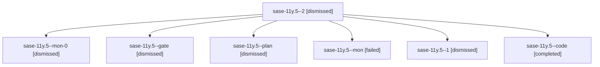

# Session: sase-11y.5

[Agent Hoods](../README.md) / [bbugyi200](../users/bbugyi200/README.md) / [athena](../users/bbugyi200/machines/athena/README.md) / [sase-11y](../users/bbugyi200/machines/athena/hoods/sase-11y/README.md) / sase-11y.5

Owner: `bbugyi200.athena` · Hood: `sase-11y` · Members: 7 · Bead: [sase-11y.5](https://github.com/sase-org/sase--beads/blob/main/pages/sase-11y/sase-11y.5.md)

## Lineage

The diagram is an optional enhancement; the ordered table below contains the same lineage in accessible text.

| Role | Agent | State | Model / provider | Timing | Commits | Prompt | Chat |
|---|---|---|---|---|---:|---|---|
| 2 | sase-11y.5--2 | dismissed | grok-4.6 / grok | 2026-09-19T08:53:14.349142 → 2026-09-19T10:01:53.331655 | [1](../agents/bbugyi200.athena.sase-11y.5--2/README.md#commits) | [Prompt](../agents/bbugyi200.athena.sase-11y.5--2/prompt.md) | [Chat](../agents/bbugyi200.athena.sase-11y.5--2/chat.md) |
| mon-0 | sase-11y.5--mon-0 | dismissed | grok-4.6 / grok | 2026-09-19T08:15:10.794650 → 2026-09-19T08:38:25.332226 | 0 | — | [Chat](../agents/bbugyi200.athena.sase-11y.5--mon-0/chat.md) |
| gate | sase-11y.5--gate | dismissed | grok-4.6 / grok | 2026-09-19T06:23:43.169298 → 2026-09-19T06:24:10 | 0 | — | [Chat](../agents/bbugyi200.athena.sase-11y.5--gate/chat.md) |
| plan | sase-11y.5--plan | dismissed | grok-4.6 / grok | 2026-09-19T06:14:45.142966 → 2026-09-19T07:20:21.686112 | 0 | [Prompt](../agents/bbugyi200.athena.sase-11y.5--plan/prompt.md) | [Chat](../agents/bbugyi200.athena.sase-11y.5--plan/chat.md) |
| mon | sase-11y.5--mon | failed | grok-4.6 / grok | 2026-09-19T11:18:26.206021+00:00 → 2026-09-19T12:08:45.053611+00:00 | 0 | — | [Chat](../agents/bbugyi200.athena.sase-11y.5--mon/chat.md) |
| 1 | sase-11y.5--1 | dismissed | grok-4.6 / grok | 2026-09-19T08:08:43.837947 → 2026-09-19T08:16:04.858633 | 0 | [Prompt](../agents/bbugyi200.athena.sase-11y.5--1/prompt.md) | [Chat](../agents/bbugyi200.athena.sase-11y.5--1/chat.md) |
| code | sase-11y.5--code | completed | grok-4.6 / grok | 2026-09-19T10:24:42.003967+00:00 → 2026-09-19T11:20:21.388576+00:00 | 0 | — | [Chat](../agents/bbugyi200.athena.sase-11y.5--code/chat.md) |

## Commits

| Role | Repo | Commit | Subject | Committed |
|---|---|---|---|---|
| — | — | `3fb42fa` | feat(service): add platform unit integration | 2026-09-18 09:07:18 EDT |
| 2 | — | `23c740a` | feat(service): finish native platform units and init integration | 2026-09-19 09:57:17 EDT |

## Neighbors

| Agent | Relation | State |
|---|---|---|
| [sase-11y.1](../agents/bbugyi200.athena.sase-11y.1/README.md) | sase-11y hood | dismissed |
| [sase-11y.10](bbugyi200.athena.sase-11y.10.md) (session · 3) | sase-11y hood | dismissed 3 |
| [sase-11y.10.1.1](../agents/bbugyi200.athena.sase-11y.10.1.1/README.md) | sase-11y hood | dismissed |
| [sase-11y.10.1.2](bbugyi200.athena.sase-11y.10.1.2.md) (session · 3) | sase-11y hood | completed 1, dismissed 2 |
| [sase-11y.10.1.3](bbugyi200.athena.sase-11y.10.1.3.md) (session · 3) | sase-11y hood | dismissed 3 |
| [sase-11y.10.1.3.1.1](../agents/bbugyi200.athena.sase-11y.10.1.3.1.1/README.md) | sase-11y hood | dismissed |
| [sase-11y.10.1.3.1.2](bbugyi200.athena.sase-11y.10.1.3.1.2.md) (session · 3) | sase-11y hood | dismissed 3 |
| [sase-11y.10.1.3.1.3](../agents/bbugyi200.athena.sase-11y.10.1.3.1.3/README.md) | sase-11y hood | dismissed |
| [sase-11y.10.1.3.1.4](../agents/bbugyi200.athena.sase-11y.10.1.3.1.4/README.md) | sase-11y hood | dismissed |
| [sase-11y.10.1.3.1.5](../agents/bbugyi200.athena.sase-11y.10.1.3.1.5/README.md) | sase-11y hood | dismissed |
| [sase-11y.10.1.3.1.land](../agents/bbugyi200.athena.sase-11y.10.1.3.1.land/README.md) | sase-11y hood | dismissed |
| [sase-11y.10.1.4](bbugyi200.athena.sase-11y.10.1.4.md) (session · 9) | sase-11y hood | completed 1, dismissed 7, failed 1 |
| [sase-11y.10.1.5](../agents/bbugyi200.athena.sase-11y.10.1.5/README.md) | sase-11y hood | dismissed |
| [sase-11y.10.1.6](../agents/bbugyi200.athena.sase-11y.10.1.6/README.md) | sase-11y hood | dismissed |
| [sase-11y.10.1.7.1](../agents/bbugyi200.athena.sase-11y.10.1.7.1/README.md) | sase-11y hood | dismissed |
| [sase-11y.10.1.7.2](../agents/bbugyi200.athena.sase-11y.10.1.7.2/README.md) | sase-11y hood | dismissed |
| [sase-11y.10.1.7.3](../agents/bbugyi200.athena.sase-11y.10.1.7.3/README.md) | sase-11y hood | dismissed |
| [sase-11y.10.1.7.4](../agents/bbugyi200.athena.sase-11y.10.1.7.4/README.md) | sase-11y hood | dismissed |
| [sase-11y.10.1.7.5](../agents/bbugyi200.athena.sase-11y.10.1.7.5/README.md) | sase-11y hood | dismissed |
| [sase-11y.10.1.7.6](../agents/bbugyi200.athena.sase-11y.10.1.7.6/README.md) | sase-11y hood | dismissed |
| [sase-11y.10.1.7.land](../agents/bbugyi200.athena.sase-11y.10.1.7.land/README.md) | sase-11y hood | dismissed |
| [sase-11y.10.1.land](bbugyi200.athena.sase-11y.10.1.land.md) (session · 3) | sase-11y hood | dismissed 3 |
| [sase-11y.11.1](../agents/bbugyi200.athena.sase-11y.11.1/README.md) | sase-11y hood | dismissed |
| [sase-11y.11.2](../agents/bbugyi200.athena.sase-11y.11.2/README.md) | sase-11y hood | dismissed |
| [sase-11y.11.3](../agents/bbugyi200.athena.sase-11y.11.3/README.md) | sase-11y hood | dismissed |
| [sase-11y.11.4](../agents/bbugyi200.athena.sase-11y.11.4/README.md) | sase-11y hood | dismissed |
| [sase-11y.11.5](../agents/bbugyi200.athena.sase-11y.11.5/README.md) | sase-11y hood | dismissed |
| [sase-11y.11.land](../agents/bbugyi200.athena.sase-11y.11.land/README.md) | sase-11y hood | dismissed |
| [sase-11y.2](bbugyi200.athena.sase-11y.2.md) (session · 3) | sase-11y hood | dismissed 3 |
| [sase-11y.2.1.1](../agents/bbugyi200.athena.sase-11y.2.1.1/README.md) | sase-11y hood | dismissed |
| [sase-11y.2.1.2](bbugyi200.athena.sase-11y.2.1.2.md) (session · 5) | sase-11y hood | dismissed 5 |
| [sase-11y.2.1.3](../agents/bbugyi200.athena.sase-11y.2.1.3/README.md) | sase-11y hood | dismissed |
| [sase-11y.2.1.4](../agents/bbugyi200.athena.sase-11y.2.1.4/README.md) | sase-11y hood | dismissed |
| [sase-11y.2.1.5.1](../agents/bbugyi200.athena.sase-11y.2.1.5.1/README.md) | sase-11y hood | dismissed |
| [sase-11y.2.1.5.2](../agents/bbugyi200.athena.sase-11y.2.1.5.2/README.md) | sase-11y hood | dismissed |
| [sase-11y.2.1.5.land](bbugyi200.athena.sase-11y.2.1.5.land.md) (session · 1) | sase-11y hood | dismissed 1 |
| [sase-11y.2.1.land](bbugyi200.athena.sase-11y.2.1.land.md) (session · 3) | sase-11y hood | dismissed 3 |
| [sase-11y.3](bbugyi200.athena.sase-11y.3.md) (session · 7) | sase-11y hood | dismissed 7 |
| [sase-11y.4](bbugyi200.athena.sase-11y.4.md) (session · 3) | sase-11y hood | completed 1, dismissed 2 |
| [sase-11y.6](bbugyi200.athena.sase-11y.6.md) (session · 3) | sase-11y hood | completed 1, dismissed 2 |
| [sase-11y.7](bbugyi200.athena.sase-11y.7.md) (session · 12) | sase-11y hood | active 1, completed 5, dismissed 2, failed 4 |
| [sase-11y.7.f0](../agents/bbugyi200.athena.sase-11y.7.f0/README.md) | sase-11y hood | dismissed |
| [sase-11y.7.f1](bbugyi200.athena.sase-11y.7.f1.md) (session · 2) | sase-11y hood | active 1, dismissed 1 |
| [sase-11y.8](../agents/bbugyi200.athena.sase-11y.8/README.md) | sase-11y hood | dismissed |
| [sase-11y.9](../agents/bbugyi200.athena.sase-11y.9/README.md) | sase-11y hood | dismissed |
| [sase-11y.land](bbugyi200.athena.sase-11y.land.md) (session · 3) | sase-11y hood | dismissed 3 |
