# Session: sase-126.4

[Agent Hoods](../README.md) / [bbugyi200](../users/bbugyi200/README.md) / [athena](../users/bbugyi200/machines/athena/README.md) / [sase-126](../users/bbugyi200/machines/athena/hoods/sase-126/README.md) / sase-126.4

Owner: `bbugyi200.athena` · Hood: `sase-126` · Members: 31 · Bead: [sase-126.4](https://github.com/sase-org/sase--beads/blob/main/pages/sase-126/sase-126.4.md)

## Lineage

```mermaid
flowchart TD
  n0["sase-126.4--2 [dismissed]"]
  n1["sase-126.4--mon-4 [dismissed]"]
  n0 --> n1
  n2["sase-126.4--c [dismissed]"]
  n0 --> n2
  n3["sase-126.4--4 [dismissed]"]
  n0 --> n3
  n4["sase-126.4--mon-b [dismissed]"]
  n0 --> n4
  n5["sase-126.4--b [dismissed]"]
  n0 --> n5
  n6["sase-126.4--7 [dismissed]"]
  n0 --> n6
  n7["sase-126.4--d [dismissed]"]
  n0 --> n7
  n8["sase-126.4--e [dismissed]"]
  n0 --> n8
  n9["sase-126.4--a [dismissed]"]
  n0 --> n9
  n10["sase-126.4--3 [dismissed]"]
  n0 --> n10
  n11["sase-126.4--mon [dismissed]"]
  n0 --> n11
  n12["sase-126.4--plan [dismissed]"]
  n0 --> n12
  n13["sase-126.4--mon-0 [dismissed]"]
  n0 --> n13
  n14["sase-126.4--mon-8 [dismissed]"]
  n0 --> n14
  n15["sase-126.4--mon-a [dismissed]"]
  n0 --> n15
  n16["sase-126.4--8 [dismissed]"]
  n0 --> n16
  n17["sase-126.4--1 [dismissed]"]
  n0 --> n17
  n18["sase-126.4--mon-2 [dismissed]"]
  n0 --> n18
  n19["sase-126.4--mon-d [dismissed]"]
  n0 --> n19
  n20["sase-126.4--f [dismissed]"]
  n0 --> n20
  n21["sase-126.4--5 [dismissed]"]
  n0 --> n21
  n22["sase-126.4--mon-c [dismissed]"]
  n0 --> n22
  n23["sase-126.4--9 [dismissed]"]
  n0 --> n23
  n24["sase-126.4--mon-5 [dismissed]"]
  n0 --> n24
  n25["sase-126.4--mon-3 [dismissed]"]
  n0 --> n25
  n26["sase-126.4--mon-9 [dismissed]"]
  n0 --> n26
  n27["sase-126.4--mon-7 [dismissed]"]
  n0 --> n27
  n28["sase-126.4--6 [dismissed]"]
  n0 --> n28
  n29["sase-126.4--mon-6 [dismissed]"]
  n0 --> n29
  n30["sase-126.4--mon-1 [dismissed]"]
  n0 --> n30
```

The diagram is an optional enhancement; the ordered table below contains the same lineage in accessible text.

| Role | Agent | State | Model / provider | Timing | Commits | Prompt | Chat |
|---|---|---|---|---|---:|---|---|
| 2 | sase-126.4--2 | dismissed | gpt-5.5 / codex | 2026-09-17T20:48:57.979017 → 2026-09-17T20:53:03.465952 | 0 | [Prompt](../agents/bbugyi200.athena.sase-126.4--2/prompt.md) | [Chat](../agents/bbugyi200.athena.sase-126.4--2/chat.md) |
| mon-4 | sase-126.4--mon-4 | dismissed | gpt-5.5 / codex | 2026-09-17T22:26:26.915274 → 2026-09-17T23:20:11.942551 | 0 | — | [Chat](../agents/bbugyi200.athena.sase-126.4--mon-4/chat.md) |
| c | sase-126.4--c | dismissed | gpt-5.5 / codex | 2026-09-18T02:54:21.442458 → 2026-09-18T03:01:12.741665 | 0 | [Prompt](../agents/bbugyi200.athena.sase-126.4--c/prompt.md) | [Chat](../agents/bbugyi200.athena.sase-126.4--c/chat.md) |
| 4 | sase-126.4--4 | dismissed | gpt-5.5 / codex | 2026-09-17T21:53:56.761073 → 2026-09-17T22:03:53.932124 | 0 | [Prompt](../agents/bbugyi200.athena.sase-126.4--4/prompt.md) | [Chat](../agents/bbugyi200.athena.sase-126.4--4/chat.md) |
| mon-b | sase-126.4--mon-b | dismissed | gpt-5.5 / codex | 2026-09-18T02:58:58.748045 → 2026-09-18T03:16:02.588193 | 0 | — | [Chat](../agents/bbugyi200.athena.sase-126.4--mon-b/chat.md) |
| b | sase-126.4--b | dismissed | gpt-5.5 / codex | 2026-09-18T01:58:31.588350 → 2026-09-18T02:03:52.606091 | 0 | [Prompt](../agents/bbugyi200.athena.sase-126.4--b/prompt.md) | [Chat](../agents/bbugyi200.athena.sase-126.4--b/chat.md) |
| 7 | sase-126.4--7 | dismissed | gpt-5.5 / codex | 2026-09-17T23:43:05.363439 → 2026-09-17T23:48:30.503668 | 0 | [Prompt](../agents/bbugyi200.athena.sase-126.4--7/prompt.md) | [Chat](../agents/bbugyi200.athena.sase-126.4--7/chat.md) |
| d | sase-126.4--d | dismissed | gpt-5.5 / codex | 2026-09-18T03:17:13.878427 → 2026-09-18T03:26:24.408081 | 0 | [Prompt](../agents/bbugyi200.athena.sase-126.4--d/prompt.md) | [Chat](../agents/bbugyi200.athena.sase-126.4--d/chat.md) |
| e | sase-126.4--e | dismissed | gpt-5.5 / codex | 2026-09-18T04:13:41.693896 → 2026-09-18T04:20:49.085310 | 0 | [Prompt](../agents/bbugyi200.athena.sase-126.4--e/prompt.md) | [Chat](../agents/bbugyi200.athena.sase-126.4--e/chat.md) |
| a | sase-126.4--a | dismissed | gpt-5.5 / codex | 2026-09-18T01:09:16.194075 → 2026-09-18T01:15:23.371829 | 0 | [Prompt](../agents/bbugyi200.athena.sase-126.4--a/prompt.md) | [Chat](../agents/bbugyi200.athena.sase-126.4--a/chat.md) |
| 3 | sase-126.4--3 | dismissed | gpt-5.5 / codex | 2026-09-17T21:10:25.139588 → 2026-09-17T21:17:10.037471 | 0 | [Prompt](../agents/bbugyi200.athena.sase-126.4--3/prompt.md) | [Chat](../agents/bbugyi200.athena.sase-126.4--3/chat.md) |
| mon | sase-126.4--mon | dismissed | gpt-5.5 / codex | 2026-09-17T20:15:08.722972 → 2026-09-17T20:15:10.196864 | 0 | — | [Chat](../agents/bbugyi200.athena.sase-126.4--mon/chat.md) |
| plan | sase-126.4--plan | dismissed | gpt-5.5 / codex | 2026-09-17T19:28:09.291236 → 2026-09-17T20:16:22.272391 | 0 | [Prompt](../agents/bbugyi200.athena.sase-126.4--plan/prompt.md) | [Chat](../agents/bbugyi200.athena.sase-126.4--plan/chat.md) |
| mon-0 | sase-126.4--mon-0 | dismissed | gpt-5.5 / codex | 2026-09-17T20:22:18.239407 → 2026-09-17T20:47:17.713100 | 0 | — | [Chat](../agents/bbugyi200.athena.sase-126.4--mon-0/chat.md) |
| mon-8 | sase-126.4--mon-8 | dismissed | gpt-5.5 / codex | 2026-09-18T00:52:24.405068 → 2026-09-18T01:08:08.554920 | 0 | — | [Chat](../agents/bbugyi200.athena.sase-126.4--mon-8/chat.md) |
| mon-a | sase-126.4--mon-a | dismissed | gpt-5.5 / codex | 2026-09-18T02:01:45.180430 → 2026-09-18T02:52:58.299061 | 0 | — | [Chat](../agents/bbugyi200.athena.sase-126.4--mon-a/chat.md) |
| 8 | sase-126.4--8 | dismissed | gpt-5.5 / codex | 2026-09-18T00:09:31.619737 → 2026-09-18T00:18:51.876808 | 0 | [Prompt](../agents/bbugyi200.athena.sase-126.4--8/prompt.md) | [Chat](../agents/bbugyi200.athena.sase-126.4--8/chat.md) |
| 1 | sase-126.4--1 | dismissed | gpt-5.5 / codex | 2026-09-17T20:18:38.843114 → 2026-09-17T20:23:06.316443 | 0 | [Prompt](../agents/bbugyi200.athena.sase-126.4--1/prompt.md) | [Chat](../agents/bbugyi200.athena.sase-126.4--1/chat.md) |
| mon-2 | sase-126.4--mon-2 | dismissed | gpt-5.5 / codex | 2026-09-17T21:15:11.801450 → 2026-09-17T21:34:23.729030 | 0 | — | [Chat](../agents/bbugyi200.athena.sase-126.4--mon-2/chat.md) |
| mon-d | sase-126.4--mon-d | dismissed | gpt-5.5 / codex | 2026-09-18T04:18:41.851383 → 2026-09-18T05:01:01.219613 | 0 | — | [Chat](../agents/bbugyi200.athena.sase-126.4--mon-d/chat.md) |
| f | sase-126.4--f | dismissed | gpt-5.5 / codex | 2026-09-18T05:02:05.715300 → 2026-09-18T06:22:06.511639 | [1](../agents/bbugyi200.athena.sase-126.4--f/README.md#commits) | [Prompt](../agents/bbugyi200.athena.sase-126.4--f/prompt.md) | [Chat](../agents/bbugyi200.athena.sase-126.4--f/chat.md) |
| 5 | sase-126.4--5 | dismissed | gpt-5.5 / codex | 2026-09-17T22:06:57.986917 → 2026-09-17T22:28:28.924346 | 0 | [Prompt](../agents/bbugyi200.athena.sase-126.4--5/prompt.md) | [Chat](../agents/bbugyi200.athena.sase-126.4--5/chat.md) |
| mon-c | sase-126.4--mon-c | dismissed | gpt-5.5 / codex | 2026-09-18T03:24:08.799541 → 2026-09-18T04:12:34.072873 | 0 | — | [Chat](../agents/bbugyi200.athena.sase-126.4--mon-c/chat.md) |
| 9 | sase-126.4--9 | dismissed | gpt-5.5 / codex | 2026-09-18T00:46:17.573765 → 2026-09-18T00:54:40.456993 | 0 | [Prompt](../agents/bbugyi200.athena.sase-126.4--9/prompt.md) | [Chat](../agents/bbugyi200.athena.sase-126.4--9/chat.md) |
| mon-5 | sase-126.4--mon-5 | dismissed | gpt-5.5 / codex | 2026-09-17T23:25:44.653326 → 2026-09-17T23:41:51.664204 | 0 | — | [Chat](../agents/bbugyi200.athena.sase-126.4--mon-5/chat.md) |
| mon-3 | sase-126.4--mon-3 | dismissed | gpt-5.5 / codex | 2026-09-17T22:02:55.903300 → 2026-09-17T22:05:26.041458 | 0 | — | [Chat](../agents/bbugyi200.athena.sase-126.4--mon-3/chat.md) |
| mon-9 | sase-126.4--mon-9 | dismissed | gpt-5.5 / codex | 2026-09-18T01:13:18.440634 → 2026-09-18T01:57:17.170037 | 0 | — | [Chat](../agents/bbugyi200.athena.sase-126.4--mon-9/chat.md) |
| mon-7 | sase-126.4--mon-7 | dismissed | gpt-5.5 / codex | 2026-09-18T00:16:45.612129 → 2026-09-18T00:44:55.457780 | 0 | — | [Chat](../agents/bbugyi200.athena.sase-126.4--mon-7/chat.md) |
| 6 | sase-126.4--6 | dismissed | gpt-5.5 / codex | 2026-09-17T23:21:54.789006 → 2026-09-17T23:28:03.426908 | 0 | [Prompt](../agents/bbugyi200.athena.sase-126.4--6/prompt.md) | [Chat](../agents/bbugyi200.athena.sase-126.4--6/chat.md) |
| mon-6 | sase-126.4--mon-6 | dismissed | gpt-5.5 / codex | 2026-09-17T23:46:26.091520 → 2026-09-18T00:08:04.177799 | 0 | — | [Chat](../agents/bbugyi200.athena.sase-126.4--mon-6/chat.md) |
| mon-1 | sase-126.4--mon-1 | dismissed | gpt-5.5 / codex | 2026-09-17T20:52:43.428532 → 2026-09-17T21:09:00.200882 | 0 | — | [Chat](../agents/bbugyi200.athena.sase-126.4--mon-1/chat.md) |

## Commits

| Role | Repo | Commit | Subject | Committed |
|---|---|---|---|---|
| f | — | `9f9f0d6` | fix(tui): restore full notification backlog access | 2026-09-18 05:56:27 EDT |
| — | — | `eaa1cbf` | fix(ci): restore pinned-core verification | 2026-09-18 06:15:38 EDT |

## Neighbors

| Agent | Relation | State |
|---|---|---|
| [sase-126.1](bbugyi200.athena.sase-126.1.md) (session · 3) | sase-126 hood | dismissed 3 |
| [sase-126.2](../agents/bbugyi200.athena.sase-126.2/README.md) | sase-126 hood | dismissed |
| [sase-126.3](../agents/bbugyi200.athena.sase-126.3/README.md) | sase-126 hood | dismissed |
| [sase-126.land](bbugyi200.athena.sase-126.land.md) (session · 7) | sase-126 hood | completed 1, dismissed 5, failed 1 |
