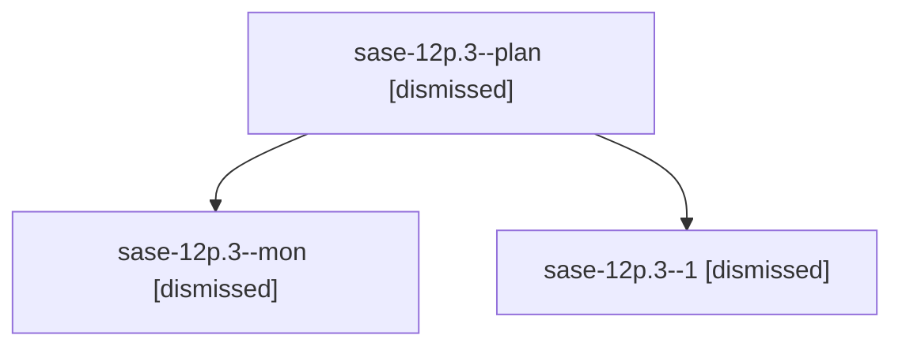

# Session: sase-12p.3

[Agent Hoods](../README.md) / [bbugyi200](../users/bbugyi200/README.md) / [athena](../users/bbugyi200/machines/athena/README.md) / [sase-12p](../users/bbugyi200/machines/athena/hoods/sase-12p/README.md) / sase-12p.3

Owner: `bbugyi200.athena` · Hood: `sase-12p` · Members: 3 · Bead: [sase-12p.3](https://github.com/sase-org/sase--beads/blob/main/pages/sase-12p/sase-12p.3.md)

## Lineage

The diagram is an optional enhancement; the ordered table below contains the same lineage in accessible text.

| Role | Agent | State | Model / provider | Timing | Commits | Prompt | Chat |
|---|---|---|---|---|---:|---|---|
| plan | sase-12p.3--plan | dismissed | gpt-5.5 / codex | 2026-09-18T08:00:10.938263 → 2026-09-18T08:10:56.485219 | 0 | [Prompt](../agents/bbugyi200.athena.sase-12p.3--plan/prompt.md) | [Chat](../agents/bbugyi200.athena.sase-12p.3--plan/chat.md) |
| mon | sase-12p.3--mon | dismissed | gpt-5.5 / codex | 2026-09-18T08:10:38.240582 → 2026-09-18T08:40:40.363245 | 0 | — | [Chat](../agents/bbugyi200.athena.sase-12p.3--mon/chat.md) |
| 1 | sase-12p.3--1 | dismissed | gpt-5.5 / codex | 2026-09-18T08:41:57.991431 → 2026-09-18T09:36:03.135706 | [1](../agents/bbugyi200.athena.sase-12p.3--1/README.md#commits) | [Prompt](../agents/bbugyi200.athena.sase-12p.3--1/prompt.md) | [Chat](../agents/bbugyi200.athena.sase-12p.3--1/chat.md) |

## Commits

| Role | Repo | Commit | Subject | Committed |
|---|---|---|---|---|
| 1 | — | `1af9c0b` | test(tui): guard by-status live churn display path | 2026-09-18 09:34:45 EDT |

## Neighbors

| Agent | Relation | State |
|---|---|---|
| [sase-12p.1](../agents/bbugyi200.athena.sase-12p.1/README.md) | sase-12p hood | dismissed |
| [sase-12p.2](../agents/bbugyi200.athena.sase-12p.2/README.md) | sase-12p hood | dismissed |
| [sase-12p.land](bbugyi200.athena.sase-12p.land.md) (session · 3) | sase-12p hood | dismissed 3 |
