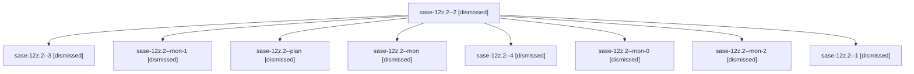

# Session: sase-12z.2

[Agent Hoods](../README.md) / [bbugyi200](../users/bbugyi200/README.md) / [athena](../users/bbugyi200/machines/athena/README.md) / [sase-12z](../users/bbugyi200/machines/athena/hoods/sase-12z/README.md) / sase-12z.2

Owner: `bbugyi200.athena` · Hood: `sase-12z` · Members: 9 · Bead: [sase-12z.2](https://github.com/sase-org/sase--beads/blob/main/pages/sase-12z/sase-12z.2.md)

## Lineage

The diagram is an optional enhancement; the ordered table below contains the same lineage in accessible text.

| Role | Agent | State | Model / provider | Timing | Commits | Prompt | Chat |
|---|---|---|---|---|---:|---|---|
| 2 | sase-12z.2--2 | dismissed | grok-4.6 / grok | 2026-09-18T12:54:56.389151 → 2026-09-18T13:03:39.349055 | 0 | [Prompt](../agents/bbugyi200.athena.sase-12z.2--2/prompt.md) | [Chat](../agents/bbugyi200.athena.sase-12z.2--2/chat.md) |
| 3 | sase-12z.2--3 | dismissed | grok-4.6 / grok | 2026-09-18T13:12:37.185250 → 2026-09-18T13:24:02.970757 | 0 | [Prompt](../agents/bbugyi200.athena.sase-12z.2--3/prompt.md) | [Chat](../agents/bbugyi200.athena.sase-12z.2--3/chat.md) |
| mon-1 | sase-12z.2--mon-1 | dismissed | grok-4.6 / grok | 2026-09-18T13:02:43.246659 → 2026-09-18T13:11:06.238766 | 0 | — | [Chat](../agents/bbugyi200.athena.sase-12z.2--mon-1/chat.md) |
| plan | sase-12z.2--plan | dismissed | grok-4.6 / grok | 2026-09-18T11:49:29.825743 → 2026-09-18T12:26:36.346483 | 0 | [Prompt](../agents/bbugyi200.athena.sase-12z.2--plan/prompt.md) | [Chat](../agents/bbugyi200.athena.sase-12z.2--plan/chat.md) |
| mon | sase-12z.2--mon | dismissed | grok-4.6 / grok | 2026-09-18T12:25:47.369717 → 2026-09-18T12:43:10.014757 | 0 | — | [Chat](../agents/bbugyi200.athena.sase-12z.2--mon/chat.md) |
| 4 | sase-12z.2--4 | dismissed | grok-4.6 / grok | 2026-09-18T13:30:32.271310 → 2026-09-18T13:35:55.351865 | [1](../agents/bbugyi200.athena.sase-12z.2--4/README.md#commits) | [Prompt](../agents/bbugyi200.athena.sase-12z.2--4/prompt.md) | [Chat](../agents/bbugyi200.athena.sase-12z.2--4/chat.md) |
| mon-0 | sase-12z.2--mon-0 | dismissed | grok-4.6 / grok | 2026-09-18T12:52:10.809818 → 2026-09-18T12:53:31.785641 | 0 | — | [Chat](../agents/bbugyi200.athena.sase-12z.2--mon-0/chat.md) |
| mon-2 | sase-12z.2--mon-2 | dismissed | grok-4.6 / grok | 2026-09-18T13:23:02.484429 → 2026-09-18T13:29:03.232442 | 0 | — | [Chat](../agents/bbugyi200.athena.sase-12z.2--mon-2/chat.md) |
| 1 | sase-12z.2--1 | dismissed | grok-4.6 / grok | 2026-09-18T12:44:25.253788 → 2026-09-18T12:52:32.603579 | 0 | [Prompt](../agents/bbugyi200.athena.sase-12z.2--1/prompt.md) | [Chat](../agents/bbugyi200.athena.sase-12z.2--1/chat.md) |

## Commits

| Role | Repo | Commit | Subject | Committed |
|---|---|---|---|---|
| 4 | — | `9243c0b` | feat(visual): add screenshot golden maintenance runner | 2026-09-18 13:34:39 EDT |

## Neighbors

| Agent | Relation | State |
|---|---|---|
| [sase-12z.1](../agents/bbugyi200.athena.sase-12z.1/README.md) | sase-12z hood | dismissed |
| [sase-12z.3](../agents/bbugyi200.athena.sase-12z.3/README.md) | sase-12z hood | dismissed |
| [sase-12z.4](bbugyi200.athena.sase-12z.4.md) (session · 13) | sase-12z hood | dismissed 13 |
| [sase-12z.5.1](../agents/bbugyi200.athena.sase-12z.5.1/README.md) | sase-12z hood | dismissed |
| [sase-12z.5.2](../agents/bbugyi200.athena.sase-12z.5.2/README.md) | sase-12z hood | dismissed |
| [sase-12z.5.land](../agents/bbugyi200.athena.sase-12z.5.land/README.md) | sase-12z hood | dismissed |
| [sase-12z.land](bbugyi200.athena.sase-12z.land.md) (session · 5) | sase-12z hood | dismissed 5 |
