# Session: sase-12z.4

[Agent Hoods](../README.md) / [bbugyi200](../users/bbugyi200/README.md) / [athena](../users/bbugyi200/machines/athena/README.md) / [sase-12z](../users/bbugyi200/machines/athena/hoods/sase-12z/README.md) / sase-12z.4

Owner: `bbugyi200.athena` · Hood: `sase-12z` · Members: 13 · Bead: [sase-12z.4](https://github.com/sase-org/sase--beads/blob/main/pages/sase-12z/sase-12z.4.md)

## Lineage

```mermaid
flowchart TD
  n0["sase-12z.4--1 [dismissed]"]
  n1["sase-12z.4--mon [dismissed]"]
  n0 --> n1
  n2["sase-12z.4--plan [dismissed]"]
  n0 --> n2
  n3["sase-12z.4--3 [dismissed]"]
  n0 --> n3
  n4["sase-12z.4--mon-0 [dismissed]"]
  n0 --> n4
  n5["sase-12z.4--6 [dismissed]"]
  n0 --> n5
  n6["sase-12z.4--5 [dismissed]"]
  n0 --> n6
  n7["sase-12z.4--2 [dismissed]"]
  n0 --> n7
  n8["sase-12z.4--mon-2 [dismissed]"]
  n0 --> n8
  n9["sase-12z.4--mon-3 [dismissed]"]
  n0 --> n9
  n10["sase-12z.4--4 [dismissed]"]
  n0 --> n10
  n11["sase-12z.4--mon-1 [dismissed]"]
  n0 --> n11
  n12["sase-12z.4--mon-4 [dismissed]"]
  n0 --> n12
```

The diagram is an optional enhancement; the ordered table below contains the same lineage in accessible text.

| Role | Agent | State | Model / provider | Timing | Commits | Prompt | Chat |
|---|---|---|---|---|---:|---|---|
| 1 | sase-12z.4--1 | dismissed | grok-4.6 / grok | 2026-09-18T15:50:45.363043 → 2026-09-18T15:56:56.521749 | 0 | [Prompt](../agents/bbugyi200.athena.sase-12z.4--1/prompt.md) | [Chat](../agents/bbugyi200.athena.sase-12z.4--1/chat.md) |
| mon | sase-12z.4--mon | dismissed | grok-4.6 / grok | 2026-09-18T15:19:33.776488 → 2026-09-18T15:49:03.455238 | 0 | — | [Chat](../agents/bbugyi200.athena.sase-12z.4--mon/chat.md) |
| plan | sase-12z.4--plan | dismissed | grok-4.6 / grok | 2026-09-18T14:03:49.130227 → 2026-09-18T15:20:11.512250 | 0 | [Prompt](../agents/bbugyi200.athena.sase-12z.4--plan/prompt.md) | [Chat](../agents/bbugyi200.athena.sase-12z.4--plan/chat.md) |
| 3 | sase-12z.4--3 | dismissed | grok-4.6 / grok | 2026-09-18T16:18:56.502184 → 2026-09-18T16:25:59.926093 | 0 | [Prompt](../agents/bbugyi200.athena.sase-12z.4--3/prompt.md) | [Chat](../agents/bbugyi200.athena.sase-12z.4--3/chat.md) |
| mon-0 | sase-12z.4--mon-0 | dismissed | grok-4.6 / grok | 2026-09-18T15:55:23.167089 → 2026-09-18T15:55:38.728870 | 0 | — | [Chat](../agents/bbugyi200.athena.sase-12z.4--mon-0/chat.md) |
| 6 | sase-12z.4--6 | dismissed | grok-4.6 / grok | 2026-09-18T17:56:21.022017 → 2026-09-18T19:05:41.006434 | [1](../agents/bbugyi200.athena.sase-12z.4--6/README.md#commits) | [Prompt](../agents/bbugyi200.athena.sase-12z.4--6/prompt.md) | [Chat](../agents/bbugyi200.athena.sase-12z.4--6/chat.md) |
| 5 | sase-12z.4--5 | dismissed | grok-4.6 / grok | 2026-09-18T17:36:10.979315 → 2026-09-18T17:57:06.290547 | 0 | [Prompt](../agents/bbugyi200.athena.sase-12z.4--5/prompt.md) | [Chat](../agents/bbugyi200.athena.sase-12z.4--5/chat.md) |
| 2 | sase-12z.4--2 | dismissed | grok-4.6 / grok | 2026-09-18T15:58:25.297327 → 2026-09-18T16:08:58.097198 | 0 | [Prompt](../agents/bbugyi200.athena.sase-12z.4--2/prompt.md) | [Chat](../agents/bbugyi200.athena.sase-12z.4--2/chat.md) |
| mon-2 | sase-12z.4--mon-2 | dismissed | grok-4.6 / grok | 2026-09-18T16:25:23.718741 → 2026-09-18T16:31:27.582883 | 0 | — | [Chat](../agents/bbugyi200.athena.sase-12z.4--mon-2/chat.md) |
| mon-3 | sase-12z.4--mon-3 | dismissed | grok-4.6 / grok | 2026-09-18T16:44:48.479579 → 2026-09-18T17:15:48.650323 | 0 | — | [Chat](../agents/bbugyi200.athena.sase-12z.4--mon-3/chat.md) |
| 4 | sase-12z.4--4 | dismissed | grok-4.6 / grok | 2026-09-18T16:32:51.406330 → 2026-09-18T16:45:23.583809 | 0 | [Prompt](../agents/bbugyi200.athena.sase-12z.4--4/prompt.md) | [Chat](../agents/bbugyi200.athena.sase-12z.4--4/chat.md) |
| mon-1 | sase-12z.4--mon-1 | dismissed | grok-4.6 / grok | 2026-09-18T16:07:57.815861 → 2026-09-18T16:17:09.636987 | 0 | — | [Chat](../agents/bbugyi200.athena.sase-12z.4--mon-1/chat.md) |
| mon-4 | sase-12z.4--mon-4 | dismissed | grok-4.6 / grok | 2026-09-18T17:48:21.353486 → 2026-09-18T17:54:01.117120 | 0 | — | [Chat](../agents/bbugyi200.athena.sase-12z.4--mon-4/chat.md) |

## Commits

| Role | Repo | Commit | Subject | Committed |
|---|---|---|---|---|
| 6 | — | `1c246dc` | feat(visual): land screenshot maintenance recipe, CI check, and refreshed goldens | 2026-09-18 18:52:38 EDT |

## Neighbors

| Agent | Relation | State |
|---|---|---|
| [sase-12z.1](../agents/bbugyi200.athena.sase-12z.1/README.md) | sase-12z hood | dismissed |
| [sase-12z.2](bbugyi200.athena.sase-12z.2.md) (session · 9) | sase-12z hood | dismissed 9 |
| [sase-12z.3](../agents/bbugyi200.athena.sase-12z.3/README.md) | sase-12z hood | dismissed |
| [sase-12z.5.1](../agents/bbugyi200.athena.sase-12z.5.1/README.md) | sase-12z hood | dismissed |
| [sase-12z.5.2](../agents/bbugyi200.athena.sase-12z.5.2/README.md) | sase-12z hood | dismissed |
| [sase-12z.5.land](../agents/bbugyi200.athena.sase-12z.5.land/README.md) | sase-12z hood | dismissed |
| [sase-12z.land](bbugyi200.athena.sase-12z.land.md) (session · 5) | sase-12z hood | dismissed 5 |
