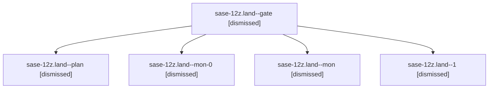

# Session: sase-12z.land

[Agent Hoods](../README.md) / [bbugyi200](../users/bbugyi200/README.md) / [athena](../users/bbugyi200/machines/athena/README.md) / [sase-12z](../users/bbugyi200/machines/athena/hoods/sase-12z/README.md) / sase-12z.land

Owner: `bbugyi200.athena` · Hood: `sase-12z` · Members: 5 · Bead: [sase-12z](https://github.com/sase-org/sase--beads/blob/main/pages/sase-12z/README.md)

## Lineage

The diagram is an optional enhancement; the ordered table below contains the same lineage in accessible text.

| Role | Agent | State | Model / provider | Timing | Commits | Prompt | Chat |
|---|---|---|---|---|---:|---|---|
| gate | sase-12z.land--gate | dismissed | gpt-5.6-sol / codex | 2026-09-18T20:30:09.937649 → 2026-09-18T20:31:25 | 0 | — | [Chat](../agents/bbugyi200.athena.sase-12z.land--gate/chat.md) |
| plan | sase-12z.land--plan | dismissed | gpt-5.6-sol / codex | 2026-09-18T19:35:34.908215 → 2026-09-18T19:50:06.949529 | 0 | [Prompt](../agents/bbugyi200.athena.sase-12z.land--plan/prompt.md) | [Chat](../agents/bbugyi200.athena.sase-12z.land--plan/chat.md) |
| mon-0 | sase-12z.land--mon-0 | dismissed | gpt-5.6-sol / codex | 2026-09-18T20:31:24.673317 → 2026-09-18T20:33:16.670471 | 0 | — | [Chat](../agents/bbugyi200.athena.sase-12z.land--mon-0/chat.md) |
| mon | sase-12z.land--mon | dismissed | gpt-5.6-sol / codex | 2026-09-18T19:47:56.580494 → 2026-09-18T20:08:26.789434 | 0 | — | [Chat](../agents/bbugyi200.athena.sase-12z.land--mon/chat.md) |
| 1 | sase-12z.land--1 | dismissed | gpt-5.6-sol / codex | 2026-09-18T20:18:45.716934 → 2026-09-18T20:31:46.858090 | 0 | [Prompt](../agents/bbugyi200.athena.sase-12z.land--1/prompt.md) | [Chat](../agents/bbugyi200.athena.sase-12z.land--1/chat.md) |

## Neighbors

| Agent | Relation | State |
|---|---|---|
| [sase-12z.1](../agents/bbugyi200.athena.sase-12z.1/README.md) | sase-12z hood | dismissed |
| [sase-12z.2](bbugyi200.athena.sase-12z.2.md) (session · 9) | sase-12z hood | dismissed 9 |
| [sase-12z.3](../agents/bbugyi200.athena.sase-12z.3/README.md) | sase-12z hood | dismissed |
| [sase-12z.4](bbugyi200.athena.sase-12z.4.md) (session · 13) | sase-12z hood | dismissed 13 |
| [sase-12z.5.1](../agents/bbugyi200.athena.sase-12z.5.1/README.md) | sase-12z hood | dismissed |
| [sase-12z.5.2](../agents/bbugyi200.athena.sase-12z.5.2/README.md) | sase-12z hood | dismissed |
| [sase-12z.5.land](../agents/bbugyi200.athena.sase-12z.5.land/README.md) | sase-12z hood | dismissed |
