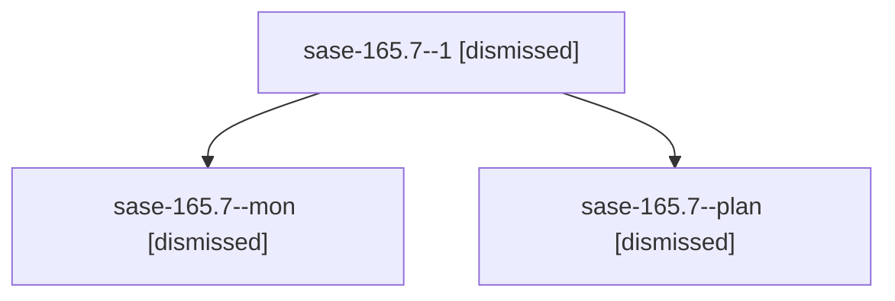

# Session: sase-165.7

[Agent Hoods](../README.md) / [bbugyi200](../users/bbugyi200/README.md) / [athena](../users/bbugyi200/machines/athena/README.md) / [sase-165](../users/bbugyi200/machines/athena/hoods/sase-165/README.md) / sase-165.7

Owner: `bbugyi200.athena` · Hood: `sase-165` · Members: 3 · Bead: [sase-165.7](https://github.com/sase-org/sase--beads/blob/main/pages/sase-165/sase-165.7.md)

## Lineage

The diagram is an optional enhancement; the ordered table below contains the same lineage in accessible text.

| Role | Agent | State | Model / provider | Timing | Commits | Prompt | Chat |
|---|---|---|---|---|---:|---|---|
| 1 | sase-165.7--1 | dismissed | muse-spark-1.3-contributor / muse | 2026-09-22T11:21:11.869068 → 2026-09-22T11:44:28.192003 | [1](../agents/bbugyi200.athena.sase-165.7--1/README.md#commits) | [Prompt](../agents/bbugyi200.athena.sase-165.7--1/prompt.md) | [Chat](../agents/bbugyi200.athena.sase-165.7--1/chat.md) |
| mon | sase-165.7--mon | dismissed | muse-spark-1.3-contributor / muse | 2026-09-22T11:17:55.451609 → 2026-09-22T11:17:58.827190 | 0 | — | [Chat](../agents/bbugyi200.athena.sase-165.7--mon/chat.md) |
| plan | sase-165.7--plan | dismissed | muse-spark-1.3-contributor / muse | 2026-09-22T11:02:25.171099 → 2026-09-22T11:20:32.160636 | 0 | [Prompt](../agents/bbugyi200.athena.sase-165.7--plan/prompt.md) | [Chat](../agents/bbugyi200.athena.sase-165.7--plan/chat.md) |

## Commits

| Role | Repo | Commit | Subject | Committed |
|---|---|---|---|---|
| 1 | — | `e081abe` | feat(config): add managed\_tmp.agent\_cargo\_incremental opt-in for agent cargo incremental | 2026-09-22 11:36:45 EDT |

## Neighbors

| Agent | Relation | State |
|---|---|---|
| [sase-165.1](../agents/bbugyi200.athena.sase-165.1/README.md) | sase-165 hood | dismissed |
| [sase-165.2](../agents/bbugyi200.athena.sase-165.2/README.md) | sase-165 hood | dismissed |
| [sase-165.3](../agents/bbugyi200.athena.sase-165.3/README.md) | sase-165 hood | dismissed |
| [sase-165.4](../agents/bbugyi200.athena.sase-165.4/README.md) | sase-165 hood | dismissed |
| [sase-165.5](../agents/bbugyi200.athena.sase-165.5/README.md) | sase-165 hood | dismissed |
| [sase-165.6](bbugyi200.athena.sase-165.6.md) (session · 3) | sase-165 hood | dismissed 3 |
| [sase-165.6.f0](bbugyi200.athena.sase-165.6.f0.md) (session · 3) | sase-165 hood | completed 1, dismissed 1, failed 1 |
| [sase-165.land](bbugyi200.athena.sase-165.land.md) (session · 5) | sase-165 hood | completed 1, dismissed 3, failed 1 |
