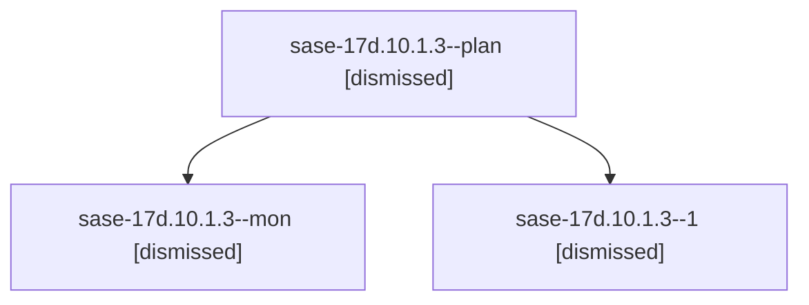

# Session: sase-17d.10.1.3

[Agent Hoods](../README.md) / [bbugyi200](../users/bbugyi200/README.md) / [athena](../users/bbugyi200/machines/athena/README.md) / [sase-17d](../users/bbugyi200/machines/athena/hoods/sase-17d/README.md) / sase-17d.10.1.3

Owner: `bbugyi200.athena` · Hood: `sase-17d` · Members: 3 · Bead: [sase-17d.10.1.3](https://github.com/sase-org/sase--beads/blob/main/pages/sase-17d/sase-17d.10.1.3.md)

## Lineage

The diagram is an optional enhancement; the ordered table below contains the same lineage in accessible text.

| Role | Agent | State | Model / provider | Timing | Commits | Prompt | Chat |
|---|---|---|---|---|---:|---|---|
| plan | sase-17d.10.1.3--plan | dismissed | muse-spark-1.3-contributor / muse | 2026-09-24T15:03:12.148032 → 2026-09-24T15:06:42.040357 | 0 | [Prompt](../agents/bbugyi200.athena.sase-17d.10.1.3--plan/prompt.md) | [Chat](../agents/bbugyi200.athena.sase-17d.10.1.3--plan/chat.md) |
| mon | sase-17d.10.1.3--mon | dismissed | muse-spark-1.3-contributor / muse | 2026-09-24T15:05:43.114401 → 2026-09-24T15:24:16.380537 | 0 | — | [Chat](../agents/bbugyi200.athena.sase-17d.10.1.3--mon/chat.md) |
| 1 | sase-17d.10.1.3--1 | dismissed | muse-spark-1.3-contributor / muse | 2026-09-24T15:34:49.386220 → 2026-09-24T16:11:22.297726 | [1](../agents/bbugyi200.athena.sase-17d.10.1.3--1/README.md#commits) | [Prompt](../agents/bbugyi200.athena.sase-17d.10.1.3--1/prompt.md) | [Chat](../agents/bbugyi200.athena.sase-17d.10.1.3--1/chat.md) |

## Commits

| Role | Repo | Commit | Subject | Committed |
|---|---|---|---|---|
| 1 | — | `37c8bb2` | fix(ace-decks): preserve pending spread card across re-push and split | 2026-09-24 16:04:11 EDT |

## Neighbors

| Agent | Relation | State |
|---|---|---|
| [sase-17d.10](../agents/bbugyi200.athena.sase-17d.10/README.md) | ancestor | waiting |
| [sase-17d.10.1.1](bbugyi200.athena.sase-17d.10.1.1.md) (session · 7) | sase-17d.10.1 hood | completed 2, dismissed 1, failed 4 |
| [sase-17d.10.1.2](bbugyi200.athena.sase-17d.10.1.2.md) (session · 3) | sase-17d.10.1 hood | completed 1, dismissed 2 |
| [sase-17d.10.1.2](../agents/bbugyi200.athena.sase-17d.10.1.2/README.md) | sase-17d.10.1 hood | waiting |
| [sase-17d.10.1.4.1](../agents/bbugyi200.athena.sase-17d.10.1.4.1/README.md) | sase-17d.10.1 hood | dismissed |
| [sase-17d.10.1.4.3](../agents/bbugyi200.athena.sase-17d.10.1.4.3/README.md) | sase-17d.10.1 hood | dismissed |
| [sase-17d.10.1.4.land](../agents/bbugyi200.athena.sase-17d.10.1.4.land/README.md) | sase-17d.10.1 hood | dismissed |
| [sase-17d.10.1.land](bbugyi200.athena.sase-17d.10.1.land.md) (session · 3) | sase-17d.10.1 hood | dismissed 3 |
| [sase-17d.1](../agents/bbugyi200.athena.sase-17d.1/README.md) | sase-17d hood | completed |
| [sase-17d.11](../agents/bbugyi200.athena.sase-17d.11/README.md) | sase-17d hood | completed |
| [sase-17d.12.1](../agents/bbugyi200.athena.sase-17d.12.1/README.md) | sase-17d hood | completed |
| [sase-17d.12.2](bbugyi200.athena.sase-17d.12.2.md) (session · 7) | sase-17d hood | completed 4, failed 3 |
| [sase-17d.12.3](../agents/bbugyi200.athena.sase-17d.12.3/README.md) | sase-17d hood | waiting |
| [sase-17d.12.land](../agents/bbugyi200.athena.sase-17d.12.land/README.md) | sase-17d hood | waiting |
| [sase-17d.2](bbugyi200.athena.sase-17d.2.md) (session · 3) | sase-17d hood | completed 2, failed 1 |
| [sase-17d.3](bbugyi200.athena.sase-17d.3.md) (session · 3) | sase-17d hood | completed 2, failed 1 |
| [sase-17d.4](../agents/bbugyi200.athena.sase-17d.4/README.md) | sase-17d hood | waiting |
| [sase-17d.5](bbugyi200.athena.sase-17d.5.md) (session · 5) | sase-17d hood | completed 3, failed 2 |
| [sase-17d.5](../agents/bbugyi200.athena.sase-17d.5/README.md) | sase-17d hood | waiting |
| [sase-17d.6](bbugyi200.athena.sase-17d.6.md) (session · 5) | sase-17d hood | completed 3, failed 2 |
| [sase-17d.6](../agents/bbugyi200.athena.sase-17d.6/README.md) | sase-17d hood | waiting |
| [sase-17d.7](../agents/bbugyi200.athena.sase-17d.7/README.md) | sase-17d hood | completed |
| [sase-17d.8](bbugyi200.athena.sase-17d.8.md) (session · 3) | sase-17d hood | completed 2, failed 1 |
| [sase-17d.8](../agents/bbugyi200.athena.sase-17d.8/README.md) | sase-17d hood | waiting |
| [sase-17d.8.f0](../agents/bbugyi200.athena.sase-17d.8.f0/README.md) | sase-17d hood | dismissed |
| [sase-17d.8.f0.f0](../agents/bbugyi200.athena.sase-17d.8.f0.f0/README.md) | sase-17d hood | dismissed |
| [sase-17d.9](../agents/bbugyi200.athena.sase-17d.9/README.md) | sase-17d hood | completed |
| [sase-17d.land](bbugyi200.athena.sase-17d.land.md) (session · 3) | sase-17d hood | failed 3 |
