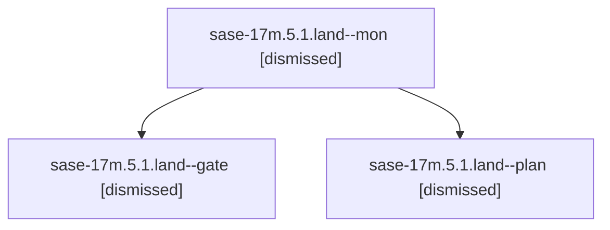

# Session: sase-17m.5.1.land

[Agent Hoods](../README.md) / [bbugyi200](../users/bbugyi200/README.md) / [athena](../users/bbugyi200/machines/athena/README.md) / [sase-17m](../users/bbugyi200/machines/athena/hoods/sase-17m/README.md) / sase-17m.5.1.land

Owner: `bbugyi200.athena` · Hood: `sase-17m` · Members: 3 · Bead: [sase-17m.5.1](https://github.com/sase-org/sase--beads/blob/main/pages/sase-17m/sase-17m.5.1.md)

## Lineage

The diagram is an optional enhancement; the ordered table below contains the same lineage in accessible text.

| Role | Agent | State | Model / provider | Timing | Commits | Prompt | Chat |
|---|---|---|---|---|---:|---|---|
| mon | sase-17m.5.1.land--mon | dismissed | opus / claude | 2026-09-25T04:39:02.587098 → 2026-09-25T04:41:10.844670 | 0 | — | [Chat](../agents/bbugyi200.athena.sase-17m.5.1.land--mon/chat.md) |
| gate | sase-17m.5.1.land--gate | dismissed | opus / claude | 2026-09-25T04:38:30.109521 → 2026-09-25T04:39:03 | 0 | — | [Chat](../agents/bbugyi200.athena.sase-17m.5.1.land--gate/chat.md) |
| plan | sase-17m.5.1.land--plan | dismissed | opus / claude | 2026-09-25T04:11:18.692405 → 2026-09-25T04:39:16.771409 | 0 | [Prompt](../agents/bbugyi200.athena.sase-17m.5.1.land--plan/prompt.md) | [Chat](../agents/bbugyi200.athena.sase-17m.5.1.land--plan/chat.md) |

## Neighbors

| Agent | Relation | State |
|---|---|---|
| [sase-17m.5](bbugyi200.athena.sase-17m.5.md) (session · 3) | ancestor | failed 3 |
| [sase-17m.5.1.1](../agents/bbugyi200.athena.sase-17m.5.1.1/README.md) | sase-17m.5.1 hood | dismissed |
| [sase-17m.5.1.2](../agents/bbugyi200.athena.sase-17m.5.1.2/README.md) | sase-17m.5.1 hood | dismissed |
| [sase-17m.5.1.3](bbugyi200.athena.sase-17m.5.1.3.md) (session · 3) | sase-17m.5.1 hood | dismissed 3 |
| [sase-17m.5.1.4](bbugyi200.athena.sase-17m.5.1.4.md) (session · 5) | sase-17m.5.1 hood | dismissed 5 |
| [sase-17m.5.1.5](../agents/bbugyi200.athena.sase-17m.5.1.5/README.md) | sase-17m.5.1 hood | dismissed |
| [sase-17m.5.1.6.1](bbugyi200.athena.sase-17m.5.1.6.1.md) (session · 5) | sase-17m.5.1 hood | completed 3, failed 2 |
| [sase-17m.5.1.6.2](../agents/bbugyi200.athena.sase-17m.5.1.6.2/README.md) | sase-17m.5.1 hood | completed |
| [sase-17m.5.1.6.3](../agents/bbugyi200.athena.sase-17m.5.1.6.3/README.md) | sase-17m.5.1 hood | completed |
| [sase-17m.5.1.6.4](../agents/bbugyi200.athena.sase-17m.5.1.6.4/README.md) | sase-17m.5.1 hood | completed |
| [sase-17m.5.1.6.5.1](bbugyi200.athena.sase-17m.5.1.6.5.1.md) (session · 3) | sase-17m.5.1 hood | completed 2, failed 1 |
| [sase-17m.5.1.6.5.land](bbugyi200.athena.sase-17m.5.1.6.5.land.md) (session · 3) | sase-17m.5.1 hood | completed 2, failed 1 |
| [sase-17m.5.1.6.land](bbugyi200.athena.sase-17m.5.1.6.land.md) (session · 3) | sase-17m.5.1 hood | failed 3 |
| [sase-17m.1](../agents/bbugyi200.athena.sase-17m.1/README.md) | sase-17m hood | completed |
| [sase-17m.10](../agents/bbugyi200.athena.sase-17m.10/README.md) | sase-17m hood | dismissed |
| [sase-17m.2](bbugyi200.athena.sase-17m.2.md) (session · 3) | sase-17m hood | failed 3 |
| [sase-17m.2.1.1](../agents/bbugyi200.athena.sase-17m.2.1.1/README.md) | sase-17m hood | dismissed |
| [sase-17m.2.1.2](../agents/bbugyi200.athena.sase-17m.2.1.2/README.md) | sase-17m hood | dismissed |
| [sase-17m.2.1.3](../agents/bbugyi200.athena.sase-17m.2.1.3/README.md) | sase-17m hood | dismissed |
| [sase-17m.2.1.4](../agents/bbugyi200.athena.sase-17m.2.1.4/README.md) | sase-17m hood | dismissed |
| [sase-17m.2.1.land](../agents/bbugyi200.athena.sase-17m.2.1.land/README.md) | sase-17m hood | dismissed |
| [sase-17m.3](bbugyi200.athena.sase-17m.3.md) (session · 3) | sase-17m hood | failed 3 |
| [sase-17m.3.1.1](../agents/bbugyi200.athena.sase-17m.3.1.1/README.md) | sase-17m hood | dismissed |
| [sase-17m.3.1.2](../agents/bbugyi200.athena.sase-17m.3.1.2/README.md) | sase-17m hood | dismissed |
| [sase-17m.3.1.3](../agents/bbugyi200.athena.sase-17m.3.1.3/README.md) | sase-17m hood | dismissed |
| [sase-17m.3.1.4](../agents/bbugyi200.athena.sase-17m.3.1.4/README.md) | sase-17m hood | dismissed |
| [sase-17m.3.1.5](../agents/bbugyi200.athena.sase-17m.3.1.5/README.md) | sase-17m hood | dismissed |
| [sase-17m.3.1.6](../agents/bbugyi200.athena.sase-17m.3.1.6/README.md) | sase-17m hood | dismissed |
| [sase-17m.3.1.7](../agents/bbugyi200.athena.sase-17m.3.1.7/README.md) | sase-17m hood | dismissed |
| [sase-17m.3.1.land](../agents/bbugyi200.athena.sase-17m.3.1.land/README.md) | sase-17m hood | dismissed |
| [sase-17m.4](bbugyi200.athena.sase-17m.4.md) (session · 3) | sase-17m hood | failed 3 |
| [sase-17m.4.1.1](../agents/bbugyi200.athena.sase-17m.4.1.1/README.md) | sase-17m hood | dismissed |
| [sase-17m.4.1.2](../agents/bbugyi200.athena.sase-17m.4.1.2/README.md) | sase-17m hood | dismissed |
| [sase-17m.4.1.3](../agents/bbugyi200.athena.sase-17m.4.1.3/README.md) | sase-17m hood | dismissed |
| [sase-17m.4.1.4](../agents/bbugyi200.athena.sase-17m.4.1.4/README.md) | sase-17m hood | dismissed |
| [sase-17m.4.1.5](../agents/bbugyi200.athena.sase-17m.4.1.5/README.md) | sase-17m hood | dismissed |
| [sase-17m.4.1.6](../agents/bbugyi200.athena.sase-17m.4.1.6/README.md) | sase-17m hood | dismissed |
| [sase-17m.4.1.7](../agents/bbugyi200.athena.sase-17m.4.1.7/README.md) | sase-17m hood | dismissed |
| [sase-17m.4.1.8](../agents/bbugyi200.athena.sase-17m.4.1.8/README.md) | sase-17m hood | dismissed |
| [sase-17m.4.1.land](../agents/bbugyi200.athena.sase-17m.4.1.land/README.md) | sase-17m hood | dismissed |
| [sase-17m.6](../agents/bbugyi200.athena.sase-17m.6/README.md) | sase-17m hood | completed |
| [sase-17m.7](bbugyi200.athena.sase-17m.7.md) (session · 3) | sase-17m hood | completed 2, failed 1 |
| [sase-17m.8](../agents/bbugyi200.athena.sase-17m.8/README.md) | sase-17m hood | completed |
| [sase-17m.9](../agents/bbugyi200.athena.sase-17m.9/README.md) | sase-17m hood | dismissed |
| [sase-17m.land](../agents/bbugyi200.athena.sase-17m.land/README.md) | sase-17m hood | dismissed |
