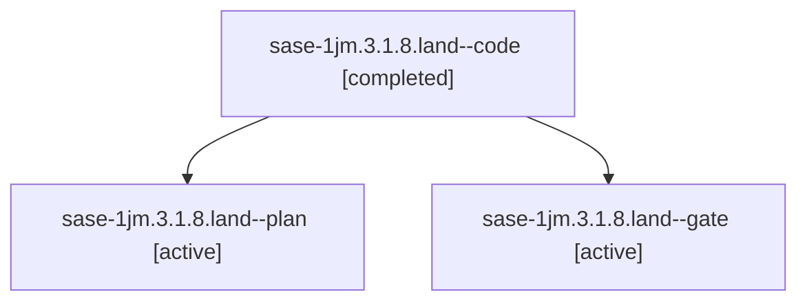

# Session: sase-1jm.3.1.8.land

[Agent Hoods](../README.md) / [bbugyi200](../users/bbugyi200/README.md) / [athena](../users/bbugyi200/machines/athena/README.md) / [sase-1jm](../users/bbugyi200/machines/athena/hoods/sase-1jm/README.md) / sase-1jm.3.1.8.land

Owner: `bbugyi200.athena` · Hood: `sase-1jm` · Members: 3 · Bead: [sase-1jm.3.1.8](https://github.com/sase-org/sase--beads/blob/main/pages/sase-1jm/sase-1jm.3.1.8.md)

## Lineage

The diagram is an optional enhancement; the ordered table below contains the same lineage in accessible text.

| Role | Agent | State | Model / provider | Timing | Commits | Prompt | Chat |
|---|---|---|---|---|---:|---|---|
| code | sase-1jm.3.1.8.land--code | completed | grok-4.6 / grok | 2026-10-12T06:42:39.580987+00:00 → 2026-10-12T09:55:26.161003+00:00 | [2](../agents/bbugyi200.athena.sase-1jm.3.1.8.land--code/README.md#commits) | — | [Chat](../agents/bbugyi200.athena.sase-1jm.3.1.8.land--code/chat.md) |
| plan | sase-1jm.3.1.8.land--plan | active | opus / claude | 2026-10-12T06:08:06.464829+00:00 | 0 | [Prompt](../agents/bbugyi200.athena.sase-1jm.3.1.8.land--plan/prompt.md) | [Chat](../agents/bbugyi200.athena.sase-1jm.3.1.8.land--plan/chat.md) |
| gate | sase-1jm.3.1.8.land--gate | active | opus / claude | 2026-10-12T06:41:33.921768+00:00 | 0 | — | [Chat](../agents/bbugyi200.athena.sase-1jm.3.1.8.land--gate/chat.md) |

## Commits

| Role | Repo | Commit | Subject | Committed |
|---|---|---|---|---|
| code | sase | [`c4c7846`](https://github.com/sase-org/sase/commit/c4c7846f57dfee7c054b0ce71fe8d7b039521670) | feat(ace): route agent arrivals to Archive | 2026-10-12 04:32:15 EDT |
| code | sase | [`87c6468`](https://github.com/sase-org/sase/commit/87c6468fd3f028858aa95256d9f46af1f3c1e8d0) | fix(bead-task-triage): read live agents from index, fix snooze gate kwargs, retire drifted gates | 2026-10-12 05:42:02 EDT |
| — | sase | [`83ed7d7`](https://github.com/sase-org/sase/commit/83ed7d7082c2959139c971b52820f2fc7ac81398) | fix(ace): finish Agents Archive landing defects before sase-1jm.3.1 lands | 2026-10-12 05:49:02 EDT |

## Neighbors

| Agent | Relation | State |
|---|---|---|
| [sase-1jm.3](bbugyi200.athena.sase-1jm.3.md) (session · 3) | ancestor | failed 3 |
| [sase-1jm.3.1.8.1](../agents/bbugyi200.athena.sase-1jm.3.1.8.1/README.md) | sase-1jm.3.1.8 hood | active |
| [sase-1jm.3.1.8.2](bbugyi200.athena.sase-1jm.3.1.8.2.md) (session · 3) | sase-1jm.3.1.8 hood | active 3 |
| [sase-1jm.3.1.8.3](../agents/bbugyi200.athena.sase-1jm.3.1.8.3/README.md) | sase-1jm.3.1.8 hood | active |
| [sase-1jm.3.1.8.4](../agents/bbugyi200.athena.sase-1jm.3.1.8.4/README.md) | sase-1jm.3.1.8 hood | active |
| [sase-1jm.3.1.8.5](../agents/bbugyi200.athena.sase-1jm.3.1.8.5/README.md) | sase-1jm.3.1.8 hood | active |
| [sase-1jm.3.1.1](../agents/bbugyi200.athena.sase-1jm.3.1.1/README.md) | sase-1jm.3.1 hood | active |
| [sase-1jm.3.1.2](../agents/bbugyi200.athena.sase-1jm.3.1.2/README.md) | sase-1jm.3.1 hood | active |
| [sase-1jm.3.1.3](../agents/bbugyi200.athena.sase-1jm.3.1.3/README.md) | sase-1jm.3.1 hood | active |
| [sase-1jm.3.1.4](../agents/bbugyi200.athena.sase-1jm.3.1.4/README.md) | sase-1jm.3.1 hood | active |
| [sase-1jm.3.1.5](../agents/bbugyi200.athena.sase-1jm.3.1.5/README.md) | sase-1jm.3.1 hood | active |
| [sase-1jm.3.1.6](../agents/bbugyi200.athena.sase-1jm.3.1.6/README.md) | sase-1jm.3.1 hood | active |
| [sase-1jm.3.1.7](bbugyi200.athena.sase-1jm.3.1.7.md) (session · 3) | sase-1jm.3.1 hood | active 3 |
| [sase-1jm.3.1.land](bbugyi200.athena.sase-1jm.3.1.land.md) (session · 3) | sase-1jm.3.1 hood | active 3 |
| [sase-1jm.1](../agents/bbugyi200.athena.sase-1jm.1/README.md) | sase-1jm hood | completed |
| [sase-1jm.2](bbugyi200.athena.sase-1jm.2.md) (session · 3) | sase-1jm hood | failed 3 |
| [sase-1jm.2.1.1](../agents/bbugyi200.athena.sase-1jm.2.1.1/README.md) | sase-1jm hood | active |
| [sase-1jm.2.1.2](../agents/bbugyi200.athena.sase-1jm.2.1.2/README.md) | sase-1jm hood | active |
| [sase-1jm.2.1.3](../agents/bbugyi200.athena.sase-1jm.2.1.3/README.md) | sase-1jm hood | active |
| [sase-1jm.2.1.4](../agents/bbugyi200.athena.sase-1jm.2.1.4/README.md) | sase-1jm hood | active |
| [sase-1jm.2.1.5](../agents/bbugyi200.athena.sase-1jm.2.1.5/README.md) | sase-1jm hood | active |
| [sase-1jm.2.1.6](bbugyi200.athena.sase-1jm.2.1.6.md) (session · 3) | sase-1jm hood | active 3 |
| [sase-1jm.2.1.land](bbugyi200.athena.sase-1jm.2.1.land.md) (session · 3) | sase-1jm hood | active 2, completed 1 |
| [sase-1jm.4](../agents/bbugyi200.athena.sase-1jm.4/README.md) | sase-1jm hood | completed |
| [sase-1jm.4.2.1](bbugyi200.athena.sase-1jm.4.2.1.md) (session · 5) | sase-1jm hood | completed 3, failed 2 |
| [sase-1jm.4.2.2](../agents/bbugyi200.athena.sase-1jm.4.2.2/README.md) | sase-1jm hood | completed |
| [sase-1jm.4.2.3](../agents/bbugyi200.athena.sase-1jm.4.2.3/README.md) | sase-1jm hood | completed |
| [sase-1jm.4.2.4](../agents/bbugyi200.athena.sase-1jm.4.2.4/README.md) | sase-1jm hood | completed |
| [sase-1jm.4.2.5](../agents/bbugyi200.athena.sase-1jm.4.2.5/README.md) | sase-1jm hood | completed |
| [sase-1jm.4.2.land](bbugyi200.athena.sase-1jm.4.2.land.md) (session · 5) | sase-1jm hood | completed 3, failed 2 |
| [sase-1jm.5](bbugyi200.athena.sase-1jm.5.md) (session · 5) | sase-1jm hood | completed 3, failed 2 |
| [sase-1jm.6](../agents/bbugyi200.athena.sase-1jm.6/README.md) | sase-1jm hood | completed |
| [sase-1jm.7](../agents/bbugyi200.athena.sase-1jm.7/README.md) | sase-1jm hood | completed |
| [sase-1jm.8](../agents/bbugyi200.athena.sase-1jm.8/README.md) | sase-1jm hood | completed |
| [sase-1jm.9.1](bbugyi200.athena.sase-1jm.9.1.md) (session · 5) | sase-1jm hood | completed 3, failed 2 |
| [sase-1jm.9.2](../agents/bbugyi200.athena.sase-1jm.9.2/README.md) | sase-1jm hood | active |
| [sase-1jm.9.3](bbugyi200.athena.sase-1jm.9.3.md) (session · 5) | sase-1jm hood | completed 3, failed 2 |
| [sase-1jm.9.4](bbugyi200.athena.sase-1jm.9.4.md) (session · 4) | sase-1jm hood | active 1, completed 2, failed 1 |
| [sase-1jm.9.5](../agents/bbugyi200.athena.sase-1jm.9.5/README.md) | sase-1jm hood | waiting |
| [sase-1jm.9.6](bbugyi200.athena.sase-1jm.9.6.md) (session · 7) | sase-1jm hood | active 1, completed 3, failed 3 |
| [sase-1jm.9.7](../agents/bbugyi200.athena.sase-1jm.9.7/README.md) | sase-1jm hood | completed |
| [sase-1jm.9.8](../agents/bbugyi200.athena.sase-1jm.9.8/README.md) | sase-1jm hood | waiting |
| [sase-1jm.9.land](../agents/bbugyi200.athena.sase-1jm.9.land/README.md) | sase-1jm hood | waiting |
| [sase-1jm.land](bbugyi200.athena.sase-1jm.land.md) (session · 3) | sase-1jm hood | failed 3 |
