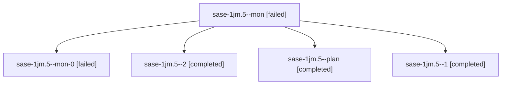

# Session: sase-1jm.5

[Agent Hoods](../README.md) / [bbugyi200](../users/bbugyi200/README.md) / [athena](../users/bbugyi200/machines/athena/README.md) / [sase-1jm](../users/bbugyi200/machines/athena/hoods/sase-1jm/README.md) / sase-1jm.5

Owner: `bbugyi200.athena` · Hood: `sase-1jm` · Members: 5 · Bead: [sase-1jm.5](https://github.com/sase-org/sase--beads/blob/main/pages/sase-1jm/sase-1jm.5.md)

## Lineage

The diagram is an optional enhancement; the ordered table below contains the same lineage in accessible text.

| Role | Agent | State | Model / provider | Timing | Commits | Prompt | Chat |
|---|---|---|---|---|---:|---|---|
| mon | sase-1jm.5--mon | failed | muse-spark-1.3-contributor / muse | 2026-10-12T08:43:24.533520+00:00 → 2026-10-12T09:07:48.159596+00:00 | 0 | — | [Chat](../agents/bbugyi200.athena.sase-1jm.5--mon/chat.md) |
| mon-0 | sase-1jm.5--mon-0 | failed | muse-spark-1.3-contributor / muse | 2026-10-12T09:12:48.205195+00:00 → 2026-10-12T10:11:34.579520+00:00 | [1](../agents/bbugyi200.athena.sase-1jm.5--mon-0/README.md#commits) | — | [Chat](../agents/bbugyi200.athena.sase-1jm.5--mon-0/chat.md) |
| 2 | sase-1jm.5--2 | completed | muse-spark-1.3-contributor / muse | 2026-10-12T10:12:34.441286+00:00 → 2026-10-12T10:16:24.000277+00:00 | 0 | [Prompt](../agents/bbugyi200.athena.sase-1jm.5--2/prompt.md) | [Chat](../agents/bbugyi200.athena.sase-1jm.5--2/chat.md) |
| plan | sase-1jm.5--plan | completed | muse-spark-1.3-contributor / muse | 2026-10-12T08:13:21.763568+00:00 → 2026-10-12T08:46:21.630410+00:00 | 0 | [Prompt](../agents/bbugyi200.athena.sase-1jm.5--plan/prompt.md) | [Chat](../agents/bbugyi200.athena.sase-1jm.5--plan/chat.md) |
| 1 | sase-1jm.5--1 | completed | muse-spark-1.3-contributor / muse | 2026-10-12T09:09:21.808693+00:00 → 2026-10-12T09:13:16.045224+00:00 | 0 | [Prompt](../agents/bbugyi200.athena.sase-1jm.5--1/prompt.md) | [Chat](../agents/bbugyi200.athena.sase-1jm.5--1/chat.md) |

## Commits

| Role | Repo | Commit | Subject | Committed |
|---|---|---|---|---|
| mon-0 | sase | [`ebd17bf`](https://github.com/sase-org/sase/commit/ebd17bf5bf64b1d9cb8dfa5001fc880c99dfb603) | feat(agents-archive): add restore, fork, and copy actions to the Archive | 2026-10-12 06:06:46 EDT |

## Neighbors

| Agent | Relation | State |
|---|---|---|
| [sase-1jm.1](../agents/bbugyi200.athena.sase-1jm.1/README.md) | sase-1jm hood | completed |
| [sase-1jm.2](bbugyi200.athena.sase-1jm.2.md) (session · 3) | sase-1jm hood | failed 3 |
| [sase-1jm.2.1.1](../agents/bbugyi200.athena.sase-1jm.2.1.1/README.md) | sase-1jm hood | active |
| [sase-1jm.2.1.2](../agents/bbugyi200.athena.sase-1jm.2.1.2/README.md) | sase-1jm hood | active |
| [sase-1jm.2.1.3](../agents/bbugyi200.athena.sase-1jm.2.1.3/README.md) | sase-1jm hood | active |
| [sase-1jm.2.1.4](../agents/bbugyi200.athena.sase-1jm.2.1.4/README.md) | sase-1jm hood | active |
| [sase-1jm.2.1.5](../agents/bbugyi200.athena.sase-1jm.2.1.5/README.md) | sase-1jm hood | active |
| [sase-1jm.2.1.6](bbugyi200.athena.sase-1jm.2.1.6.md) (session · 3) | sase-1jm hood | active 3 |
| [sase-1jm.2.1.land](bbugyi200.athena.sase-1jm.2.1.land.md) (session · 3) | sase-1jm hood | active 2, completed 1 |
| [sase-1jm.3](bbugyi200.athena.sase-1jm.3.md) (session · 3) | sase-1jm hood | failed 3 |
| [sase-1jm.3.1.1](../agents/bbugyi200.athena.sase-1jm.3.1.1/README.md) | sase-1jm hood | active |
| [sase-1jm.3.1.2](../agents/bbugyi200.athena.sase-1jm.3.1.2/README.md) | sase-1jm hood | active |
| [sase-1jm.3.1.3](../agents/bbugyi200.athena.sase-1jm.3.1.3/README.md) | sase-1jm hood | active |
| [sase-1jm.3.1.4](../agents/bbugyi200.athena.sase-1jm.3.1.4/README.md) | sase-1jm hood | active |
| [sase-1jm.3.1.5](../agents/bbugyi200.athena.sase-1jm.3.1.5/README.md) | sase-1jm hood | active |
| [sase-1jm.3.1.6](../agents/bbugyi200.athena.sase-1jm.3.1.6/README.md) | sase-1jm hood | active |
| [sase-1jm.3.1.7](bbugyi200.athena.sase-1jm.3.1.7.md) (session · 3) | sase-1jm hood | active 3 |
| [sase-1jm.3.1.8.1](../agents/bbugyi200.athena.sase-1jm.3.1.8.1/README.md) | sase-1jm hood | active |
| [sase-1jm.3.1.8.2](bbugyi200.athena.sase-1jm.3.1.8.2.md) (session · 3) | sase-1jm hood | active 3 |
| [sase-1jm.3.1.8.3](../agents/bbugyi200.athena.sase-1jm.3.1.8.3/README.md) | sase-1jm hood | active |
| [sase-1jm.3.1.8.4](../agents/bbugyi200.athena.sase-1jm.3.1.8.4/README.md) | sase-1jm hood | active |
| [sase-1jm.3.1.8.5](../agents/bbugyi200.athena.sase-1jm.3.1.8.5/README.md) | sase-1jm hood | active |
| [sase-1jm.3.1.8.land](bbugyi200.athena.sase-1jm.3.1.8.land.md) (session · 3) | sase-1jm hood | active 2, completed 1 |
| [sase-1jm.3.1.land](bbugyi200.athena.sase-1jm.3.1.land.md) (session · 3) | sase-1jm hood | active 3 |
| [sase-1jm.4](../agents/bbugyi200.athena.sase-1jm.4/README.md) | sase-1jm hood | completed |
| [sase-1jm.4.2.1](bbugyi200.athena.sase-1jm.4.2.1.md) (session · 5) | sase-1jm hood | completed 3, failed 2 |
| [sase-1jm.4.2.2](../agents/bbugyi200.athena.sase-1jm.4.2.2/README.md) | sase-1jm hood | completed |
| [sase-1jm.4.2.3](../agents/bbugyi200.athena.sase-1jm.4.2.3/README.md) | sase-1jm hood | completed |
| [sase-1jm.4.2.4](../agents/bbugyi200.athena.sase-1jm.4.2.4/README.md) | sase-1jm hood | completed |
| [sase-1jm.4.2.5](../agents/bbugyi200.athena.sase-1jm.4.2.5/README.md) | sase-1jm hood | completed |
| [sase-1jm.4.2.land](bbugyi200.athena.sase-1jm.4.2.land.md) (session · 5) | sase-1jm hood | completed 3, failed 2 |
| [sase-1jm.6](../agents/bbugyi200.athena.sase-1jm.6/README.md) | sase-1jm hood | completed |
| [sase-1jm.7](../agents/bbugyi200.athena.sase-1jm.7/README.md) | sase-1jm hood | completed |
| [sase-1jm.8](../agents/bbugyi200.athena.sase-1jm.8/README.md) | sase-1jm hood | completed |
| [sase-1jm.9.1](bbugyi200.athena.sase-1jm.9.1.md) (session · 5) | sase-1jm hood | completed 3, failed 2 |
| [sase-1jm.9.2](../agents/bbugyi200.athena.sase-1jm.9.2/README.md) | sase-1jm hood | active |
| [sase-1jm.9.3](bbugyi200.athena.sase-1jm.9.3.md) (session · 5) | sase-1jm hood | completed 3, failed 2 |
| [sase-1jm.9.4](bbugyi200.athena.sase-1jm.9.4.md) (session · 4) | sase-1jm hood | active 1, completed 2, failed 1 |
| [sase-1jm.9.5](../agents/bbugyi200.athena.sase-1jm.9.5/README.md) | sase-1jm hood | waiting |
| [sase-1jm.9.6](bbugyi200.athena.sase-1jm.9.6.md) (session · 7) | sase-1jm hood | active 1, completed 3, failed 3 |
| [sase-1jm.9.7](../agents/bbugyi200.athena.sase-1jm.9.7/README.md) | sase-1jm hood | completed |
| [sase-1jm.9.8](../agents/bbugyi200.athena.sase-1jm.9.8/README.md) | sase-1jm hood | waiting |
| [sase-1jm.9.land](../agents/bbugyi200.athena.sase-1jm.9.land/README.md) | sase-1jm hood | waiting |
| [sase-1jm.land](bbugyi200.athena.sase-1jm.land.md) (session · 3) | sase-1jm hood | failed 3 |
