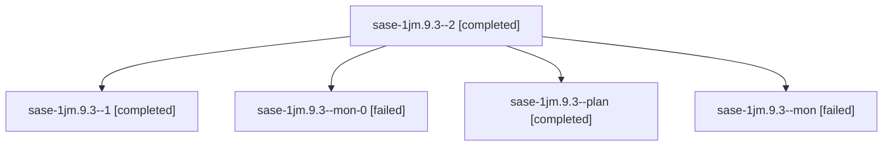

# Session: sase-1jm.9.3

[Agent Hoods](../README.md) / [bbugyi200](../users/bbugyi200/README.md) / [athena](../users/bbugyi200/machines/athena/README.md) / [sase-1jm](../users/bbugyi200/machines/athena/hoods/sase-1jm/README.md) / sase-1jm.9.3

Owner: `bbugyi200.athena` · Hood: `sase-1jm` · Members: 5 · Bead: [sase-1jm.9.3](https://github.com/sase-org/sase--beads/blob/main/pages/sase-1jm/sase-1jm.9.3.md)

## Lineage

The diagram is an optional enhancement; the ordered table below contains the same lineage in accessible text.

| Role | Agent | State | Model / provider | Timing | Commits | Prompt | Chat |
|---|---|---|---|---|---:|---|---|
| 2 | sase-1jm.9.3--2 | completed | grok-4.6 / grok | 2026-10-12T22:55:34.102025+00:00 → 2026-10-12T23:09:10.295190+00:00 | [1](../agents/bbugyi200.athena.sase-1jm.9.3--2/README.md#commits) | [Prompt](../agents/bbugyi200.athena.sase-1jm.9.3--2/prompt.md) | [Chat](../agents/bbugyi200.athena.sase-1jm.9.3--2/chat.md) |
| 1 | sase-1jm.9.3--1 | completed | grok-4.6 / grok | 2026-10-12T22:22:07.212566+00:00 → 2026-10-12T22:27:51.967901+00:00 | 0 | [Prompt](../agents/bbugyi200.athena.sase-1jm.9.3--1/prompt.md) | [Chat](../agents/bbugyi200.athena.sase-1jm.9.3--1/chat.md) |
| mon-0 | sase-1jm.9.3--mon-0 | failed | grok-4.6 / grok | 2026-10-12T22:26:59.530128+00:00 → 2026-10-12T22:54:02.230569+00:00 | 0 | — | [Chat](../agents/bbugyi200.athena.sase-1jm.9.3--mon-0/chat.md) |
| plan | sase-1jm.9.3--plan | completed | grok-4.6 / grok | 2026-10-12T21:35:11.715637+00:00 → 2026-10-12T22:18:16.085712+00:00 | 0 | [Prompt](../agents/bbugyi200.athena.sase-1jm.9.3--plan/prompt.md) | [Chat](../agents/bbugyi200.athena.sase-1jm.9.3--plan/chat.md) |
| mon | sase-1jm.9.3--mon | failed | grok-4.6 / grok | 2026-10-12T22:15:02.429345+00:00 → 2026-10-12T22:20:22.454520+00:00 | 0 | — | [Chat](../agents/bbugyi200.athena.sase-1jm.9.3--mon/chat.md) |

## Commits

| Role | Repo | Commit | Subject | Committed |
|---|---|---|---|---|
| 2 | sase | [`9fa4792`](https://github.com/sase-org/sase/commit/9fa479245cd17a709d4358896b55c74d166b34ac) | feat(ace): add Archive chooser READ section, container restore, and copy keys | 2026-10-12 19:03:24 EDT |

## Neighbors

| Agent | Relation | State |
|---|---|---|
| [sase-1jm.9.1](bbugyi200.athena.sase-1jm.9.1.md) (session · 5) | sase-1jm.9 hood | completed 3, failed 2 |
| [sase-1jm.9.2](../agents/bbugyi200.athena.sase-1jm.9.2/README.md) | sase-1jm.9 hood | active |
| [sase-1jm.9.4](bbugyi200.athena.sase-1jm.9.4.md) (session · 4) | sase-1jm.9 hood | active 1, completed 2, failed 1 |
| [sase-1jm.9.5](../agents/bbugyi200.athena.sase-1jm.9.5/README.md) | sase-1jm.9 hood | waiting |
| [sase-1jm.9.6](bbugyi200.athena.sase-1jm.9.6.md) (session · 7) | sase-1jm.9 hood | active 1, completed 3, failed 3 |
| [sase-1jm.9.7](../agents/bbugyi200.athena.sase-1jm.9.7/README.md) | sase-1jm.9 hood | completed |
| [sase-1jm.9.8](../agents/bbugyi200.athena.sase-1jm.9.8/README.md) | sase-1jm.9 hood | waiting |
| [sase-1jm.9.land](../agents/bbugyi200.athena.sase-1jm.9.land/README.md) | sase-1jm.9 hood | waiting |
| [sase-1jm.1](../agents/bbugyi200.athena.sase-1jm.1/README.md) | sase-1jm hood | completed |
| [sase-1jm.2](bbugyi200.athena.sase-1jm.2.md) (session · 3) | sase-1jm hood | failed 3 |
| [sase-1jm.2.1.1](../agents/bbugyi200.athena.sase-1jm.2.1.1/README.md) | sase-1jm hood | active |
| [sase-1jm.2.1.2](../agents/bbugyi200.athena.sase-1jm.2.1.2/README.md) | sase-1jm hood | active |
| [sase-1jm.2.1.3](../agents/bbugyi200.athena.sase-1jm.2.1.3/README.md) | sase-1jm hood | active |
| [sase-1jm.2.1.4](../agents/bbugyi200.athena.sase-1jm.2.1.4/README.md) | sase-1jm hood | active |
| [sase-1jm.2.1.5](../agents/bbugyi200.athena.sase-1jm.2.1.5/README.md) | sase-1jm hood | active |
| [sase-1jm.2.1.6](bbugyi200.athena.sase-1jm.2.1.6.md) (session · 3) | sase-1jm hood | active 3 |
| [sase-1jm.2.1.land](bbugyi200.athena.sase-1jm.2.1.land.md) (session · 3) | sase-1jm hood | active 2, completed 1 |
| [sase-1jm.3](bbugyi200.athena.sase-1jm.3.md) (session · 3) | sase-1jm hood | failed 3 |
| [sase-1jm.3.1.1](../agents/bbugyi200.athena.sase-1jm.3.1.1/README.md) | sase-1jm hood | active |
| [sase-1jm.3.1.2](../agents/bbugyi200.athena.sase-1jm.3.1.2/README.md) | sase-1jm hood | active |
| [sase-1jm.3.1.3](../agents/bbugyi200.athena.sase-1jm.3.1.3/README.md) | sase-1jm hood | active |
| [sase-1jm.3.1.4](../agents/bbugyi200.athena.sase-1jm.3.1.4/README.md) | sase-1jm hood | active |
| [sase-1jm.3.1.5](../agents/bbugyi200.athena.sase-1jm.3.1.5/README.md) | sase-1jm hood | active |
| [sase-1jm.3.1.6](../agents/bbugyi200.athena.sase-1jm.3.1.6/README.md) | sase-1jm hood | active |
| [sase-1jm.3.1.7](bbugyi200.athena.sase-1jm.3.1.7.md) (session · 3) | sase-1jm hood | active 3 |
| [sase-1jm.3.1.8.1](../agents/bbugyi200.athena.sase-1jm.3.1.8.1/README.md) | sase-1jm hood | active |
| [sase-1jm.3.1.8.2](bbugyi200.athena.sase-1jm.3.1.8.2.md) (session · 3) | sase-1jm hood | active 3 |
| [sase-1jm.3.1.8.3](../agents/bbugyi200.athena.sase-1jm.3.1.8.3/README.md) | sase-1jm hood | active |
| [sase-1jm.3.1.8.4](../agents/bbugyi200.athena.sase-1jm.3.1.8.4/README.md) | sase-1jm hood | active |
| [sase-1jm.3.1.8.5](../agents/bbugyi200.athena.sase-1jm.3.1.8.5/README.md) | sase-1jm hood | active |
| [sase-1jm.3.1.8.land](bbugyi200.athena.sase-1jm.3.1.8.land.md) (session · 3) | sase-1jm hood | active 2, completed 1 |
| [sase-1jm.3.1.land](bbugyi200.athena.sase-1jm.3.1.land.md) (session · 3) | sase-1jm hood | active 3 |
| [sase-1jm.4](../agents/bbugyi200.athena.sase-1jm.4/README.md) | sase-1jm hood | completed |
| [sase-1jm.4.2.1](bbugyi200.athena.sase-1jm.4.2.1.md) (session · 5) | sase-1jm hood | completed 3, failed 2 |
| [sase-1jm.4.2.2](../agents/bbugyi200.athena.sase-1jm.4.2.2/README.md) | sase-1jm hood | completed |
| [sase-1jm.4.2.3](../agents/bbugyi200.athena.sase-1jm.4.2.3/README.md) | sase-1jm hood | completed |
| [sase-1jm.4.2.4](../agents/bbugyi200.athena.sase-1jm.4.2.4/README.md) | sase-1jm hood | completed |
| [sase-1jm.4.2.5](../agents/bbugyi200.athena.sase-1jm.4.2.5/README.md) | sase-1jm hood | completed |
| [sase-1jm.4.2.land](bbugyi200.athena.sase-1jm.4.2.land.md) (session · 5) | sase-1jm hood | completed 3, failed 2 |
| [sase-1jm.5](bbugyi200.athena.sase-1jm.5.md) (session · 5) | sase-1jm hood | completed 3, failed 2 |
| [sase-1jm.6](../agents/bbugyi200.athena.sase-1jm.6/README.md) | sase-1jm hood | completed |
| [sase-1jm.7](../agents/bbugyi200.athena.sase-1jm.7/README.md) | sase-1jm hood | completed |
| [sase-1jm.8](../agents/bbugyi200.athena.sase-1jm.8/README.md) | sase-1jm hood | completed |
| [sase-1jm.land](bbugyi200.athena.sase-1jm.land.md) (session · 3) | sase-1jm hood | failed 3 |
