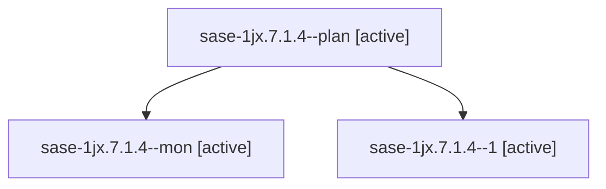

# Session: sase-1jx.7.1.4

[Agent Hoods](../README.md) / [bbugyi200](../users/bbugyi200/README.md) / [athena](../users/bbugyi200/machines/athena/README.md) / [sase-1jx](../users/bbugyi200/machines/athena/hoods/sase-1jx/README.md) / sase-1jx.7.1.4

Owner: `bbugyi200.athena` · Hood: `sase-1jx` · Members: 3 · Bead: [sase-1jx.7.1.4](https://github.com/sase-org/sase--beads/blob/main/pages/sase-1jx/sase-1jx.7.1.4.md)

## Lineage

The diagram is an optional enhancement; the ordered table below contains the same lineage in accessible text.

| Role | Agent | State | Model / provider | Timing | Commits | Prompt | Chat |
|---|---|---|---|---|---:|---|---|
| plan | sase-1jx.7.1.4--plan | active | gpt-6-luna / codex | 2026-10-12T06:18:46.647104+00:00 | 0 | [Prompt](../agents/bbugyi200.athena.sase-1jx.7.1.4--plan/prompt.md) | [Chat](../agents/bbugyi200.athena.sase-1jx.7.1.4--plan/chat.md) |
| mon | sase-1jx.7.1.4--mon | active | gpt-6-luna / codex | 2026-10-12T07:00:03.271290+00:00 | 0 | — | — |
| 1 | sase-1jx.7.1.4--1 | active | gpt-6-luna / codex | 2026-10-12T07:20:40.003993+00:00 | [1](../agents/bbugyi200.athena.sase-1jx.7.1.4--1/README.md#commits) | [Prompt](../agents/bbugyi200.athena.sase-1jx.7.1.4--1/prompt.md) | — |

## Commits

| Role | Repo | Commit | Subject | Committed |
|---|---|---|---|---|
| 1 | sase | [`4ccfc62`](https://github.com/sase-org/sase/commit/4ccfc62c8f05013317cfb1cd13ed42067f709ad8) | feat(project): add existing repository onboarding | 2026-10-12 03:26:38 EDT |

## Neighbors

| Agent | Relation | State |
|---|---|---|
| [sase-1jx.7](bbugyi200.athena.sase-1jx.7.md) (session · 3) | ancestor | failed 3 |
| [sase-1jx.7.1.1](../agents/bbugyi200.athena.sase-1jx.7.1.1/README.md) | sase-1jx.7.1 hood | active |
| [sase-1jx.7.1.2](../agents/bbugyi200.athena.sase-1jx.7.1.2/README.md) | sase-1jx.7.1 hood | active |
| [sase-1jx.7.1.3](../agents/bbugyi200.athena.sase-1jx.7.1.3/README.md) | sase-1jx.7.1 hood | active |
| [sase-1jx.7.1.land](../agents/bbugyi200.athena.sase-1jx.7.1.land/README.md) | sase-1jx.7.1 hood | active |
| [sase-1jx.1](../agents/bbugyi200.athena.sase-1jx.1/README.md) | sase-1jx hood | completed |
| [sase-1jx.10](bbugyi200.athena.sase-1jx.10.md) (session · 3) | sase-1jx hood | failed 3 |
| [sase-1jx.10.1.1](bbugyi200.athena.sase-1jx.10.1.1.md) (session · 3) | sase-1jx hood | active 3 |
| [sase-1jx.10.1.2](../agents/bbugyi200.athena.sase-1jx.10.1.2/README.md) | sase-1jx hood | active |
| [sase-1jx.10.1.3](../agents/bbugyi200.athena.sase-1jx.10.1.3/README.md) | sase-1jx hood | active |
| [sase-1jx.10.1.4](../agents/bbugyi200.athena.sase-1jx.10.1.4/README.md) | sase-1jx hood | active |
| [sase-1jx.10.1.land](bbugyi200.athena.sase-1jx.10.1.land.md) (session · 3) | sase-1jx hood | active 2, completed 1 |
| [sase-1jx.11](../agents/bbugyi200.athena.sase-1jx.11/README.md) | sase-1jx hood | completed |
| [sase-1jx.12](bbugyi200.athena.sase-1jx.12.md) (session · 3) | sase-1jx hood | failed 3 |
| [sase-1jx.12.1.1](../agents/bbugyi200.athena.sase-1jx.12.1.1/README.md) | sase-1jx hood | completed |
| [sase-1jx.12.1.2](../agents/bbugyi200.athena.sase-1jx.12.1.2/README.md) | sase-1jx hood | completed |
| [sase-1jx.12.1.3](bbugyi200.athena.sase-1jx.12.1.3.md) (session · 5) | sase-1jx hood | completed 3, failed 2 |
| [sase-1jx.12.1.4](bbugyi200.athena.sase-1jx.12.1.4.md) (session · 3) | sase-1jx hood | completed 2, failed 1 |
| [sase-1jx.12.1.land](../agents/bbugyi200.athena.sase-1jx.12.1.land/README.md) | sase-1jx hood | completed |
| [sase-1jx.13.1](../agents/bbugyi200.athena.sase-1jx.13.1/README.md) | sase-1jx hood | completed |
| [sase-1jx.13.2](../agents/bbugyi200.athena.sase-1jx.13.2/README.md) | sase-1jx hood | completed |
| [sase-1jx.13.3](../agents/bbugyi200.athena.sase-1jx.13.3/README.md) | sase-1jx hood | completed |
| [sase-1jx.13.4](../agents/bbugyi200.athena.sase-1jx.13.4/README.md) | sase-1jx hood | completed |
| [sase-1jx.13.5](bbugyi200.athena.sase-1jx.13.5.md) (session · 3) | sase-1jx hood | completed 2, failed 1 |
| [sase-1jx.13.6.1](../agents/bbugyi200.athena.sase-1jx.13.6.1/README.md) | sase-1jx hood | active |
| [sase-1jx.13.6.2](../agents/bbugyi200.athena.sase-1jx.13.6.2/README.md) | sase-1jx hood | active |
| [sase-1jx.13.6.3](../agents/bbugyi200.athena.sase-1jx.13.6.3/README.md) | sase-1jx hood | active |
| [sase-1jx.13.6.4](../agents/bbugyi200.athena.sase-1jx.13.6.4/README.md) | sase-1jx hood | waiting |
| [sase-1jx.13.6.land](../agents/bbugyi200.athena.sase-1jx.13.6.land/README.md) | sase-1jx hood | waiting |
| [sase-1jx.13.land](bbugyi200.athena.sase-1jx.13.land.md) (session · 3) | sase-1jx hood | failed 3 |
| [sase-1jx.2](bbugyi200.athena.sase-1jx.2.md) (session · 3) | sase-1jx hood | completed 2, failed 1 |
| [sase-1jx.3](../agents/bbugyi200.athena.sase-1jx.3/README.md) | sase-1jx hood | completed |
| [sase-1jx.4](../agents/bbugyi200.athena.sase-1jx.4/README.md) | sase-1jx hood | completed |
| [sase-1jx.5](../agents/bbugyi200.athena.sase-1jx.5/README.md) | sase-1jx hood | completed |
| [sase-1jx.6](bbugyi200.athena.sase-1jx.6.md) (session · 3) | sase-1jx hood | completed 2, failed 1 |
| [sase-1jx.8](../agents/bbugyi200.athena.sase-1jx.8/README.md) | sase-1jx hood | completed |
| [sase-1jx.9](bbugyi200.athena.sase-1jx.9.md) (session · 3) | sase-1jx hood | completed 2, failed 1 |
| [sase-1jx.land](bbugyi200.athena.sase-1jx.land.md) (session · 3) | sase-1jx hood | failed 3 |
