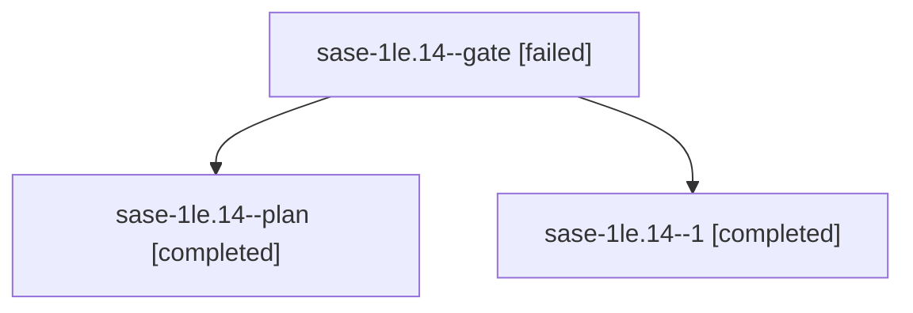

# Session: sase-1le.14

[Agent Hoods](../README.md) / [bbugyi200](../users/bbugyi200/README.md) / [athena](../users/bbugyi200/machines/athena/README.md) / [sase-1le](../users/bbugyi200/machines/athena/hoods/sase-1le/README.md) / sase-1le.14

Owner: `bbugyi200.athena` · Hood: `sase-1le` · Members: 3 · Bead: [sase-1le.14](https://github.com/sase-org/sase--beads/blob/main/pages/sase-1le/sase-1le.14.md)

## Lineage

The diagram is an optional enhancement; the ordered table below contains the same lineage in accessible text.

| Role | Agent | State | Model / provider | Timing | Commits | Prompt | Chat |
|---|---|---|---|---|---:|---|---|
| gate | sase-1le.14--gate | failed | gpt-6-luna / codex | 2026-10-16T10:37:14.684858+00:00 → 2026-10-16T10:38:27.297480+00:00 | 0 | — | [Chat](../agents/bbugyi200.athena.sase-1le.14--gate/chat.md) |
| plan | sase-1le.14--plan | completed | gpt-6-luna / codex | 2026-10-16T03:02:49.827954+00:00 → 2026-10-16T03:10:51.863772+00:00 | 0 | [Prompt](../agents/bbugyi200.athena.sase-1le.14--plan/prompt.md) | [Chat](../agents/bbugyi200.athena.sase-1le.14--plan/chat.md) |
| 1 | sase-1le.14--1 | completed | gpt-6-luna / codex | 2026-10-16T10:39:22.094252+00:00 → 2026-10-16T11:05:50.465922+00:00 | [1](../agents/bbugyi200.athena.sase-1le.14--1/README.md#commits) | [Prompt](../agents/bbugyi200.athena.sase-1le.14--1/prompt.md) | [Chat](../agents/bbugyi200.athena.sase-1le.14--1/chat.md) |

## Commits

| Role | Repo | Commit | Subject | Committed |
|---|---|---|---|---|
| 1 | sase | [`30c3500`](https://github.com/sase-org/sase/commit/30c35004958dfa6ba94d4d0a381898780b0026dc) | docs: add daily work guides | 2026-10-16 06:59:57 EDT |

## Neighbors

| Agent | Relation | State |
|---|---|---|
| [sase-1le.1](../agents/bbugyi200.athena.sase-1le.1/README.md) | sase-1le hood | completed |
| [sase-1le.10](../agents/bbugyi200.athena.sase-1le.10/README.md) | sase-1le hood | completed |
| [sase-1le.11](../agents/bbugyi200.athena.sase-1le.11/README.md) | sase-1le hood | completed |
| [sase-1le.12](../agents/bbugyi200.athena.sase-1le.12/README.md) | sase-1le hood | completed |
| [sase-1le.13](../agents/bbugyi200.athena.sase-1le.13/README.md) | sase-1le hood | completed |
| [sase-1le.15](../agents/bbugyi200.athena.sase-1le.15/README.md) | sase-1le hood | completed |
| [sase-1le.16](../agents/bbugyi200.athena.sase-1le.16/README.md) | sase-1le hood | completed |
| [sase-1le.17](../agents/bbugyi200.athena.sase-1le.17/README.md) | sase-1le hood | completed |
| [sase-1le.18](../agents/bbugyi200.athena.sase-1le.18/README.md) | sase-1le hood | completed |
| [sase-1le.19](../agents/bbugyi200.athena.sase-1le.19/README.md) | sase-1le hood | completed |
| [sase-1le.2](bbugyi200.athena.sase-1le.2.md) (session · 5) | sase-1le hood | completed 3, failed 2 |
| [sase-1le.20](bbugyi200.athena.sase-1le.20.md) (session · 3) | sase-1le hood | failed 3 |
| [sase-1le.20.1.1](../agents/bbugyi200.athena.sase-1le.20.1.1/README.md) | sase-1le hood | completed |
| [sase-1le.20.1.10](../agents/bbugyi200.athena.sase-1le.20.1.10/README.md) | sase-1le hood | completed |
| [sase-1le.20.1.11](../agents/bbugyi200.athena.sase-1le.20.1.11/README.md) | sase-1le hood | completed |
| [sase-1le.20.1.12](../agents/bbugyi200.athena.sase-1le.20.1.12/README.md) | sase-1le hood | completed |
| [sase-1le.20.1.13](../agents/bbugyi200.athena.sase-1le.20.1.13/README.md) | sase-1le hood | completed |
| [sase-1le.20.1.14](../agents/bbugyi200.athena.sase-1le.20.1.14/README.md) | sase-1le hood | completed |
| [sase-1le.20.1.15](../agents/bbugyi200.athena.sase-1le.20.1.15/README.md) | sase-1le hood | waiting |
| [sase-1le.20.1.16](../agents/bbugyi200.athena.sase-1le.20.1.16/README.md) | sase-1le hood | waiting |
| [sase-1le.20.1.17](../agents/bbugyi200.athena.sase-1le.20.1.17/README.md) | sase-1le hood | completed |
| [sase-1le.20.1.18](../agents/bbugyi200.athena.sase-1le.20.1.18/README.md) | sase-1le hood | completed |
| [sase-1le.20.1.19](bbugyi200.athena.sase-1le.20.1.19.md) (session · 3) | sase-1le hood | completed 2, failed 1 |
| [sase-1le.20.1.2](../agents/bbugyi200.athena.sase-1le.20.1.2/README.md) | sase-1le hood | completed |
| [sase-1le.20.1.20](../agents/bbugyi200.athena.sase-1le.20.1.20/README.md) | sase-1le hood | active |
| [sase-1le.20.1.21](../agents/bbugyi200.athena.sase-1le.20.1.21/README.md) | sase-1le hood | waiting |
| [sase-1le.20.1.3](../agents/bbugyi200.athena.sase-1le.20.1.3/README.md) | sase-1le hood | completed |
| [sase-1le.20.1.4](../agents/bbugyi200.athena.sase-1le.20.1.4/README.md) | sase-1le hood | completed |
| [sase-1le.20.1.5](bbugyi200.athena.sase-1le.20.1.5.md) (session · 5) | sase-1le hood | active 1, completed 2, failed 2 |
| [sase-1le.20.1.6](../agents/bbugyi200.athena.sase-1le.20.1.6/README.md) | sase-1le hood | waiting |
| [sase-1le.20.1.7](../agents/bbugyi200.athena.sase-1le.20.1.7/README.md) | sase-1le hood | completed |
| [sase-1le.20.1.8](../agents/bbugyi200.athena.sase-1le.20.1.8/README.md) | sase-1le hood | completed |
| [sase-1le.20.1.9](../agents/bbugyi200.athena.sase-1le.20.1.9/README.md) | sase-1le hood | completed |
| [sase-1le.20.1.land](../agents/bbugyi200.athena.sase-1le.20.1.land/README.md) | sase-1le hood | waiting |
| [sase-1le.3](../agents/bbugyi200.athena.sase-1le.3/README.md) | sase-1le hood | completed |
| [sase-1le.4](bbugyi200.athena.sase-1le.4.md) (session · 5) | sase-1le hood | completed 3, failed 2 |
| [sase-1le.5](../agents/bbugyi200.athena.sase-1le.5/README.md) | sase-1le hood | completed |
| [sase-1le.6](../agents/bbugyi200.athena.sase-1le.6/README.md) | sase-1le hood | completed |
| [sase-1le.7](../agents/bbugyi200.athena.sase-1le.7/README.md) | sase-1le hood | completed |
| [sase-1le.8](../agents/bbugyi200.athena.sase-1le.8/README.md) | sase-1le hood | completed |
| [sase-1le.9](../agents/bbugyi200.athena.sase-1le.9/README.md) | sase-1le hood | completed |
| [sase-1le.land](../agents/bbugyi200.athena.sase-1le.land/README.md) | sase-1le hood | waiting |
