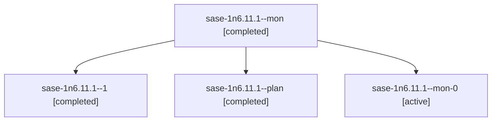

# Session: sase-1n6.11.1

[Agent Hoods](../README.md) / [bbugyi200](../users/bbugyi200/README.md) / [athena](../users/bbugyi200/machines/athena/README.md) / [sase-1n6](../users/bbugyi200/machines/athena/hoods/sase-1n6/README.md) / sase-1n6.11.1

Owner: `bbugyi200.athena` · Hood: `sase-1n6` · Members: 4 · Bead: [sase-1n6.11.1](https://github.com/sase-org/sase--beads/blob/main/pages/sase-1n6/sase-1n6.11.1.md)

## Lineage

The diagram is an optional enhancement; the ordered table below contains the same lineage in accessible text.

| Role | Agent | State | Model / provider | Timing | Commits | Prompt | Chat |
|---|---|---|---|---|---:|---|---|
| mon | sase-1n6.11.1--mon | completed | gpt-6-astra / codex | 2026-11-03T22:15:36.137490+00:00 → 2026-11-03T22:39:11.897789+00:00 | 0 | — | [Chat](../agents/bbugyi200.athena.sase-1n6.11.1--mon/chat.md) |
| 1 | sase-1n6.11.1--1 | completed | gpt-6-astra / codex | 2026-11-03T22:40:02.472207+00:00 → 2026-11-03T22:48:49.131698+00:00 | [1](../agents/bbugyi200.athena.sase-1n6.11.1--1/README.md#commits) | [Prompt](../agents/bbugyi200.athena.sase-1n6.11.1--1/prompt.md) | [Chat](../agents/bbugyi200.athena.sase-1n6.11.1--1/chat.md) |
| plan | sase-1n6.11.1--plan | completed | gpt-6-astra / codex | 2026-11-03T21:44:31.086798+00:00 → 2026-11-03T22:16:35.297731+00:00 | 0 | [Prompt](../agents/bbugyi200.athena.sase-1n6.11.1--plan/prompt.md) | [Chat](../agents/bbugyi200.athena.sase-1n6.11.1--plan/chat.md) |
| mon-0 | sase-1n6.11.1--mon-0 | active | gpt-6-astra / codex | 2026-11-03T22:45:03.416102+00:00 | 0 | — | — |

## Commits

| Role | Repo | Commit | Subject | Committed |
|---|---|---|---|---|
| 1 | sase | [`a732756`](https://github.com/sase-org/sase/commit/a732756c9eb926ee83d580d24170b65ca83e5efe) | fix(release-steward): read merge checks from the versioned inventory | 2026-11-03 17:47:22 EST |

## Neighbors

| Agent | Relation | State |
|---|---|---|
| [sase-1n6.11.2](../agents/bbugyi200.athena.sase-1n6.11.2/README.md) | sase-1n6.11 hood | completed |
| [sase-1n6.11.3](../agents/bbugyi200.athena.sase-1n6.11.3/README.md) | sase-1n6.11 hood | waiting |
| [sase-1n6.11.4](../agents/bbugyi200.athena.sase-1n6.11.4/README.md) | sase-1n6.11 hood | waiting |
| [sase-1n6.11.land](../agents/bbugyi200.athena.sase-1n6.11.land/README.md) | sase-1n6.11 hood | waiting |
| [sase-1n6.1](../agents/bbugyi200.athena.sase-1n6.1/README.md) | sase-1n6 hood | completed |
| [sase-1n6.10](bbugyi200.athena.sase-1n6.10.md) (session · 2) | sase-1n6 hood | completed 1, stopped 1 |
| [sase-1n6.10](../agents/bbugyi200.athena.sase-1n6.10/README.md) | sase-1n6 hood | waiting |
| [sase-1n6.10.f0](../agents/bbugyi200.athena.sase-1n6.10.f0/README.md) | sase-1n6 hood | active |
| [sase-1n6.2](../agents/bbugyi200.athena.sase-1n6.2/README.md) | sase-1n6 hood | completed |
| [sase-1n6.3](../agents/bbugyi200.athena.sase-1n6.3/README.md) | sase-1n6 hood | completed |
| [sase-1n6.4](bbugyi200.athena.sase-1n6.4.md) (session · 3) | sase-1n6 hood | completed 2, failed 1 |
| [sase-1n6.5](bbugyi200.athena.sase-1n6.5.md) (session · 3) | sase-1n6 hood | failed 3 |
| [sase-1n6.5.1.1](../agents/bbugyi200.athena.sase-1n6.5.1.1/README.md) | sase-1n6 hood | active |
| [sase-1n6.5.1.2](bbugyi200.athena.sase-1n6.5.1.2.md) (session · 5) | sase-1n6 hood | active 5 |
| [sase-1n6.5.1.3](../agents/bbugyi200.athena.sase-1n6.5.1.3/README.md) | sase-1n6 hood | active |
| [sase-1n6.5.1.4](../agents/bbugyi200.athena.sase-1n6.5.1.4/README.md) | sase-1n6 hood | active |
| [sase-1n6.5.1.5.1](../agents/bbugyi200.athena.sase-1n6.5.1.5.1/README.md) | sase-1n6 hood | completed |
| [sase-1n6.5.1.5.2](../agents/bbugyi200.athena.sase-1n6.5.1.5.2/README.md) | sase-1n6 hood | completed |
| [sase-1n6.5.1.5.2.1.1](bbugyi200.athena.sase-1n6.5.1.5.2.1.1.md) (session · 3) | sase-1n6 hood | active 3 |
| [sase-1n6.5.1.5.2.1.2](bbugyi200.athena.sase-1n6.5.1.5.2.1.2.md) (session · 7) | sase-1n6 hood | active 3, completed 2, failed 2 |
| [sase-1n6.5.1.5.2.1.3.1](bbugyi200.athena.sase-1n6.5.1.5.2.1.3.1.md) (session · 3) | sase-1n6 hood | completed 2, failed 1 |
| [sase-1n6.5.1.5.2.1.3.2](bbugyi200.athena.sase-1n6.5.1.5.2.1.3.2.md) (session · 7) | sase-1n6 hood | completed 4, failed 3 |
| [sase-1n6.5.1.5.2.1.3.land](../agents/bbugyi200.athena.sase-1n6.5.1.5.2.1.3.land/README.md) | sase-1n6 hood | completed |
| [sase-1n6.5.1.5.2.1.land](bbugyi200.athena.sase-1n6.5.1.5.2.1.land.md) (session · 3) | sase-1n6 hood | active 3 |
| [sase-1n6.5.1.5.land](bbugyi200.athena.sase-1n6.5.1.5.land.md) (session · 5) | sase-1n6 hood | completed 3, failed 2 |
| [sase-1n6.5.1.land](bbugyi200.athena.sase-1n6.5.1.land.md) (session · 3) | sase-1n6 hood | active 3 |
| [sase-1n6.6](bbugyi200.athena.sase-1n6.6.md) (session · 3) | sase-1n6 hood | completed 2, failed 1 |
| [sase-1n6.7](bbugyi200.athena.sase-1n6.7.md) (session · 3) | sase-1n6 hood | failed 3 |
| [sase-1n6.7.1.1](../agents/bbugyi200.athena.sase-1n6.7.1.1/README.md) | sase-1n6 hood | active |
| [sase-1n6.7.1.2](bbugyi200.athena.sase-1n6.7.1.2.md) (session · 5) | sase-1n6 hood | active 5 |
| [sase-1n6.7.1.3](../agents/bbugyi200.athena.sase-1n6.7.1.3/README.md) | sase-1n6 hood | active |
| [sase-1n6.7.1.4](bbugyi200.athena.sase-1n6.7.1.4.md) (session · 3) | sase-1n6 hood | active 3 |
| [sase-1n6.7.1.5](bbugyi200.athena.sase-1n6.7.1.5.md) (session · 3) | sase-1n6 hood | active 3 |
| [sase-1n6.7.1.land](bbugyi200.athena.sase-1n6.7.1.land.md) (session · 15) | sase-1n6 hood | active 13, completed 1, failed 1 |
| [sase-1n6.8](../agents/bbugyi200.athena.sase-1n6.8/README.md) | sase-1n6 hood | completed |
| [sase-1n6.9](../agents/bbugyi200.athena.sase-1n6.9/README.md) | sase-1n6 hood | completed |
| [sase-1n6.land](bbugyi200.athena.sase-1n6.land.md) (session · 3) | sase-1n6 hood | active 1, completed 2 |
| [sase-1n6.land](../agents/bbugyi200.athena.sase-1n6.land/README.md) | sase-1n6 hood | waiting |
