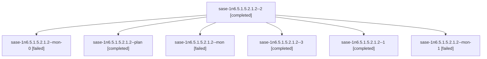

# Session: sase-1n6.5.1.5.2.1.2

[Agent Hoods](../README.md) / [bbugyi200](../users/bbugyi200/README.md) / [athena](../users/bbugyi200/machines/athena/README.md) / [sase-1n6](../users/bbugyi200/machines/athena/hoods/sase-1n6/README.md) / sase-1n6.5.1.5.2.1.2

Owner: `bbugyi200.athena` · Hood: `sase-1n6` · Members: 7 · Bead: [sase-1n6.5.1.5.2.1.2](https://github.com/sase-org/sase--beads/blob/main/pages/sase-1n6/sase-1n6.5.1.5.2.1.2.md)

## Lineage



The diagram is an optional enhancement; the ordered table below contains the same lineage in accessible text.

| Role | Agent | State | Model / provider | Timing | Commits | Prompt | Chat |
|---|---|---|---|---|---:|---|---|
| <a id="member-2"></a>2 | sase-1n6.5.1.5.2.1.2--2 | completed | gpt-6-luna / codex | 2026-10-20T22:08:21.405486+00:00 → 2026-10-20T22:19:54.090970+00:00 | 0 | [Prompt](../agents/bbugyi200.athena.sase-1n6.5.1.5.2.1.2--2/prompt.md) | [Chat](../agents/bbugyi200.athena.sase-1n6.5.1.5.2.1.2--2/chat.md) |
| <a id="member-mon-0"></a>mon-0 | sase-1n6.5.1.5.2.1.2--mon-0 | failed | gpt-6-luna / codex | 2026-10-20T21:20:07.516018+00:00 → 2026-10-20T22:06:47.672623+00:00 | 0 | — | [Chat](../agents/bbugyi200.athena.sase-1n6.5.1.5.2.1.2--mon-0/chat.md) |
| <a id="member-plan"></a>plan | sase-1n6.5.1.5.2.1.2--plan | completed | gpt-6-astra / codex | 2026-10-23T18:00:54.422830+00:00 → 2026-10-23T18:11:34.997116+00:00 | 0 | [Prompt](../agents/bbugyi200.athena.sase-1n6.5.1.5.2.1.2--plan/prompt.md) | [Chat](../agents/bbugyi200.athena.sase-1n6.5.1.5.2.1.2--plan/chat.md) |
| <a id="member-mon"></a>mon | sase-1n6.5.1.5.2.1.2--mon | failed | gpt-6-astra / codex | 2026-10-23T18:10:58.527884+00:00 → 2026-10-23T21:15:49.197348+00:00 | 0 | — | [Chat](../agents/bbugyi200.athena.sase-1n6.5.1.5.2.1.2--mon/chat.md) |
| <a id="member-3"></a>3 | sase-1n6.5.1.5.2.1.2--3 | completed | gpt-6-luna / codex | 2026-10-22T10:21:40.246645+00:00 → 2026-10-22T10:32:17.875567+00:00 | [1](../agents/bbugyi200.athena.sase-1n6.5.1.5.2.1.2--3/README.md#commits) | [Prompt](../agents/bbugyi200.athena.sase-1n6.5.1.5.2.1.2--3/prompt.md) | [Chat](../agents/bbugyi200.athena.sase-1n6.5.1.5.2.1.2--3/chat.md) |
| <a id="member-1"></a>1 | sase-1n6.5.1.5.2.1.2--1 | completed | gpt-6-astra / codex | 2026-10-23T21:17:07.972326+00:00 → 2026-10-23T21:58:27.328726+00:00 | [1](../agents/bbugyi200.athena.sase-1n6.5.1.5.2.1.2--1/README.md#commits) | [Prompt](../agents/bbugyi200.athena.sase-1n6.5.1.5.2.1.2--1/prompt.md) | [Chat](../agents/bbugyi200.athena.sase-1n6.5.1.5.2.1.2--1/chat.md) |
| <a id="member-mon-1"></a>mon-1 | sase-1n6.5.1.5.2.1.2--mon-1 | failed | gpt-6-luna / codex | 2026-10-20T22:18:47.034249+00:00 → 2026-10-22T10:20:16.891745+00:00 | 0 | — | [Chat](../agents/bbugyi200.athena.sase-1n6.5.1.5.2.1.2--mon-1/chat.md) |

## Commits

| Role | Repo | Commit | Subject | Committed |
|---|---|---|---|---|
| 3 | sase | [`ba7ab4e`](https://github.com/sase-org/sase/commit/ba7ab4e96bce13fdf71b9e429bffe92a8cf39205) | fix(release): repair identity version validation | 2026-10-22 06:28:03 EDT |
| 1 | sase | [`2d1e7fd`](https://github.com/sase-org/sase/commit/2d1e7fd48646c6240f99ba6ac44f5c6e0f75f3c0) | fix(release): retain qualification observations after evaluation | 2026-10-23 17:53:29 EDT |

## Variables

| Role | Variable | Value |
|---|---|---|
| 1 | `artifacts` | \[{bead: sase-1n6.5.1.5.2.1.2, kind: file, label: Green deployed candidate manifest, run 40000653149, path: /home/bryan/.sase/artifacts/agents/gh\_sase-org\_\_sase/20261023171448/candidate-manifest-db389… |
| 2 | `artifacts` | \[{bead: sase-1n6.5.1.5.2.1.2, kind: markdown, label: Live-proof check and containment recheck 2026-10-20, path: /home/bryan/.sase/artifacts/agents/gh\_sase-org\_\_sase/20261020180503/sase-1n6-live-proof… |
| plan | `artifacts` | \[{bead: sase-1n6.5.1.5.2.1.2, kind: file, label: Qualification live proof: 2026-10-23 readiness and core/probe checks, path: /home/bryan/.sase/artifacts/agents/gh\_sase-org\_\_sase/20261023135103/readin… |

#### artifacts

**Role:** `1`

```yaml
- bead: sase-1n6.5.1.5.2.1.2
  kind: file
  label: Green deployed candidate manifest, run 40000653149
  path: /home/bryan/.sase/artifacts/agents/gh_sase-org__sase/20261023171448/candidate-manifest-db389004df8d.json
  ref: file:explicit:8bc875efcb830c862a8c0a3d
  source_path: /home/bryan/.local/state/sase/workspaces/sase-org/sase/sase_10/.sase/live-proof-20261023/green/candidate-build/candidate-manifest.json
- bead: sase-1n6.5.1.5.2.1.2
  kind: file
  label: Probe deployed candidate manifest, run 40000657197
  path: /home/bryan/.sase/artifacts/agents/gh_sase-org__sase/20261023171448/candidate-manifest-19ba7c826d23.json
  ref: file:explicit:9135aae02237170b0632e49b
  source_path: /home/bryan/.local/state/sase/workspaces/sase-org/sase/sase_10/.sase/live-proof-20261023/probe/candidate-build/candidate-manifest.json
- bead: sase-1n6.5.1.5.2.1.2
  kind: file
  label: Green locally reconstructed qualification observation, NOT deployed
  path: /home/bryan/.sase/artifacts/agents/gh_sase-org__sase/20261023171448/reconstructed-observation-9eac77579bad.json
  ref: file:explicit:aa18ca111c87695d17839ee5
  source_path: /home/bryan/.local/state/sase/workspaces/sase-org/sase/sase_10/.sase/live-proof-20261023/green/reconstructed-observation.json
- bead: sase-1n6.5.1.5.2.1.2
  kind: file
  label: Probe locally reconstructed qualification observation, NOT deployed
  path: /home/bryan/.sase/artifacts/agents/gh_sase-org__sase/20261023171448/reconstructed-observation-355c71fd9326.json
  ref: file:explicit:fad2903cc032f8bb9de4f553
  source_path: /home/bryan/.local/state/sase/workspaces/sase-org/sase/sase_10/.sase/live-proof-20261023/probe/reconstructed-observation.json
- bead: sase-1n6.5.1.5.2.1.2
  kind: file
  label: Green evaluate of archived empty observation list
  path: /home/bryan/.sase/artifacts/agents/gh_sase-org__sase/20261023171448/archived-evaluate-0aca590f35b7.json
  ref: file:explicit:ecfaa196c32b298f81e28554
  source_path: /home/bryan/.local/state/sase/workspaces/sase-org/sase/sase_10/.sase/live-proof-20261023/green/archived-evaluate.json
- bead: sase-1n6.5.1.5.2.1.2
  kind: file
  label: Probe evaluate of archived empty observation list
  path: /home/bryan/.sase/artifacts/agents/gh_sase-org__sase/20261023171448/archived-evaluate-58c4987966e1.json
  ref: file:explicit:380b624f2bd18f6804db1e8e
  source_path: /home/bryan/.local/state/sase/workspaces/sase-org/sase/sase_10/.sase/live-proof-20261023/probe/archived-evaluate.json
- bead: sase-1n6.5.1.5.2.1.2
  kind: file
  label: Green evaluate of locally reconstructed evidence
  path: /home/bryan/.sase/artifacts/agents/gh_sase-org__sase/20261023171448/reconstructed-evaluate-9a6a6df3ec42.json
  ref: file:explicit:a76f7706333cb444f33c2532
  source_path: /home/bryan/.local/state/sase/workspaces/sase-org/sase/sase_10/.sase/live-proof-20261023/green/reconstructed-evaluate.json
- bead: sase-1n6.5.1.5.2.1.2
  kind: file
  label: Probe evaluate of locally reconstructed evidence
  path: /home/bryan/.sase/artifacts/agents/gh_sase-org__sase/20261023171448/reconstructed-evaluate-82f6d4a1d443.json
  ref: file:explicit:00443e8656e3e07fdc958d6c
  source_path: /home/bryan/.local/state/sase/workspaces/sase-org/sase/sase_10/.sase/live-proof-20261023/probe/reconstructed-evaluate.json
- bead: sase-1n6.5.1.5.2.1.2
  kind: file
  label: Live proof required jobs, source comparison and advisories
  path: /home/bryan/.sase/artifacts/agents/gh_sase-org__sase/20261023171448/evidence-summary-ccd270f47f0d.json
  ref: file:explicit:2c9807d13101d7e4f1920d8c
  source_path: /home/bryan/.local/state/sase/workspaces/sase-org/sase/sase_10/.sase/live-proof-20261023/evidence-summary.json
- bead: sase-1n6.5.1.5.2.1.2
  kind: file
  label: Aligned live proof raw artifacts, logs and diagnostic replay at bdec291
  path: /home/bryan/.sase/artifacts/agents/gh_sase-org__sase/20261023171448/live-proof-evidence.tar-d30b2b972538.gz
  ref: file:explicit:d1d05f2daface15a4c425e9f
  source_path: /home/bryan/.local/state/sase/workspaces/sase-org/sase/sase_10/.sase/live-proof-20261023/live-proof-evidence.tar.gz
- bead: sase-1n6.5.1.5.2.1.2
  kind: markdown
  label: Live proof acceptance mapping and REPROOF REQUIRED repair handoff
  path: /home/bryan/.sase/artifacts/agents/gh_sase-org__sase/20261023171448/acceptance-mapping-46934a399160.md
  ref: file:explicit:88fe402c602e56f995848006
  source_path: /home/bryan/.local/state/sase/workspaces/sase-org/sase/sase_10/.sase/live-proof-20261023/acceptance-mapping.md
- bead: sase-1n6.5.1.5.2.1.2
  kind: file
  label: Repair verification: focused pass, full check red, unchanged-tree and clean-base probes
  path: /home/bryan/.sase/artifacts/agents/gh_sase-org__sase/20261023171448/verification-evidence.tar-bb7102234ed2.gz
  ref: file:explicit:e021a91a561c8a6e9a41f557
  source_path: /home/bryan/.local/state/sase/workspaces/sase-org/sase/sase_10/.sase/live-proof-20261023/verification-evidence.tar.gz
```

#### artifacts

**Role:** `2`

```yaml
- bead: sase-1n6.5.1.5.2.1.2
  kind: markdown
  label: Live-proof check and containment recheck 2026-10-20
  path: /home/bryan/.sase/artifacts/agents/gh_sase-org__sase/20261020180503/sase-1n6-live-proof-check-2ee1cb3f-765d86f45188.md
  ref: file:explicit:5a53615900b27783daf3033f
  source_path: /tmp/sase-1n6-live-proof-check-2ee1cb3f.md
```

#### artifacts

**Role:** `plan`

```yaml
- bead: sase-1n6.5.1.5.2.1.2
  kind: file
  label: Qualification live proof: 2026-10-23 readiness and core/probe checks
  path: /home/bryan/.sase/artifacts/agents/gh_sase-org__sase/20261023135103/readiness-9ee6bbb63d16.json
  ref: file:explicit:4b085fa3c19a8eccb6d96032
  source_path: /home/bryan/.local/state/sase/workspaces/sase-org/sase/sase_10/.sase/live-proof-20261023/readiness.json
- bead: sase-1n6.5.1.5.2.1.2
  kind: file
  label: Qualification live proof: 2026-10-23 aligned dispatch receipts
  path: /home/bryan/.sase/artifacts/agents/gh_sase-org__sase/20261023135103/dispatch-dcb966e3713e.json
  ref: file:explicit:f7620f53009d4743a99d9694
  source_path: /home/bryan/.local/state/sase/workspaces/sase-org/sase/sase_10/.sase/live-proof-20261023/dispatch.json
```

Values are truncated for display; see each member's agent meta.json for the full values.

## Neighbors

| Agent | Relation | State |
|---|---|---|
| [sase-1n6.5.1.5.2](../agents/bbugyi200.athena.sase-1n6.5.1.5.2/README.md) | ancestor | completed |
| [sase-1n6.5](bbugyi200.athena.sase-1n6.5.md) (session · 3) | ancestor | failed 3 |
| [sase-1n6.5.1.5.2.1.1](bbugyi200.athena.sase-1n6.5.1.5.2.1.1.md) (session · 3) | sase-1n6.5.1.5.2.1 hood | completed 2, failed 1 |
| [sase-1n6.5.1.5.2.1.3.1](bbugyi200.athena.sase-1n6.5.1.5.2.1.3.1.md) (session · 2) | sase-1n6.5.1.5.2.1 hood | active 1, completed 1 |
| [sase-1n6.5.1.5.2.1.3.2](../agents/bbugyi200.athena.sase-1n6.5.1.5.2.1.3.2/README.md) | sase-1n6.5.1.5.2.1 hood | waiting |
| [sase-1n6.5.1.5.2.1.3.land](../agents/bbugyi200.athena.sase-1n6.5.1.5.2.1.3.land/README.md) | sase-1n6.5.1.5.2.1 hood | waiting |
| [sase-1n6.5.1.5.2.1.land](bbugyi200.athena.sase-1n6.5.1.5.2.1.land.md) (session · 3) | sase-1n6.5.1.5.2.1 hood | failed 3 |
| [sase-1n6.5.1.5.1](../agents/bbugyi200.athena.sase-1n6.5.1.5.1/README.md) | sase-1n6.5.1.5 hood | completed |
| [sase-1n6.5.1.5.land](../agents/bbugyi200.athena.sase-1n6.5.1.5.land/README.md) | sase-1n6.5.1.5 hood | waiting |
| [sase-1n6.5.1.1](../agents/bbugyi200.athena.sase-1n6.5.1.1/README.md) | sase-1n6.5.1 hood | active |
| [sase-1n6.5.1.2](bbugyi200.athena.sase-1n6.5.1.2.md) (session · 5) | sase-1n6.5.1 hood | active 5 |
| [sase-1n6.5.1.3](../agents/bbugyi200.athena.sase-1n6.5.1.3/README.md) | sase-1n6.5.1 hood | active |
| [sase-1n6.5.1.4](../agents/bbugyi200.athena.sase-1n6.5.1.4/README.md) | sase-1n6.5.1 hood | active |
| [sase-1n6.5.1.land](bbugyi200.athena.sase-1n6.5.1.land.md) (session · 3) | sase-1n6.5.1 hood | active 3 |
| [sase-1n6.1](../agents/bbugyi200.athena.sase-1n6.1/README.md) | sase-1n6 hood | completed |
| [sase-1n6.10](../agents/bbugyi200.athena.sase-1n6.10/README.md) | sase-1n6 hood | waiting |
| [sase-1n6.2](../agents/bbugyi200.athena.sase-1n6.2/README.md) | sase-1n6 hood | completed |
| [sase-1n6.3](../agents/bbugyi200.athena.sase-1n6.3/README.md) | sase-1n6 hood | completed |
| [sase-1n6.4](bbugyi200.athena.sase-1n6.4.md) (session · 3) | sase-1n6 hood | completed 2, failed 1 |
| [sase-1n6.6](../agents/bbugyi200.athena.sase-1n6.6/README.md) | sase-1n6 hood | waiting |
| [sase-1n6.7](bbugyi200.athena.sase-1n6.7.md) (session · 3) | sase-1n6 hood | failed 3 |
| [sase-1n6.7.1.1](../agents/bbugyi200.athena.sase-1n6.7.1.1/README.md) | sase-1n6 hood | active |
| [sase-1n6.7.1.2](bbugyi200.athena.sase-1n6.7.1.2.md) (session · 5) | sase-1n6 hood | active 5 |
| [sase-1n6.7.1.3](../agents/bbugyi200.athena.sase-1n6.7.1.3/README.md) | sase-1n6 hood | active |
| [sase-1n6.7.1.4](bbugyi200.athena.sase-1n6.7.1.4.md) (session · 3) | sase-1n6 hood | active 3 |
| [sase-1n6.7.1.5](bbugyi200.athena.sase-1n6.7.1.5.md) (session · 3) | sase-1n6 hood | active 3 |
| [sase-1n6.7.1.land](bbugyi200.athena.sase-1n6.7.1.land.md) (session · 15) | sase-1n6 hood | active 13, completed 1, failed 1 |
| [sase-1n6.8](../agents/bbugyi200.athena.sase-1n6.8/README.md) | sase-1n6 hood | completed |
| [sase-1n6.9](../agents/bbugyi200.athena.sase-1n6.9/README.md) | sase-1n6 hood | waiting |
| [sase-1n6.land](../agents/bbugyi200.athena.sase-1n6.land/README.md) | sase-1n6 hood | waiting |
