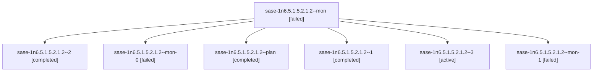

# Session: sase-1n6.5.1.5.2.1.2

[Agent Hoods](../README.md) / [bbugyi200](../users/bbugyi200/README.md) / [athena](../users/bbugyi200/machines/athena/README.md) / [sase-1n6](../users/bbugyi200/machines/athena/hoods/sase-1n6/README.md) / sase-1n6.5.1.5.2.1.2

Owner: `bbugyi200.athena` · Hood: `sase-1n6` · Members: 7 · Bead: [sase-1n6.5.1.5.2.1.2](https://github.com/sase-org/sase--beads/blob/main/pages/sase-1n6/sase-1n6.5.1.5.2.1.2.md)

## Lineage



The diagram is an optional enhancement; the ordered table below contains the same lineage in accessible text.

| Role | Agent | State | Model / provider | Timing | Commits | Prompt | Chat |
|---|---|---|---|---|---:|---|---|
| <a id="member-mon"></a>mon | sase-1n6.5.1.5.2.1.2--mon | failed | gpt-6-luna / codex | 2026-10-20T20:56:13.840762+00:00 → 2026-10-20T21:01:11.803897+00:00 | 0 | — | [Chat](../agents/bbugyi200.athena.sase-1n6.5.1.5.2.1.2--mon/chat.md) |
| <a id="member-2"></a>2 | sase-1n6.5.1.5.2.1.2--2 | completed | gpt-6-luna / codex | 2026-10-20T22:08:21.405486+00:00 → 2026-10-20T22:19:54.090970+00:00 | 0 | [Prompt](../agents/bbugyi200.athena.sase-1n6.5.1.5.2.1.2--2/prompt.md) | [Chat](../agents/bbugyi200.athena.sase-1n6.5.1.5.2.1.2--2/chat.md) |
| <a id="member-mon-0"></a>mon-0 | sase-1n6.5.1.5.2.1.2--mon-0 | failed | gpt-6-luna / codex | 2026-10-20T21:20:07.516018+00:00 → 2026-10-20T22:06:47.672623+00:00 | 0 | — | [Chat](../agents/bbugyi200.athena.sase-1n6.5.1.5.2.1.2--mon-0/chat.md) |
| <a id="member-plan"></a>plan | sase-1n6.5.1.5.2.1.2--plan | completed | gpt-6-luna / codex | 2026-10-20T20:47:35.311267+00:00 → 2026-10-20T20:57:13.736133+00:00 | 0 | [Prompt](../agents/bbugyi200.athena.sase-1n6.5.1.5.2.1.2--plan/prompt.md) | [Chat](../agents/bbugyi200.athena.sase-1n6.5.1.5.2.1.2--plan/chat.md) |
| <a id="member-1"></a>1 | sase-1n6.5.1.5.2.1.2--1 | completed | gpt-6-luna / codex | 2026-10-20T21:02:39.550743+00:00 → 2026-10-20T21:21:42.956571+00:00 | 0 | [Prompt](../agents/bbugyi200.athena.sase-1n6.5.1.5.2.1.2--1/prompt.md) | [Chat](../agents/bbugyi200.athena.sase-1n6.5.1.5.2.1.2--1/chat.md) |
| <a id="member-3"></a>3 | sase-1n6.5.1.5.2.1.2--3 | active | gpt-6-luna / codex | 2026-10-22T10:21:40.246645+00:00 | [1](../agents/bbugyi200.athena.sase-1n6.5.1.5.2.1.2--3/README.md#commits) | [Prompt](../agents/bbugyi200.athena.sase-1n6.5.1.5.2.1.2--3/prompt.md) | — |
| <a id="member-mon-1"></a>mon-1 | sase-1n6.5.1.5.2.1.2--mon-1 | failed | gpt-6-luna / codex | 2026-10-20T22:18:47.034249+00:00 → 2026-10-22T10:20:16.891745+00:00 | 0 | — | [Chat](../agents/bbugyi200.athena.sase-1n6.5.1.5.2.1.2--mon-1/chat.md) |

## Commits

| Role | Repo | Commit | Subject | Committed |
|---|---|---|---|---|
| 3 | sase | [`ba7ab4e`](https://github.com/sase-org/sase/commit/ba7ab4e96bce13fdf71b9e429bffe92a8cf39205) | fix(release): repair identity version validation | 2026-10-22 06:28:03 EDT |

## Variables

| Role | Variable | Value |
|---|---|---|
| 1 | `artifacts` | \[{bead: sase-1n6.5.1.5.2.1.2, kind: file, label: Green rehearsal 39495874381 run metadata, path: /home/bryan/.sase/artifacts/agents/gh\_sase-org\_\_sase/20261020170011/39495874381-api-d5fec920aaa0.json,… |
| 2 | `artifacts` | \[{bead: sase-1n6.5.1.5.2.1.2, kind: markdown, label: Live-proof check and containment recheck 2026-10-20, path: /home/bryan/.sase/artifacts/agents/gh\_sase-org\_\_sase/20261020180503/sase-1n6-live-proof… |

#### artifacts

**Role:** `1`

```yaml
- bead: sase-1n6.5.1.5.2.1.2
  kind: file
  label: Green rehearsal 39495874381 run metadata
  path: /home/bryan/.sase/artifacts/agents/gh_sase-org__sase/20261020170011/39495874381-api-d5fec920aaa0.json
  ref: file:explicit:50fd3359e020644fc0d1bc88
  source_path: /tmp/sase-live-proof-4adee846/39495874381-api.json
- bead: sase-1n6.5.1.5.2.1.2
  kind: markdown
  label: Acceptance mapping for compared SHA 4adee846
  path: /home/bryan/.sase/artifacts/agents/gh_sase-org__sase/20261020170011/sase-live-proof-4adee846-acceptance-d95df327df45.md
  ref: file:explicit:f27fe0e4e8e21041282b6bfd
  source_path: /tmp/sase-live-proof-4adee846-acceptance.md
- bead: sase-1n6.5.1.5.2.1.2
  kind: file
  label: Run logs and core containment evidence for SHA 4adee846
  path: /home/bryan/.sase/artifacts/agents/gh_sase-org__sase/20261020170011/sase-live-proof-4adee846-evidence.tar-4a2627e11649.gz
  ref: file:explicit:79476a9749f868b5d7c7f2d4
  source_path: /tmp/sase-live-proof-4adee846-evidence.tar.gz
```

#### artifacts

**Role:** `2`

```yaml
- bead: sase-1n6.5.1.5.2.1.2
  kind: markdown
  label: Live-proof check and containment recheck 2026-10-20
  path: /home/bryan/.sase/artifacts/agents/gh_sase-org__sase/20261020180503/sase-1n6-live-proof-check-2ee1cb3f-765d86f45188.md
  ref: file:explicit:5a53615900b27783daf3033f
  source_path: /tmp/sase-1n6-live-proof-check-2ee1cb3f.md
```

Values are truncated for display; see each member's agent meta.json for the full values.

## Neighbors

| Agent | Relation | State |
|---|---|---|
| [sase-1n6.5.1.5.2](../agents/bbugyi200.athena.sase-1n6.5.1.5.2/README.md) | ancestor | completed |
| [sase-1n6.5](bbugyi200.athena.sase-1n6.5.md) (session · 3) | ancestor | failed 3 |
| [sase-1n6.5.1.5.2.1.1](bbugyi200.athena.sase-1n6.5.1.5.2.1.1.md) (session · 3) | sase-1n6.5.1.5.2.1 hood | completed 2, failed 1 |
| [sase-1n6.5.1.5.2.1.land](../agents/bbugyi200.athena.sase-1n6.5.1.5.2.1.land/README.md) | sase-1n6.5.1.5.2.1 hood | waiting |
| [sase-1n6.5.1.5.1](../agents/bbugyi200.athena.sase-1n6.5.1.5.1/README.md) | sase-1n6.5.1.5 hood | completed |
| [sase-1n6.5.1.5.land](../agents/bbugyi200.athena.sase-1n6.5.1.5.land/README.md) | sase-1n6.5.1.5 hood | waiting |
| [sase-1n6.5.1.1](../agents/bbugyi200.athena.sase-1n6.5.1.1/README.md) | sase-1n6.5.1 hood | active |
| [sase-1n6.5.1.2](bbugyi200.athena.sase-1n6.5.1.2.md) (session · 5) | sase-1n6.5.1 hood | active 5 |
| [sase-1n6.5.1.3](../agents/bbugyi200.athena.sase-1n6.5.1.3/README.md) | sase-1n6.5.1 hood | active |
| [sase-1n6.5.1.4](../agents/bbugyi200.athena.sase-1n6.5.1.4/README.md) | sase-1n6.5.1 hood | active |
| [sase-1n6.5.1.land](bbugyi200.athena.sase-1n6.5.1.land.md) (session · 3) | sase-1n6.5.1 hood | active 3 |
| [sase-1n6.1](../agents/bbugyi200.athena.sase-1n6.1/README.md) | sase-1n6 hood | completed |
| [sase-1n6.10](../agents/bbugyi200.athena.sase-1n6.10/README.md) | sase-1n6 hood | waiting |
| [sase-1n6.2](../agents/bbugyi200.athena.sase-1n6.2/README.md) | sase-1n6 hood | completed |
| [sase-1n6.3](../agents/bbugyi200.athena.sase-1n6.3/README.md) | sase-1n6 hood | completed |
| [sase-1n6.4](bbugyi200.athena.sase-1n6.4.md) (session · 3) | sase-1n6 hood | completed 2, failed 1 |
| [sase-1n6.6](../agents/bbugyi200.athena.sase-1n6.6/README.md) | sase-1n6 hood | waiting |
| [sase-1n6.7](bbugyi200.athena.sase-1n6.7.md) (session · 3) | sase-1n6 hood | failed 3 |
| [sase-1n6.7.1.1](../agents/bbugyi200.athena.sase-1n6.7.1.1/README.md) | sase-1n6 hood | active |
| [sase-1n6.7.1.2](bbugyi200.athena.sase-1n6.7.1.2.md) (session · 5) | sase-1n6 hood | active 5 |
| [sase-1n6.7.1.3](../agents/bbugyi200.athena.sase-1n6.7.1.3/README.md) | sase-1n6 hood | active |
| [sase-1n6.7.1.4](bbugyi200.athena.sase-1n6.7.1.4.md) (session · 3) | sase-1n6 hood | active 3 |
| [sase-1n6.7.1.5](bbugyi200.athena.sase-1n6.7.1.5.md) (session · 3) | sase-1n6 hood | active 3 |
| [sase-1n6.7.1.land](bbugyi200.athena.sase-1n6.7.1.land.md) (session · 15) | sase-1n6 hood | active 13, completed 1, failed 1 |
| [sase-1n6.8](../agents/bbugyi200.athena.sase-1n6.8/README.md) | sase-1n6 hood | completed |
| [sase-1n6.9](../agents/bbugyi200.athena.sase-1n6.9/README.md) | sase-1n6 hood | waiting |
| [sase-1n6.land](../agents/bbugyi200.athena.sase-1n6.land/README.md) | sase-1n6 hood | waiting |
