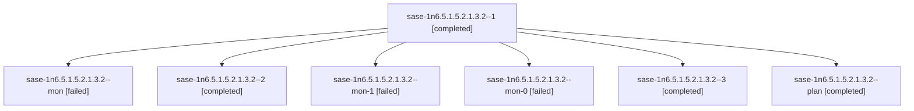

# Session: sase-1n6.5.1.5.2.1.3.2

[Agent Hoods](../README.md) / [bbugyi200](../users/bbugyi200/README.md) / [athena](../users/bbugyi200/machines/athena/README.md) / [sase-1n6](../users/bbugyi200/machines/athena/hoods/sase-1n6/README.md) / sase-1n6.5.1.5.2.1.3.2

Owner: `bbugyi200.athena` · Hood: `sase-1n6` · Members: 7 · Bead: [sase-1n6.5.1.5.2.1.3.2](https://github.com/sase-org/sase--beads/blob/main/pages/sase-1n6/sase-1n6.5.1.5.2.1.3.2.md)

## Lineage



The diagram is an optional enhancement; the ordered table below contains the same lineage in accessible text.

| Role | Agent | State | Model / provider | Timing | Commits | Prompt | Chat |
|---|---|---|---|---|---:|---|---|
| <a id="member-1"></a>1 | sase-1n6.5.1.5.2.1.3.2--1 | completed | muse-spark-1.3-contributor / muse | 2026-10-25T13:37:39.405430+00:00 → 2026-10-25T13:42:58.114877+00:00 | 0 | [Prompt](../agents/bbugyi200.athena.sase-1n6.5.1.5.2.1.3.2--1/prompt.md) | [Chat](../agents/bbugyi200.athena.sase-1n6.5.1.5.2.1.3.2--1/chat.md) |
| <a id="member-mon"></a>mon | sase-1n6.5.1.5.2.1.3.2--mon | failed | muse-spark-1.3-contributor / muse | 2026-10-25T11:34:34.251623+00:00 → 2026-10-25T13:36:20.599673+00:00 | 0 | — | [Chat](../agents/bbugyi200.athena.sase-1n6.5.1.5.2.1.3.2--mon/chat.md) |
| <a id="member-2"></a>2 | sase-1n6.5.1.5.2.1.3.2--2 | completed | muse-spark-1.3-contributor / muse | 2026-10-25T15:44:55.689639+00:00 → 2026-10-25T16:19:22.766972+00:00 | 0 | [Prompt](../agents/bbugyi200.athena.sase-1n6.5.1.5.2.1.3.2--2/prompt.md) | [Chat](../agents/bbugyi200.athena.sase-1n6.5.1.5.2.1.3.2--2/chat.md) |
| <a id="member-mon-1"></a>mon-1 | sase-1n6.5.1.5.2.1.3.2--mon-1 | failed | muse-spark-1.3-contributor / muse | 2026-10-25T16:18:49.761457+00:00 → 2026-10-25T18:20:22.524401+00:00 | 0 | — | [Chat](../agents/bbugyi200.athena.sase-1n6.5.1.5.2.1.3.2--mon-1/chat.md) |
| <a id="member-mon-0"></a>mon-0 | sase-1n6.5.1.5.2.1.3.2--mon-0 | failed | muse-spark-1.3-contributor / muse | 2026-10-25T13:42:08.931088+00:00 → 2026-10-25T15:43:41.478051+00:00 | 0 | — | [Chat](../agents/bbugyi200.athena.sase-1n6.5.1.5.2.1.3.2--mon-0/chat.md) |
| <a id="member-3"></a>3 | sase-1n6.5.1.5.2.1.3.2--3 | completed | muse-spark-1.3-contributor / muse | 2026-10-25T18:21:25.036978+00:00 → 2026-10-25T18:33:53.191507+00:00 | 0 | [Prompt](../agents/bbugyi200.athena.sase-1n6.5.1.5.2.1.3.2--3/prompt.md) | [Chat](../agents/bbugyi200.athena.sase-1n6.5.1.5.2.1.3.2--3/chat.md) |
| <a id="member-plan"></a>plan | sase-1n6.5.1.5.2.1.3.2--plan | completed | muse-spark-1.3-contributor / muse | 2026-10-25T11:29:21.181961+00:00 → 2026-10-25T11:35:23.995976+00:00 | 0 | [Prompt](../agents/bbugyi200.athena.sase-1n6.5.1.5.2.1.3.2--plan/prompt.md) | [Chat](../agents/bbugyi200.athena.sase-1n6.5.1.5.2.1.3.2--plan/chat.md) |

## Variables

| Role | Variable | Value |
|---|---|---|
| 2 | `artifacts` | \[{bead: sase-1n6.5.1.5.2.1.3.2, kind: file, label: reproof-7423fa83-eval-green, path: /home/bryan/.sase/artifacts/agents/gh\_sase-org\_\_sase/20261025114241/eval\_green-56f9954915fd.json, ref: file:expli… |
| 3 | `artifacts` | \[{bead: sase-1n6.5.1.5.2.1.3.2, kind: markdown, label: Source proof: scheduled Full CI 40189680772 exact-SHA evidence, path: /home/bryan/.sase/artifacts/agents/gh\_sase-org\_\_sase/20261025141922/source… |

#### artifacts

**Role:** `2`

```yaml
- bead: sase-1n6.5.1.5.2.1.3.2
  kind: file
  label: reproof-7423fa83-eval-green
  path: /home/bryan/.sase/artifacts/agents/gh_sase-org__sase/20261025114241/eval_green-56f9954915fd.json
  ref: file:explicit:69ee9f86a11968966b65ea45
  source_path: /tmp/reproof/eval_green.json
- bead: sase-1n6.5.1.5.2.1.3.2
  kind: markdown
  label: reproof-7423fa83-RETENTION_deployed_reproof_7423fa83.md
  path: /home/bryan/.sase/artifacts/agents/gh_sase-org__sase/20261025114241/RETENTION_deployed_reproof_7423fa83-4fce50a05a44.md
  ref: file:explicit:1ee10e9b1af1678b8846a4ff
  source_path: /tmp/reproof/RETENTION_deployed_reproof_7423fa83.md
- bead: sase-1n6.5.1.5.2.1.3.2
  kind: file
  label: reproof-7423fa83-eval_probe.json
  path: /home/bryan/.sase/artifacts/agents/gh_sase-org__sase/20261025114241/eval_probe-56f9954915fd.json
  ref: file:explicit:7750533a8aba81f68394c607
  source_path: /tmp/reproof/eval_probe.json
- bead: sase-1n6.5.1.5.2.1.3.2
  kind: file
  label: reproof-7423fa83-manifest_green.json
  path: /home/bryan/.sase/artifacts/agents/gh_sase-org__sase/20261025114241/manifest_green-4a08c2a3c191.json
  ref: file:explicit:35784ebd6bcebd6eaf0416a8
  source_path: /tmp/reproof/manifest_green.json
- bead: sase-1n6.5.1.5.2.1.3.2
  kind: file
  label: reproof-7423fa83-manifest_probe.json
  path: /home/bryan/.sase/artifacts/agents/gh_sase-org__sase/20261025114241/manifest_probe-f30c691b2846.json
  ref: file:explicit:3f19133de54838b34be8acf5
  source_path: /tmp/reproof/manifest_probe.json
- bead: sase-1n6.5.1.5.2.1.3.2
  kind: file
  label: reproof-7423fa83-obs_green.json
  path: /home/bryan/.sase/artifacts/agents/gh_sase-org__sase/20261025114241/obs_green-d4681d299230.json
  ref: file:explicit:3934b2768847931314eaffc3
  source_path: /tmp/reproof/obs_green.json
- bead: sase-1n6.5.1.5.2.1.3.2
  kind: file
  label: reproof-7423fa83-obs_probe.json
  path: /home/bryan/.sase/artifacts/agents/gh_sase-org__sase/20261025114241/obs_probe-f43b4da031f1.json
  ref: file:explicit:798586cbaa5db68c3781bad8
  source_path: /tmp/reproof/obs_probe.json
- bead: sase-1n6.5.1.5.2.1.3.2
  kind: file
  label: reproof-7423fa83-jobs_40189341606.json
  path: /home/bryan/.sase/artifacts/agents/gh_sase-org__sase/20261025114241/jobs_40189341606-53c01cf76680.json
  ref: file:explicit:b9f3fccfe5e8972f4e44b1fa
  source_path: /tmp/reproof/jobs_40189341606.json
- bead: sase-1n6.5.1.5.2.1.3.2
  kind: file
  label: reproof-7423fa83-jobs_40189365714.json
  path: /home/bryan/.sase/artifacts/agents/gh_sase-org__sase/20261025114241/jobs_40189365714-3bcfb4c8f79b.json
  ref: file:explicit:c885a85836f186dbf320b50e
  source_path: /tmp/reproof/jobs_40189365714.json
- bead: sase-1n6.5.1.5.2.1.3.2
  kind: markdown
  label: reproof-7423fa83-jobs_40199727112_attempt1.md
  path: /home/bryan/.sase/artifacts/agents/gh_sase-org__sase/20261025114241/jobs_40199727112_attempt1-7f682fa6adec.md
  ref: file:explicit:95dfb88af4872864ccc04d49
  source_path: /tmp/reproof/jobs_40199727112_attempt1.md
- bead: sase-1n6.5.1.5.2.1.3.2
  kind: file
  label: reproof-7423fa83-run_40189341606.json
  path: /home/bryan/.sase/artifacts/agents/gh_sase-org__sase/20261025114241/run_40189341606-ce4a820ba6fe.json
  ref: file:explicit:eaca1d0ff401f43ef7ff7715
  source_path: /tmp/reproof/run_40189341606.json
- bead: sase-1n6.5.1.5.2.1.3.2
  kind: markdown
  label: reproof-7423fa83-RETENTION
  path: /home/bryan/.sase/artifacts/agents/gh_sase-org__sase/20261025114241/RETENTION_deployed_reproof_7423fa83-4fce50a05a44.md
  ref: file:explicit:6bbf16c2af9d559a66d90edb
  source_path: /tmp/reproof/RETENTION_deployed_reproof_7423fa83.md
- bead: sase-1n6.5.1.5.2.1.3.2
  kind: file
  label: reproof-7423fa83-eval-probe
  path: /home/bryan/.sase/artifacts/agents/gh_sase-org__sase/20261025114241/eval_probe-56f9954915fd.json
  ref: file:explicit:522d31ca2719b8349ddf4661
  source_path: /tmp/reproof/eval_probe.json
- bead: sase-1n6.5.1.5.2.1.3.2
  kind: file
  label: reproof-7423fa83-manifest-green
  path: /home/bryan/.sase/artifacts/agents/gh_sase-org__sase/20261025114241/manifest_green-4a08c2a3c191.json
  ref: file:explicit:c28309c1af2b9794fd081502
  source_path: /tmp/reproof/manifest_green.json
- bead: sase-1n6.5.1.5.2.1.3.2
  kind: file
  label: reproof-7423fa83-manifest-probe
  path: /home/bryan/.sase/artifacts/agents/gh_sase-org__sase/20261025114241/manifest_probe-f30c691b2846.json
  ref: file:explicit:6237c8ca770f2e713c733712
  source_path: /tmp/reproof/manifest_probe.json
- bead: sase-1n6.5.1.5.2.1.3.2
  kind: file
  label: reproof-7423fa83-obs-green
  path: /home/bryan/.sase/artifacts/agents/gh_sase-org__sase/20261025114241/obs_green-d4681d299230.json
  ref: file:explicit:78cf081730a03abf7cbb687a
  source_path: /tmp/reproof/obs_green.json
- bead: sase-1n6.5.1.5.2.1.3.2
  kind: file
  label: reproof-7423fa83-obs-probe
  path: /home/bryan/.sase/artifacts/agents/gh_sase-org__sase/20261025114241/obs_probe-f43b4da031f1.json
  ref: file:explicit:e7cf9f77495941d45cb96233
  source_path: /tmp/reproof/obs_probe.json
- bead: sase-1n6.5.1.5.2.1.3.2
  kind: file
  label: reproof-7423fa83-jobs-green
  path: /home/bryan/.sase/artifacts/agents/gh_sase-org__sase/20261025114241/jobs_40189341606-53c01cf76680.json
  ref: file:explicit:9c4a7946175440c76497b0ca
  source_path: /tmp/reproof/jobs_40189341606.json
- bead: sase-1n6.5.1.5.2.1.3.2
  kind: file
  label: reproof-7423fa83-jobs-probe
  path: /home/bryan/.sase/artifacts/agents/gh_sase-org__sase/20261025114241/jobs_40189365714-3bcfb4c8f79b.json
  ref: file:explicit:a3167fd5db56d2ad498e50c2
  source_path: /tmp/reproof/jobs_40189365714.json
- bead: sase-1n6.5.1.5.2.1.3.2
  kind: markdown
  label: reproof-7423fa83-jobs-source-attempt1
  path: /home/bryan/.sase/artifacts/agents/gh_sase-org__sase/20261025114241/jobs_40199727112_attempt1-7f682fa6adec.md
  ref: file:explicit:b57d0be29efa2c265b31d300
  source_path: /tmp/reproof/jobs_40199727112_attempt1.md
- bead: sase-1n6.5.1.5.2.1.3.2
  kind: file
  label: reproof-7423fa83-run_40189365714.json
  path: /home/bryan/.sase/artifacts/agents/gh_sase-org__sase/20261025114241/run_40189365714-249030047d5e.json
  ref: file:explicit:19877f153d81426e2bddd93e
  source_path: /tmp/reproof/run_40189365714.json
- bead: sase-1n6.5.1.5.2.1.3.2
  kind: file
  label: reproof-7423fa83-run_40199727112.json
  path: /home/bryan/.sase/artifacts/agents/gh_sase-org__sase/20261025114241/run_40199727112-682c5b5021d7.json
  ref: file:explicit:d5049ae933afa5ed1332cfe0
  source_path: /tmp/reproof/run_40199727112.json
- bead: sase-1n6.5.1.5.2.1.3.2
  kind: file
  label: reproof-7423fa83-run_40189388674.json
  path: /home/bryan/.sase/artifacts/agents/gh_sase-org__sase/20261025114241/run_40189388674-21aef48b4556.json
  ref: file:explicit:3ab154b50a57f6a27a3497d6
  source_path: /tmp/reproof/run_40189388674.json
- bead: sase-1n6.5.1.5.2.1.3.2
  kind: file
  label: reproof-7423fa83-run_40189680772.json
  path: /home/bryan/.sase/artifacts/agents/gh_sase-org__sase/20261025114241/run_40189680772-ecaa2f231ac5.json
  ref: file:explicit:942193d315e2fb99fd9754aa
  source_path: /tmp/reproof/run_40189680772.json
- bead: sase-1n6.5.1.5.2.1.3.2
  kind: file
  label: reproof-7423fa83-src-evidence-attempt1
  path: /home/bryan/.sase/artifacts/agents/gh_sase-org__sase/20261025114241/src_evidence_attempt1-b242bf85afd1.json
  ref: file:explicit:b7570fff061d5241084346a6
  source_path: /tmp/reproof/src_evidence_attempt1.json
```

#### artifacts

**Role:** `3`

```yaml
- bead: sase-1n6.5.1.5.2.1.3.2
  kind: markdown
  label: Source proof: scheduled Full CI 40189680772 exact-SHA evidence
  path: /home/bryan/.sase/artifacts/agents/gh_sase-org__sase/20261025141922/source-40189680772-evidence-037a75289a61.md
  ref: file:explicit:e38ba06b3bdb3c52a52a2657
  source_path: /tmp/reproof-closeout/source-40189680772-evidence.md
- bead: sase-1n6.5.1.5.2.1.3.2
  kind: markdown
  label: Superseded source run 40199727112 flake record (abandoned attempt)
  path: /home/bryan/.sase/artifacts/agents/gh_sase-org__sase/20261025141922/source-40199727112-flake-record-09f410ec3862.md
  ref: file:explicit:dfa30156a15eeca38cbfce64
  source_path: /tmp/reproof-closeout/source-40199727112-flake-record.md
- bead: sase-1n6.5.1.5.2.1.3.2
  kind: markdown
  label: Deployed-reproof acceptance mapping (green/probe/source)
  path: /home/bryan/.sase/artifacts/agents/gh_sase-org__sase/20261025141922/acceptance-mapping-90ce048ae428.md
  ref: file:explicit:d214a552d318b5ebbe68e847
  source_path: /tmp/reproof-closeout/acceptance-mapping.md
```

Values are truncated for display; see each member's agent meta.json for the full values.

## Neighbors

| Agent | Relation | State |
|---|---|---|
| [sase-1n6.5.1.5.2](../agents/bbugyi200.athena.sase-1n6.5.1.5.2/README.md) | ancestor | completed |
| [sase-1n6.5](bbugyi200.athena.sase-1n6.5.md) (session · 3) | ancestor | failed 3 |
| [sase-1n6.5.1.5.2.1.3.1](bbugyi200.athena.sase-1n6.5.1.5.2.1.3.1.md) (session · 3) | sase-1n6.5.1.5.2.1.3 hood | completed 2, failed 1 |
| [sase-1n6.5.1.5.2.1.3.land](../agents/bbugyi200.athena.sase-1n6.5.1.5.2.1.3.land/README.md) | sase-1n6.5.1.5.2.1.3 hood | completed |
| [sase-1n6.5.1.5.2.1.1](bbugyi200.athena.sase-1n6.5.1.5.2.1.1.md) (session · 3) | sase-1n6.5.1.5.2.1 hood | active 3 |
| [sase-1n6.5.1.5.2.1.2](bbugyi200.athena.sase-1n6.5.1.5.2.1.2.md) (session · 7) | sase-1n6.5.1.5.2.1 hood | active 3, completed 2, failed 2 |
| [sase-1n6.5.1.5.2.1.land](bbugyi200.athena.sase-1n6.5.1.5.2.1.land.md) (session · 3) | sase-1n6.5.1.5.2.1 hood | active 3 |
| [sase-1n6.5.1.5.1](../agents/bbugyi200.athena.sase-1n6.5.1.5.1/README.md) | sase-1n6.5.1.5 hood | completed |
| [sase-1n6.5.1.5.land](bbugyi200.athena.sase-1n6.5.1.5.land.md) (session · 5) | sase-1n6.5.1.5 hood | completed 3, failed 2 |
| [sase-1n6.5.1.1](../agents/bbugyi200.athena.sase-1n6.5.1.1/README.md) | sase-1n6.5.1 hood | active |
| [sase-1n6.5.1.2](bbugyi200.athena.sase-1n6.5.1.2.md) (session · 5) | sase-1n6.5.1 hood | active 5 |
| [sase-1n6.5.1.3](../agents/bbugyi200.athena.sase-1n6.5.1.3/README.md) | sase-1n6.5.1 hood | active |
| [sase-1n6.5.1.4](../agents/bbugyi200.athena.sase-1n6.5.1.4/README.md) | sase-1n6.5.1 hood | active |
| [sase-1n6.5.1.land](bbugyi200.athena.sase-1n6.5.1.land.md) (session · 3) | sase-1n6.5.1 hood | active 3 |
| [sase-1n6.1](../agents/bbugyi200.athena.sase-1n6.1/README.md) | sase-1n6 hood | completed |
| [sase-1n6.10](../agents/bbugyi200.athena.sase-1n6.10/README.md) | sase-1n6 hood | waiting |
| [sase-1n6.2](../agents/bbugyi200.athena.sase-1n6.2/README.md) | sase-1n6 hood | completed |
| [sase-1n6.3](../agents/bbugyi200.athena.sase-1n6.3/README.md) | sase-1n6 hood | completed |
| [sase-1n6.4](bbugyi200.athena.sase-1n6.4.md) (session · 3) | sase-1n6 hood | completed 2, failed 1 |
| [sase-1n6.6](bbugyi200.athena.sase-1n6.6.md) (session · 2) | sase-1n6 hood | active 1, completed 1 |
| [sase-1n6.7](bbugyi200.athena.sase-1n6.7.md) (session · 3) | sase-1n6 hood | failed 3 |
| [sase-1n6.7.1.1](../agents/bbugyi200.athena.sase-1n6.7.1.1/README.md) | sase-1n6 hood | active |
| [sase-1n6.7.1.2](bbugyi200.athena.sase-1n6.7.1.2.md) (session · 5) | sase-1n6 hood | active 5 |
| [sase-1n6.7.1.3](../agents/bbugyi200.athena.sase-1n6.7.1.3/README.md) | sase-1n6 hood | active |
| [sase-1n6.7.1.4](bbugyi200.athena.sase-1n6.7.1.4.md) (session · 3) | sase-1n6 hood | active 3 |
| [sase-1n6.7.1.5](bbugyi200.athena.sase-1n6.7.1.5.md) (session · 3) | sase-1n6 hood | active 3 |
| [sase-1n6.7.1.land](bbugyi200.athena.sase-1n6.7.1.land.md) (session · 15) | sase-1n6 hood | active 13, completed 1, failed 1 |
| [sase-1n6.8](../agents/bbugyi200.athena.sase-1n6.8/README.md) | sase-1n6 hood | completed |
| [sase-1n6.9](../agents/bbugyi200.athena.sase-1n6.9/README.md) | sase-1n6 hood | waiting |
| [sase-1n6.land](../agents/bbugyi200.athena.sase-1n6.land/README.md) | sase-1n6 hood | waiting |
