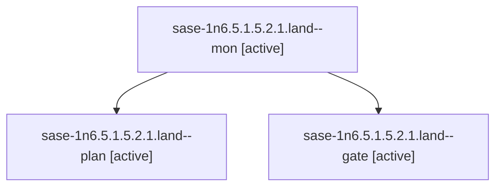

# Session: sase-1n6.5.1.5.2.1.land

[Agent Hoods](../README.md) / [bbugyi200](../users/bbugyi200/README.md) / [athena](../users/bbugyi200/machines/athena/README.md) / [sase-1n6](../users/bbugyi200/machines/athena/hoods/sase-1n6/README.md) / sase-1n6.5.1.5.2.1.land

Owner: `bbugyi200.athena` · Hood: `sase-1n6` · Members: 3 · Bead: [sase-1n6.5.1.5.2.1](https://github.com/sase-org/sase--beads/blob/main/pages/sase-1n6/sase-1n6.5.1.5.2.1.md)

## Lineage



The diagram is an optional enhancement; the ordered table below contains the same lineage in accessible text.

| Role | Agent | State | Model / provider | Timing | Commits | Prompt | Chat |
|---|---|---|---|---|---:|---|---|
| <a id="member-mon"></a>mon | sase-1n6.5.1.5.2.1.land--mon | active | gpt-6-astra / codex | 2026-10-23T22:27:23.138451+00:00 | 0 | — | [Chat](../agents/bbugyi200.athena.sase-1n6.5.1.5.2.1.land--mon/chat.md) |
| <a id="member-plan"></a>plan | sase-1n6.5.1.5.2.1.land--plan | active | gpt-6-astra / codex | 2026-10-23T22:09:20.010907+00:00 | 0 | [Prompt](../agents/bbugyi200.athena.sase-1n6.5.1.5.2.1.land--plan/prompt.md) | [Chat](../agents/bbugyi200.athena.sase-1n6.5.1.5.2.1.land--plan/chat.md) |
| <a id="member-gate"></a>gate | sase-1n6.5.1.5.2.1.land--gate | active | gpt-6-astra / codex | 2026-10-23T22:25:42.127614+00:00 | 0 | — | [Chat](../agents/bbugyi200.athena.sase-1n6.5.1.5.2.1.land--gate/chat.md) |

## Variables

| Role | Variable | Value |
|---|---|---|
| plan | `artifacts` | \[{bead: sase-1n6.5.1.5.2.1, kind: file, label: Proof landing: diagnostic env causes three unrelated TUI test failures, path: /home/bryan/.sase/artifacts/agents/gh\_sase-org\_\_sase/20261020152723/qualif… |

#### artifacts

**Role:** `plan`

```yaml
- bead: sase-1n6.5.1.5.2.1
  kind: file
  label: Proof landing: diagnostic env causes three unrelated TUI test failures
  path: /home/bryan/.sase/artifacts/agents/gh_sase-org__sase/20261020152723/qualification_environment_evidence.tar-0a51a0efa6dd.gz
  ref: file:explicit:15c7ad369468dbc665ab8141
  source_path: /tmp/qualification_environment_evidence.tar.gz
```

Values are truncated for display; see each member's agent meta.json for the full values.

## Neighbors

| Agent | Relation | State |
|---|---|---|
| [sase-1n6.5.1.5.2](../agents/bbugyi200.athena.sase-1n6.5.1.5.2/README.md) | ancestor | completed |
| [sase-1n6.5](bbugyi200.athena.sase-1n6.5.md) (session · 3) | ancestor | failed 3 |
| [sase-1n6.5.1.5.2.1.1](bbugyi200.athena.sase-1n6.5.1.5.2.1.1.md) (session · 3) | sase-1n6.5.1.5.2.1 hood | active 3 |
| [sase-1n6.5.1.5.2.1.2](bbugyi200.athena.sase-1n6.5.1.5.2.1.2.md) (session · 7) | sase-1n6.5.1.5.2.1 hood | active 3, completed 2, failed 2 |
| [sase-1n6.5.1.5.2.1.3.1](bbugyi200.athena.sase-1n6.5.1.5.2.1.3.1.md) (session · 3) | sase-1n6.5.1.5.2.1 hood | active 1, completed 1, failed 1 |
| [sase-1n6.5.1.5.2.1.3.2](../agents/bbugyi200.athena.sase-1n6.5.1.5.2.1.3.2/README.md) | sase-1n6.5.1.5.2.1 hood | waiting |
| [sase-1n6.5.1.5.2.1.3.land](../agents/bbugyi200.athena.sase-1n6.5.1.5.2.1.3.land/README.md) | sase-1n6.5.1.5.2.1 hood | waiting |
| [sase-1n6.5.1.5.1](../agents/bbugyi200.athena.sase-1n6.5.1.5.1/README.md) | sase-1n6.5.1.5 hood | completed |
| [sase-1n6.5.1.5.land](../agents/bbugyi200.athena.sase-1n6.5.1.5.land/README.md) | sase-1n6.5.1.5 hood | waiting |
| [sase-1n6.5.1.1](../agents/bbugyi200.athena.sase-1n6.5.1.1/README.md) | sase-1n6.5.1 hood | active |
| [sase-1n6.5.1.2](bbugyi200.athena.sase-1n6.5.1.2.md) (session · 5) | sase-1n6.5.1 hood | active 5 |
| [sase-1n6.5.1.3](../agents/bbugyi200.athena.sase-1n6.5.1.3/README.md) | sase-1n6.5.1 hood | active |
| [sase-1n6.5.1.4](../agents/bbugyi200.athena.sase-1n6.5.1.4/README.md) | sase-1n6.5.1 hood | active |
| [sase-1n6.5.1.land](bbugyi200.athena.sase-1n6.5.1.land.md) (session · 3) | sase-1n6.5.1 hood | active 3 |
| [sase-1n6.1](../agents/bbugyi200.athena.sase-1n6.1/README.md) | sase-1n6 hood | completed |
| [sase-1n6.10](../agents/bbugyi200.athena.sase-1n6.10/README.md) | sase-1n6 hood | waiting |
| [sase-1n6.2](../agents/bbugyi200.athena.sase-1n6.2/README.md) | sase-1n6 hood | completed |
| [sase-1n6.3](../agents/bbugyi200.athena.sase-1n6.3/README.md) | sase-1n6 hood | completed |
| [sase-1n6.4](bbugyi200.athena.sase-1n6.4.md) (session · 3) | sase-1n6 hood | completed 2, failed 1 |
| [sase-1n6.6](../agents/bbugyi200.athena.sase-1n6.6/README.md) | sase-1n6 hood | waiting |
| [sase-1n6.7](bbugyi200.athena.sase-1n6.7.md) (session · 3) | sase-1n6 hood | failed 3 |
| [sase-1n6.7.1.1](../agents/bbugyi200.athena.sase-1n6.7.1.1/README.md) | sase-1n6 hood | active |
| [sase-1n6.7.1.2](bbugyi200.athena.sase-1n6.7.1.2.md) (session · 5) | sase-1n6 hood | active 5 |
| [sase-1n6.7.1.3](../agents/bbugyi200.athena.sase-1n6.7.1.3/README.md) | sase-1n6 hood | active |
| [sase-1n6.7.1.4](bbugyi200.athena.sase-1n6.7.1.4.md) (session · 3) | sase-1n6 hood | active 3 |
| [sase-1n6.7.1.5](bbugyi200.athena.sase-1n6.7.1.5.md) (session · 3) | sase-1n6 hood | active 3 |
| [sase-1n6.7.1.land](bbugyi200.athena.sase-1n6.7.1.land.md) (session · 15) | sase-1n6 hood | active 13, completed 1, failed 1 |
| [sase-1n6.8](../agents/bbugyi200.athena.sase-1n6.8/README.md) | sase-1n6 hood | completed |
| [sase-1n6.9](../agents/bbugyi200.athena.sase-1n6.9/README.md) | sase-1n6 hood | waiting |
| [sase-1n6.land](../agents/bbugyi200.athena.sase-1n6.land/README.md) | sase-1n6 hood | waiting |
