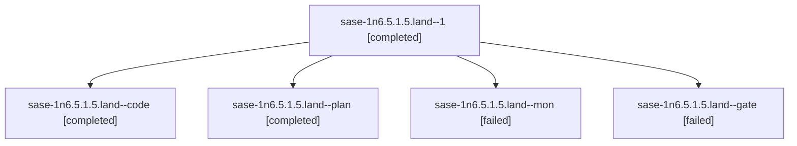

# Session: sase-1n6.5.1.5.land

[Agent Hoods](../README.md) / [bbugyi200](../users/bbugyi200/README.md) / [athena](../users/bbugyi200/machines/athena/README.md) / [sase-1n6](../users/bbugyi200/machines/athena/hoods/sase-1n6/README.md) / sase-1n6.5.1.5.land

Owner: `bbugyi200.athena` · Hood: `sase-1n6` · Members: 5 · Bead: [sase-1n6.5.1.5](https://github.com/sase-org/sase--beads/blob/main/pages/sase-1n6/sase-1n6.5.1.5.md)

## Lineage

The diagram is an optional enhancement; the ordered table below contains the same lineage in accessible text.

| Role | Agent | State | Model / provider | Timing | Commits | Prompt | Chat |
|---|---|---|---|---|---:|---|---|
| 1 | sase-1n6.5.1.5.land--1 | completed | muse-spark-1.3-contributor / muse | 2026-10-25T19:30:12.150809+00:00 → 2026-10-25T19:46:12.299953+00:00 | [1](../agents/bbugyi200.athena.sase-1n6.5.1.5.land--1/README.md#commits) | [Prompt](../agents/bbugyi200.athena.sase-1n6.5.1.5.land--1/prompt.md) | [Chat](../agents/bbugyi200.athena.sase-1n6.5.1.5.land--1/chat.md) |
| code | sase-1n6.5.1.5.land--code | completed | muse-spark-1.3-contributor / muse | 2026-10-25T19:05:31.574147+00:00 → 2026-10-25T19:18:32.744954+00:00 | 0 | — | [Chat](../agents/bbugyi200.athena.sase-1n6.5.1.5.land--code/chat.md) |
| plan | sase-1n6.5.1.5.land--plan | completed | gpt-6-astra / codex | 2026-10-25T18:48:44.539593+00:00 → 2026-10-25T19:18:32.744954+00:00 | 0 | [Prompt](../agents/bbugyi200.athena.sase-1n6.5.1.5.land--plan/prompt.md) | [Chat](../agents/bbugyi200.athena.sase-1n6.5.1.5.land--plan/chat.md) |
| mon | sase-1n6.5.1.5.land--mon | failed | muse-spark-1.3-contributor / muse | 2026-10-25T19:17:43.142875+00:00 → 2026-10-25T19:29:01.751031+00:00 | 0 | — | [Chat](../agents/bbugyi200.athena.sase-1n6.5.1.5.land--mon/chat.md) |
| gate | sase-1n6.5.1.5.land--gate | failed | gpt-6-astra / codex | 2026-10-25T19:04:14.787298+00:00 → 2026-10-25T19:04:58.269791+00:00 | 0 | — | [Chat](../agents/bbugyi200.athena.sase-1n6.5.1.5.land--gate/chat.md) |

## Commits

| Role | Repo | Commit | Subject | Committed |
|---|---|---|---|---|
| 1 | sase | [`5bf39b5`](https://github.com/sase-org/sase/commit/5bf39b5cc61b819781cd1ad7b105ed1496a27f08) | fix(release): delegate metrics inventory to shared qualification validator | 2026-10-25 15:39:49 EDT |

## Neighbors

| Agent | Relation | State |
|---|---|---|
| [sase-1n6.5](bbugyi200.athena.sase-1n6.5.md) (session · 3) | ancestor | failed 3 |
| [sase-1n6.5.1.5.1](../agents/bbugyi200.athena.sase-1n6.5.1.5.1/README.md) | sase-1n6.5.1.5 hood | completed |
| [sase-1n6.5.1.5.2](../agents/bbugyi200.athena.sase-1n6.5.1.5.2/README.md) | sase-1n6.5.1.5 hood | completed |
| [sase-1n6.5.1.5.2.1.1](bbugyi200.athena.sase-1n6.5.1.5.2.1.1.md) (session · 3) | sase-1n6.5.1.5 hood | active 3 |
| [sase-1n6.5.1.5.2.1.2](bbugyi200.athena.sase-1n6.5.1.5.2.1.2.md) (session · 7) | sase-1n6.5.1.5 hood | active 3, completed 2, failed 2 |
| [sase-1n6.5.1.5.2.1.3.1](bbugyi200.athena.sase-1n6.5.1.5.2.1.3.1.md) (session · 3) | sase-1n6.5.1.5 hood | completed 2, failed 1 |
| [sase-1n6.5.1.5.2.1.3.2](bbugyi200.athena.sase-1n6.5.1.5.2.1.3.2.md) (session · 7) | sase-1n6.5.1.5 hood | completed 4, failed 3 |
| [sase-1n6.5.1.5.2.1.3.land](../agents/bbugyi200.athena.sase-1n6.5.1.5.2.1.3.land/README.md) | sase-1n6.5.1.5 hood | completed |
| [sase-1n6.5.1.5.2.1.land](bbugyi200.athena.sase-1n6.5.1.5.2.1.land.md) (session · 3) | sase-1n6.5.1.5 hood | active 3 |
| [sase-1n6.5.1.1](../agents/bbugyi200.athena.sase-1n6.5.1.1/README.md) | sase-1n6.5.1 hood | active |
| [sase-1n6.5.1.2](bbugyi200.athena.sase-1n6.5.1.2.md) (session · 5) | sase-1n6.5.1 hood | active 5 |
| [sase-1n6.5.1.3](../agents/bbugyi200.athena.sase-1n6.5.1.3/README.md) | sase-1n6.5.1 hood | active |
| [sase-1n6.5.1.4](../agents/bbugyi200.athena.sase-1n6.5.1.4/README.md) | sase-1n6.5.1 hood | active |
| [sase-1n6.5.1.land](bbugyi200.athena.sase-1n6.5.1.land.md) (session · 3) | sase-1n6.5.1 hood | active 3 |
| [sase-1n6.1](../agents/bbugyi200.athena.sase-1n6.1/README.md) | sase-1n6 hood | completed |
| [sase-1n6.10](../agents/bbugyi200.athena.sase-1n6.10/README.md) | sase-1n6 hood | waiting |
| [sase-1n6.2](../agents/bbugyi200.athena.sase-1n6.2/README.md) | sase-1n6 hood | completed |
| [sase-1n6.3](../agents/bbugyi200.athena.sase-1n6.3/README.md) | sase-1n6 hood | completed |
| [sase-1n6.4](bbugyi200.athena.sase-1n6.4.md) (session · 3) | sase-1n6 hood | completed 2, failed 1 |
| [sase-1n6.6](bbugyi200.athena.sase-1n6.6.md) (session · 3) | sase-1n6 hood | active 1, completed 1, failed 1 |
| [sase-1n6.7](bbugyi200.athena.sase-1n6.7.md) (session · 3) | sase-1n6 hood | failed 3 |
| [sase-1n6.7.1.1](../agents/bbugyi200.athena.sase-1n6.7.1.1/README.md) | sase-1n6 hood | active |
| [sase-1n6.7.1.2](bbugyi200.athena.sase-1n6.7.1.2.md) (session · 5) | sase-1n6 hood | active 5 |
| [sase-1n6.7.1.3](../agents/bbugyi200.athena.sase-1n6.7.1.3/README.md) | sase-1n6 hood | active |
| [sase-1n6.7.1.4](bbugyi200.athena.sase-1n6.7.1.4.md) (session · 3) | sase-1n6 hood | active 3 |
| [sase-1n6.7.1.5](bbugyi200.athena.sase-1n6.7.1.5.md) (session · 3) | sase-1n6 hood | active 3 |
| [sase-1n6.7.1.land](bbugyi200.athena.sase-1n6.7.1.land.md) (session · 15) | sase-1n6 hood | active 13, completed 1, failed 1 |
| [sase-1n6.8](../agents/bbugyi200.athena.sase-1n6.8/README.md) | sase-1n6 hood | completed |
| [sase-1n6.9](../agents/bbugyi200.athena.sase-1n6.9/README.md) | sase-1n6 hood | waiting |
| [sase-1n6.land](../agents/bbugyi200.athena.sase-1n6.land/README.md) | sase-1n6 hood | waiting |
