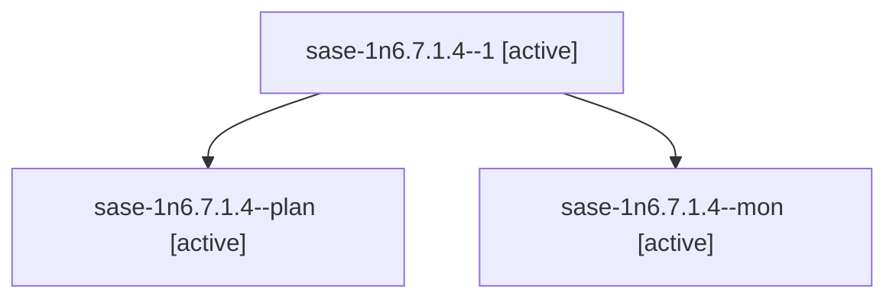

# Session: sase-1n6.7.1.4

[Agent Hoods](../README.md) / [bbugyi200](../users/bbugyi200/README.md) / [athena](../users/bbugyi200/machines/athena/README.md) / [sase-1n6](../users/bbugyi200/machines/athena/hoods/sase-1n6/README.md) / sase-1n6.7.1.4

Owner: `bbugyi200.athena` · Hood: `sase-1n6` · Members: 3 · Bead: [sase-1n6.7.1.4](https://github.com/sase-org/sase--beads/blob/main/pages/sase-1n6/sase-1n6.7.1.4.md)

## Lineage

The diagram is an optional enhancement; the ordered table below contains the same lineage in accessible text.

| Role | Agent | State | Model / provider | Timing | Commits | Prompt | Chat |
|---|---|---|---|---|---:|---|---|
| 1 | sase-1n6.7.1.4--1 | active | gpt-6-luna / codex | 2026-10-20T04:35:49.219674+00:00 | [1](../agents/bbugyi200.athena.sase-1n6.7.1.4--1/README.md#commits) | [Prompt](../agents/bbugyi200.athena.sase-1n6.7.1.4--1/prompt.md) | [Chat](../agents/bbugyi200.athena.sase-1n6.7.1.4--1/chat.md) |
| plan | sase-1n6.7.1.4--plan | active | gpt-6-luna / codex | 2026-10-20T04:13:41.764887+00:00 | 0 | [Prompt](../agents/bbugyi200.athena.sase-1n6.7.1.4--plan/prompt.md) | [Chat](../agents/bbugyi200.athena.sase-1n6.7.1.4--plan/chat.md) |
| mon | sase-1n6.7.1.4--mon | active | gpt-6-luna / codex | 2026-10-20T04:30:41.197536+00:00 | 0 | — | [Chat](../agents/bbugyi200.athena.sase-1n6.7.1.4--mon/chat.md) |

## Commits

| Role | Repo | Commit | Subject | Committed |
|---|---|---|---|---|
| 1 | sase | [`dab5776`](https://github.com/sase-org/sase/commit/dab57765835ea8f61dfe1143570ce5a0bb0c2235) | feat(release-watch): add restart-safe actions and issue sinks | 2026-10-20 00:49:28 EDT |

## Neighbors

| Agent | Relation | State |
|---|---|---|
| [sase-1n6.7](bbugyi200.athena.sase-1n6.7.md) (session · 3) | ancestor | failed 3 |
| [sase-1n6.7.1.1](../agents/bbugyi200.athena.sase-1n6.7.1.1/README.md) | sase-1n6.7.1 hood | active |
| [sase-1n6.7.1.2](bbugyi200.athena.sase-1n6.7.1.2.md) (session · 5) | sase-1n6.7.1 hood | active 5 |
| [sase-1n6.7.1.3](../agents/bbugyi200.athena.sase-1n6.7.1.3/README.md) | sase-1n6.7.1 hood | active |
| [sase-1n6.7.1.5](bbugyi200.athena.sase-1n6.7.1.5.md) (session · 3) | sase-1n6.7.1 hood | active 3 |
| [sase-1n6.7.1.land](bbugyi200.athena.sase-1n6.7.1.land.md) (session · 15) | sase-1n6.7.1 hood | active 13, completed 1, failed 1 |
| [sase-1n6.1](../agents/bbugyi200.athena.sase-1n6.1/README.md) | sase-1n6 hood | completed |
| [sase-1n6.10](../agents/bbugyi200.athena.sase-1n6.10/README.md) | sase-1n6 hood | waiting |
| [sase-1n6.2](../agents/bbugyi200.athena.sase-1n6.2/README.md) | sase-1n6 hood | completed |
| [sase-1n6.3](../agents/bbugyi200.athena.sase-1n6.3/README.md) | sase-1n6 hood | completed |
| [sase-1n6.4](bbugyi200.athena.sase-1n6.4.md) (session · 3) | sase-1n6 hood | completed 2, failed 1 |
| [sase-1n6.5](bbugyi200.athena.sase-1n6.5.md) (session · 3) | sase-1n6 hood | failed 3 |
| [sase-1n6.5.1.1](../agents/bbugyi200.athena.sase-1n6.5.1.1/README.md) | sase-1n6 hood | active |
| [sase-1n6.5.1.2](bbugyi200.athena.sase-1n6.5.1.2.md) (session · 5) | sase-1n6 hood | active 5 |
| [sase-1n6.5.1.3](../agents/bbugyi200.athena.sase-1n6.5.1.3/README.md) | sase-1n6 hood | active |
| [sase-1n6.5.1.4](../agents/bbugyi200.athena.sase-1n6.5.1.4/README.md) | sase-1n6 hood | active |
| [sase-1n6.5.1.5.1](../agents/bbugyi200.athena.sase-1n6.5.1.5.1/README.md) | sase-1n6 hood | completed |
| [sase-1n6.5.1.5.2](../agents/bbugyi200.athena.sase-1n6.5.1.5.2/README.md) | sase-1n6 hood | completed |
| [sase-1n6.5.1.5.2.1.1](bbugyi200.athena.sase-1n6.5.1.5.2.1.1.md) (session · 3) | sase-1n6 hood | completed 2, failed 1 |
| [sase-1n6.5.1.5.2.1.2](bbugyi200.athena.sase-1n6.5.1.5.2.1.2.md) (session · 7) | sase-1n6 hood | completed 4, failed 3 |
| [sase-1n6.5.1.5.2.1.land](../agents/bbugyi200.athena.sase-1n6.5.1.5.2.1.land/README.md) | sase-1n6 hood | waiting |
| [sase-1n6.5.1.5.land](../agents/bbugyi200.athena.sase-1n6.5.1.5.land/README.md) | sase-1n6 hood | waiting |
| [sase-1n6.5.1.land](bbugyi200.athena.sase-1n6.5.1.land.md) (session · 3) | sase-1n6 hood | active 3 |
| [sase-1n6.6](../agents/bbugyi200.athena.sase-1n6.6/README.md) | sase-1n6 hood | waiting |
| [sase-1n6.8](../agents/bbugyi200.athena.sase-1n6.8/README.md) | sase-1n6 hood | completed |
| [sase-1n6.9](../agents/bbugyi200.athena.sase-1n6.9/README.md) | sase-1n6 hood | waiting |
| [sase-1n6.land](../agents/bbugyi200.athena.sase-1n6.land/README.md) | sase-1n6 hood | waiting |
