# Session: sase-1n6.7.1.land

[Agent Hoods](../README.md) / [bbugyi200](../users/bbugyi200/README.md) / [athena](../users/bbugyi200/machines/athena/README.md) / [sase-1n6](../users/bbugyi200/machines/athena/hoods/sase-1n6/README.md) / sase-1n6.7.1.land

Owner: `bbugyi200.athena` · Hood: `sase-1n6` · Members: 15 · Bead: [sase-1n6.7.1](https://github.com/sase-org/sase--beads/blob/main/pages/sase-1n6/sase-1n6.7.1.md)

## Lineage

```mermaid
flowchart TD
  n0["sase-1n6.7.1.land--6 [dismissed]"]
  n1["sase-1n6.7.1.land--2 [dismissed]"]
  n0 --> n1
  n2["sase-1n6.7.1.land--1 [dismissed]"]
  n0 --> n2
  n3["sase-1n6.7.1.land--gate [dismissed]"]
  n0 --> n3
  n4["sase-1n6.7.1.land--mon-4 [dismissed]"]
  n0 --> n4
  n5["sase-1n6.7.1.land--mon-3 [dismissed]"]
  n0 --> n5
  n6["sase-1n6.7.1.land--5 [dismissed]"]
  n0 --> n6
  n7["sase-1n6.7.1.land--mon-0 [dismissed]"]
  n0 --> n7
  n8["sase-1n6.7.1.land--3 [dismissed]"]
  n0 --> n8
  n9["sase-1n6.7.1.land--mon-1 [dismissed]"]
  n0 --> n9
  n10["sase-1n6.7.1.land--plan [dismissed]"]
  n0 --> n10
  n11["sase-1n6.7.1.land--code [completed]"]
  n0 --> n11
  n12["sase-1n6.7.1.land--4 [dismissed]"]
  n0 --> n12
  n13["sase-1n6.7.1.land--mon-2 [dismissed]"]
  n0 --> n13
  n14["sase-1n6.7.1.land--mon [failed]"]
  n0 --> n14
```



The diagram is an optional enhancement; the ordered table below contains the same lineage in accessible text.

| Role | Agent | State | Model / provider | Timing | Commits | Prompt | Chat |
|---|---|---|---|---|---:|---|---|
| <a id="member-6"></a>6 | sase-1n6.7.1.land--6 | dismissed | gpt-6-luna / codex | 2026-10-20T11:43:25.622115 → 2026-10-20T11:55:19.401382 | 0 | [Prompt](../agents/bbugyi200.athena.sase-1n6.7.1.land--6/prompt.md) | [Chat](../agents/bbugyi200.athena.sase-1n6.7.1.land--6/chat.md) |
| <a id="member-2"></a>2 | sase-1n6.7.1.land--2 | dismissed | gpt-6-luna / codex | 2026-10-20T02:53:22.609035 → 2026-10-20T03:36:17.495569 | 0 | [Prompt](../agents/bbugyi200.athena.sase-1n6.7.1.land--2/prompt.md) | [Chat](../agents/bbugyi200.athena.sase-1n6.7.1.land--2/chat.md) |
| <a id="member-1"></a>1 | sase-1n6.7.1.land--1 | dismissed | gpt-6-luna / codex | 2026-10-20T02:37:41.366219 → 2026-10-20T02:42:18.301355 | 0 | [Prompt](../agents/bbugyi200.athena.sase-1n6.7.1.land--1/prompt.md) | [Chat](../agents/bbugyi200.athena.sase-1n6.7.1.land--1/chat.md) |
| <a id="member-gate"></a>gate | sase-1n6.7.1.land--gate | dismissed | opus / claude | 2026-10-20T02:04:55.196921 → 2026-10-20T02:05:23 | 0 | — | [Chat](../agents/bbugyi200.athena.sase-1n6.7.1.land--gate/chat.md) |
| <a id="member-mon-4"></a>mon-4 | sase-1n6.7.1.land--mon-4 | dismissed | gpt-6-luna / codex | 2026-10-20T04:50:42.884359 → 2026-10-20T11:41:10.491908 | 0 | — | [Chat](../agents/bbugyi200.athena.sase-1n6.7.1.land--mon-4/chat.md) |
| <a id="member-mon-3"></a>mon-3 | sase-1n6.7.1.land--mon-3 | dismissed | gpt-6-luna / codex | 2026-10-20T04:19:24.604100 → 2026-10-20T04:35:12.056562 | 0 | — | [Chat](../agents/bbugyi200.athena.sase-1n6.7.1.land--mon-3/chat.md) |
| <a id="member-5"></a>5 | sase-1n6.7.1.land--5 | dismissed | gpt-6-luna / codex | 2026-10-20T04:37:44.810072 → 2026-10-20T04:51:18.835125 | 0 | [Prompt](../agents/bbugyi200.athena.sase-1n6.7.1.land--5/prompt.md) | [Chat](../agents/bbugyi200.athena.sase-1n6.7.1.land--5/chat.md) |
| <a id="member-mon-0"></a>mon-0 | sase-1n6.7.1.land--mon-0 | dismissed | gpt-6-luna / codex | 2026-10-20T02:41:47.383293 → 2026-10-20T02:51:09.680094 | 0 | — | [Chat](../agents/bbugyi200.athena.sase-1n6.7.1.land--mon-0/chat.md) |
| <a id="member-3"></a>3 | sase-1n6.7.1.land--3 | dismissed | gpt-6-luna / codex | 2026-10-20T03:53:47.297023 → 2026-10-20T03:58:56.690661 | 0 | [Prompt](../agents/bbugyi200.athena.sase-1n6.7.1.land--3/prompt.md) | [Chat](../agents/bbugyi200.athena.sase-1n6.7.1.land--3/chat.md) |
| <a id="member-mon-1"></a>mon-1 | sase-1n6.7.1.land--mon-1 | dismissed | gpt-6-luna / codex | 2026-10-20T03:35:38.693205 → 2026-10-20T03:51:28.940131 | 0 | — | [Chat](../agents/bbugyi200.athena.sase-1n6.7.1.land--mon-1/chat.md) |
| <a id="member-plan"></a>plan | sase-1n6.7.1.land--plan | dismissed | opus / claude | 2026-10-20T01:42:39.466273 → 2026-10-20T02:35:03.594755 | 0 | [Prompt](../agents/bbugyi200.athena.sase-1n6.7.1.land--plan/prompt.md) | [Chat](../agents/bbugyi200.athena.sase-1n6.7.1.land--plan/chat.md) |
| <a id="member-code"></a>code | sase-1n6.7.1.land--code | completed | gpt-6-luna / codex | 2026-10-20T06:06:01.980736+00:00 → 2026-10-20T06:35:03.538350+00:00 | 0 | — | [Chat](../agents/bbugyi200.athena.sase-1n6.7.1.land--code/chat.md) |
| <a id="member-4"></a>4 | sase-1n6.7.1.land--4 | dismissed | gpt-6-luna / codex | 2026-10-20T04:13:31.074860 → 2026-10-20T04:19:59.972901 | 0 | [Prompt](../agents/bbugyi200.athena.sase-1n6.7.1.land--4/prompt.md) | [Chat](../agents/bbugyi200.athena.sase-1n6.7.1.land--4/chat.md) |
| <a id="member-mon-2"></a>mon-2 | sase-1n6.7.1.land--mon-2 | dismissed | gpt-6-luna / codex | 2026-10-20T03:58:09.325772 → 2026-10-20T04:11:01.958104 | 0 | — | [Chat](../agents/bbugyi200.athena.sase-1n6.7.1.land--mon-2/chat.md) |
| <a id="member-mon"></a>mon | sase-1n6.7.1.land--mon | failed | gpt-6-luna / codex | 2026-10-20T06:34:24.461352+00:00 → 2026-10-20T06:36:52.187757+00:00 | 0 | — | [Chat](../agents/bbugyi200.athena.sase-1n6.7.1.land--mon/chat.md) |

## Variables

| Role | Variable | Value |
|---|---|---|
| 5 | `artifacts` | \[{bead: sase-1n6.7.1, kind: file, label: Release steward live read-only observe result, path: /home/bryan/.sase/artifacts/agents/gh\_sase-org\_\_sase/20261020043555/release-steward-once-record-5c082be8d… |

#### artifacts

**Role:** `5`

```yaml
- bead: sase-1n6.7.1
  kind: file
  label: Release steward live read-only observe result
  path: /home/bryan/.sase/artifacts/agents/gh_sase-org__sase/20261020043555/release-steward-once-record-5c082be8dce2.json
  ref: file:explicit:fb884a84728efd9ed363ab97
  source_path: /tmp/release-steward-once-record.json
```

Values are truncated for display; see each member's agent meta.json for the full values.

## Neighbors

| Agent | Relation | State |
|---|---|---|
| [sase-1n6.7](bbugyi200.athena.sase-1n6.7.md) (session · 3) | ancestor | failed 3 |
| [sase-1n6.7.1.1](../agents/bbugyi200.athena.sase-1n6.7.1.1/README.md) | sase-1n6.7.1 hood | dismissed |
| [sase-1n6.7.1.2](bbugyi200.athena.sase-1n6.7.1.2.md) (session · 5) | sase-1n6.7.1 hood | dismissed 5 |
| [sase-1n6.7.1.3](../agents/bbugyi200.athena.sase-1n6.7.1.3/README.md) | sase-1n6.7.1 hood | dismissed |
| [sase-1n6.7.1.4](bbugyi200.athena.sase-1n6.7.1.4.md) (session · 3) | sase-1n6.7.1 hood | dismissed 3 |
| [sase-1n6.7.1.5](bbugyi200.athena.sase-1n6.7.1.5.md) (session · 3) | sase-1n6.7.1 hood | dismissed 3 |
| [sase-1n6.1](../agents/bbugyi200.athena.sase-1n6.1/README.md) | sase-1n6 hood | completed |
| [sase-1n6.10](bbugyi200.athena.sase-1n6.10.md) (session · 2) | sase-1n6 hood | completed 1, stopped 1 |
| [sase-1n6.10](../agents/bbugyi200.athena.sase-1n6.10/README.md) | sase-1n6 hood | waiting |
| [sase-1n6.10.f0](../agents/bbugyi200.athena.sase-1n6.10.f0/README.md) | sase-1n6 hood | dismissed |
| [sase-1n6.11.1](bbugyi200.athena.sase-1n6.11.1.md) (session · 5) | sase-1n6 hood | completed 5 |
| [sase-1n6.11.2](../agents/bbugyi200.athena.sase-1n6.11.2/README.md) | sase-1n6 hood | completed |
| [sase-1n6.11.3](bbugyi200.athena.sase-1n6.11.3.md) (session · 3) | sase-1n6 hood | completed 3 |
| [sase-1n6.11.4](../agents/bbugyi200.athena.sase-1n6.11.4/README.md) | sase-1n6 hood | waiting |
| [sase-1n6.11.land](../agents/bbugyi200.athena.sase-1n6.11.land/README.md) | sase-1n6 hood | waiting |
| [sase-1n6.2](../agents/bbugyi200.athena.sase-1n6.2/README.md) | sase-1n6 hood | completed |
| [sase-1n6.3](../agents/bbugyi200.athena.sase-1n6.3/README.md) | sase-1n6 hood | completed |
| [sase-1n6.4](bbugyi200.athena.sase-1n6.4.md) (session · 3) | sase-1n6 hood | completed 2, failed 1 |
| [sase-1n6.5](bbugyi200.athena.sase-1n6.5.md) (session · 3) | sase-1n6 hood | failed 3 |
| [sase-1n6.5.1.1](../agents/bbugyi200.athena.sase-1n6.5.1.1/README.md) | sase-1n6 hood | dismissed |
| [sase-1n6.5.1.2](bbugyi200.athena.sase-1n6.5.1.2.md) (session · 5) | sase-1n6 hood | dismissed 5 |
| [sase-1n6.5.1.3](../agents/bbugyi200.athena.sase-1n6.5.1.3/README.md) | sase-1n6 hood | dismissed |
| [sase-1n6.5.1.4](../agents/bbugyi200.athena.sase-1n6.5.1.4/README.md) | sase-1n6 hood | dismissed |
| [sase-1n6.5.1.5.1](../agents/bbugyi200.athena.sase-1n6.5.1.5.1/README.md) | sase-1n6 hood | completed |
| [sase-1n6.5.1.5.2](../agents/bbugyi200.athena.sase-1n6.5.1.5.2/README.md) | sase-1n6 hood | completed |
| [sase-1n6.5.1.5.2.1.1](bbugyi200.athena.sase-1n6.5.1.5.2.1.1.md) (session · 3) | sase-1n6 hood | dismissed 3 |
| [sase-1n6.5.1.5.2.1.2](bbugyi200.athena.sase-1n6.5.1.5.2.1.2.md) (session · 7) | sase-1n6 hood | completed 2, dismissed 3, failed 2 |
| [sase-1n6.5.1.5.2.1.3.1](bbugyi200.athena.sase-1n6.5.1.5.2.1.3.1.md) (session · 3) | sase-1n6 hood | completed 2, failed 1 |
| [sase-1n6.5.1.5.2.1.3.2](bbugyi200.athena.sase-1n6.5.1.5.2.1.3.2.md) (session · 7) | sase-1n6 hood | completed 4, failed 3 |
| [sase-1n6.5.1.5.2.1.3.land](../agents/bbugyi200.athena.sase-1n6.5.1.5.2.1.3.land/README.md) | sase-1n6 hood | completed |
| [sase-1n6.5.1.5.2.1.land](bbugyi200.athena.sase-1n6.5.1.5.2.1.land.md) (session · 3) | sase-1n6 hood | dismissed 3 |
| [sase-1n6.5.1.5.land](bbugyi200.athena.sase-1n6.5.1.5.land.md) (session · 5) | sase-1n6 hood | completed 3, failed 2 |
| [sase-1n6.5.1.land](bbugyi200.athena.sase-1n6.5.1.land.md) (session · 3) | sase-1n6 hood | dismissed 3 |
| [sase-1n6.6](bbugyi200.athena.sase-1n6.6.md) (session · 3) | sase-1n6 hood | completed 2, failed 1 |
| [sase-1n6.8](../agents/bbugyi200.athena.sase-1n6.8/README.md) | sase-1n6 hood | completed |
| [sase-1n6.9](../agents/bbugyi200.athena.sase-1n6.9/README.md) | sase-1n6 hood | completed |
| [sase-1n6.land](bbugyi200.athena.sase-1n6.land.md) (session · 3) | sase-1n6 hood | active 1, completed 2 |
| [sase-1n6.land](../agents/bbugyi200.athena.sase-1n6.land/README.md) | sase-1n6 hood | waiting |
