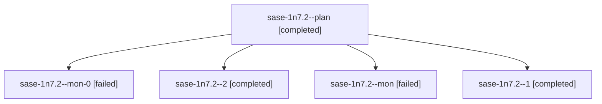

# Session: sase-1n7.2

[Agent Hoods](../README.md) / [bbugyi200](../users/bbugyi200/README.md) / [athena](../users/bbugyi200/machines/athena/README.md) / [sase-1n7](../users/bbugyi200/machines/athena/hoods/sase-1n7/README.md) / sase-1n7.2

Owner: `bbugyi200.athena` · Hood: `sase-1n7` · Members: 5 · Bead: [sase-1n7.2](https://github.com/sase-org/sase--beads/blob/main/pages/sase-1n7/sase-1n7.2.md)

## Lineage

The diagram is an optional enhancement; the ordered table below contains the same lineage in accessible text.

| Role | Agent | State | Model / provider | Timing | Commits | Prompt | Chat |
|---|---|---|---|---|---:|---|---|
| plan | sase-1n7.2--plan | completed | gpt-6-luna / codex | 2026-10-19T23:31:48.736583+00:00 → 2026-10-19T23:43:25.927734+00:00 | 0 | [Prompt](../agents/bbugyi200.athena.sase-1n7.2--plan/prompt.md) | [Chat](../agents/bbugyi200.athena.sase-1n7.2--plan/chat.md) |
| mon-0 | sase-1n7.2--mon-0 | failed | gpt-6-luna / codex | 2026-10-20T00:14:54.662116+00:00 → 2026-10-20T00:36:56.936812+00:00 | 0 | — | [Chat](../agents/bbugyi200.athena.sase-1n7.2--mon-0/chat.md) |
| 2 | sase-1n7.2--2 | completed | gpt-6-luna / codex | 2026-10-20T00:37:53.128149+00:00 → 2026-10-20T00:53:46.572094+00:00 | [1](../agents/bbugyi200.athena.sase-1n7.2--2/README.md#commits) | [Prompt](../agents/bbugyi200.athena.sase-1n7.2--2/prompt.md) | [Chat](../agents/bbugyi200.athena.sase-1n7.2--2/chat.md) |
| mon | sase-1n7.2--mon | failed | gpt-6-luna / codex | 2026-10-19T23:41:48.241647+00:00 → 2026-10-19T23:45:48.863453+00:00 | 0 | — | [Chat](../agents/bbugyi200.athena.sase-1n7.2--mon/chat.md) |
| 1 | sase-1n7.2--1 | completed | gpt-6-luna / codex | 2026-10-19T23:46:47.706707+00:00 → 2026-10-20T00:15:41.205517+00:00 | 0 | [Prompt](../agents/bbugyi200.athena.sase-1n7.2--1/prompt.md) | [Chat](../agents/bbugyi200.athena.sase-1n7.2--1/chat.md) |

## Commits

| Role | Repo | Commit | Subject | Committed |
|---|---|---|---|---|
| 2 | sase | [`798e786`](https://github.com/sase-org/sase/commit/798e786c88c01c265748f294cc7af700d0099b3f) | feat(ace): add Agents deck view lock toggle | 2026-10-19 20:48:05 EDT |

## Neighbors

| Agent | Relation | State |
|---|---|---|
| [sase-1n7.1](../agents/bbugyi200.athena.sase-1n7.1/README.md) | sase-1n7 hood | completed |
| [sase-1n7.3](../agents/bbugyi200.athena.sase-1n7.3/README.md) | sase-1n7 hood | completed |
| [sase-1n7.4](bbugyi200.athena.sase-1n7.4.md) (session · 3) | sase-1n7 hood | completed 2, failed 1 |
| [sase-1n7.land](../agents/bbugyi200.athena.sase-1n7.land/README.md) | sase-1n7 hood | waiting |
