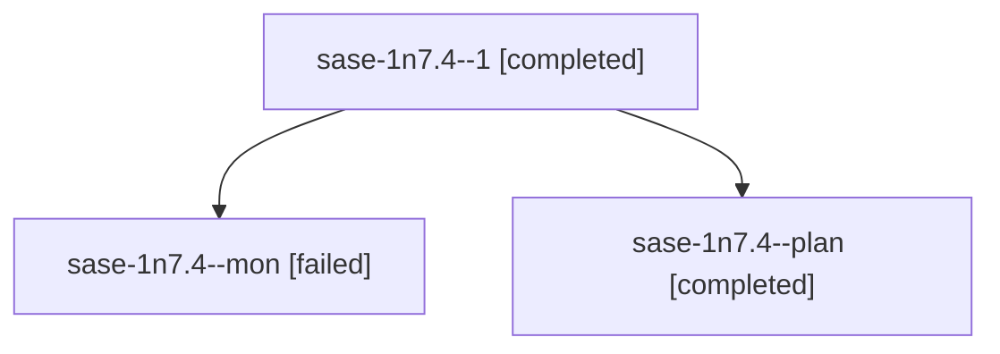

# Session: sase-1n7.4

[Agent Hoods](../README.md) / [bbugyi200](../users/bbugyi200/README.md) / [athena](../users/bbugyi200/machines/athena/README.md) / [sase-1n7](../users/bbugyi200/machines/athena/hoods/sase-1n7/README.md) / sase-1n7.4

Owner: `bbugyi200.athena` · Hood: `sase-1n7` · Members: 3 · Bead: [sase-1n7.4](https://github.com/sase-org/sase--beads/blob/main/pages/sase-1n7/sase-1n7.4.md)

## Lineage

The diagram is an optional enhancement; the ordered table below contains the same lineage in accessible text.

| Role | Agent | State | Model / provider | Timing | Commits | Prompt | Chat |
|---|---|---|---|---|---:|---|---|
| 1 | sase-1n7.4--1 | completed | grok-4.6 / grok | 2026-10-20T11:22:15.884853+00:00 → 2026-10-20T11:27:30.959196+00:00 | 0 | [Prompt](../agents/bbugyi200.athena.sase-1n7.4--1/prompt.md) | [Chat](../agents/bbugyi200.athena.sase-1n7.4--1/chat.md) |
| mon | sase-1n7.4--mon | failed | grok-4.6 / grok | 2026-10-20T11:00:40.822592+00:00 → 2026-10-20T11:13:32.756686+00:00 | [1](../agents/bbugyi200.athena.sase-1n7.4--mon/README.md#commits) | — | [Chat](../agents/bbugyi200.athena.sase-1n7.4--mon/chat.md) |
| plan | sase-1n7.4--plan | completed | grok-4.6 / grok | 2026-10-20T10:46:44.208922+00:00 → 2026-10-20T11:01:22.372210+00:00 | 0 | [Prompt](../agents/bbugyi200.athena.sase-1n7.4--plan/prompt.md) | [Chat](../agents/bbugyi200.athena.sase-1n7.4--plan/chat.md) |

## Commits

| Role | Repo | Commit | Subject | Committed |
|---|---|---|---|---|
| mon | sase | [`3dbe570`](https://github.com/sase-org/sase/commit/3dbe5704627fc397dee88b7e9ff9c630929237c4) | docs(tui): document tabs-mean-pages deck chrome and lock vocabulary | 2026-10-20 07:09:04 EDT |

## Neighbors

| Agent | Relation | State |
|---|---|---|
| [sase-1n7.1](../agents/bbugyi200.athena.sase-1n7.1/README.md) | sase-1n7 hood | completed |
| [sase-1n7.2](bbugyi200.athena.sase-1n7.2.md) (session · 5) | sase-1n7 hood | completed 3, failed 2 |
| [sase-1n7.3](../agents/bbugyi200.athena.sase-1n7.3/README.md) | sase-1n7 hood | completed |
| [sase-1n7.land](../agents/bbugyi200.athena.sase-1n7.land/README.md) | sase-1n7 hood | waiting |
