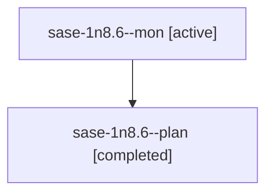

# Session: sase-1n8.6

[Agent Hoods](../README.md) / [bbugyi200](../users/bbugyi200/README.md) / [athena](../users/bbugyi200/machines/athena/README.md) / [sase-1n8](../users/bbugyi200/machines/athena/hoods/sase-1n8/README.md) / sase-1n8.6

Owner: `bbugyi200.athena` · Hood: `sase-1n8` · Members: 2 · Bead: [sase-1n8.6](https://github.com/sase-org/sase--beads/blob/main/pages/sase-1n8/sase-1n8.6.md)

## Lineage

The diagram is an optional enhancement; the ordered table below contains the same lineage in accessible text.

| Role | Agent | State | Model / provider | Timing | Commits | Prompt | Chat |
|---|---|---|---|---|---:|---|---|
| mon | sase-1n8.6--mon | active | grok-4.6 / grok | 2026-10-20T11:32:53.884484+00:00 | 0 | — | — |
| plan | sase-1n8.6--plan | completed | grok-4.6 / grok | 2026-10-20T11:17:44.229759+00:00 → 2026-10-20T11:35:02.299914+00:00 | 0 | [Prompt](../agents/bbugyi200.athena.sase-1n8.6--plan/prompt.md) | [Chat](../agents/bbugyi200.athena.sase-1n8.6--plan/chat.md) |

## Neighbors

| Agent | Relation | State |
|---|---|---|
| [sase-1n8.1](../agents/bbugyi200.athena.sase-1n8.1/README.md) | sase-1n8 hood | active |
| [sase-1n8.2](../agents/bbugyi200.athena.sase-1n8.2/README.md) | sase-1n8 hood | waiting |
| [sase-1n8.3](../agents/bbugyi200.athena.sase-1n8.3/README.md) | sase-1n8 hood | active |
| [sase-1n8.4](bbugyi200.athena.sase-1n8.4.md) (session · 2) | sase-1n8 hood | active 1, completed 1 |
| [sase-1n8.5](../agents/bbugyi200.athena.sase-1n8.5/README.md) | sase-1n8 hood | active |
| [sase-1n8.land](../agents/bbugyi200.athena.sase-1n8.land/README.md) | sase-1n8 hood | waiting |
