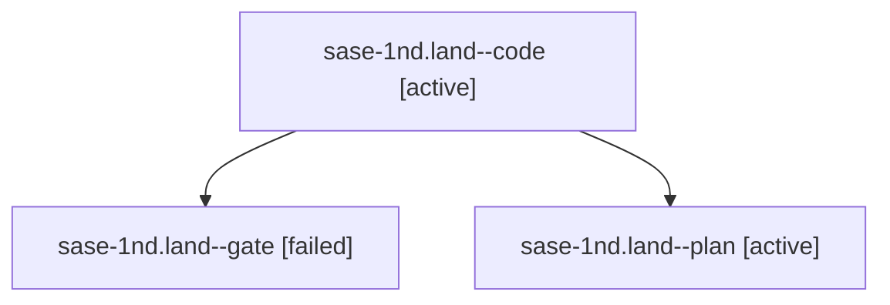

# Session: sase-1nd.land

[Agent Hoods](../README.md) / [bbugyi200](../users/bbugyi200/README.md) / [athena](../users/bbugyi200/machines/athena/README.md) / [sase-1nd](../users/bbugyi200/machines/athena/hoods/sase-1nd/README.md) / sase-1nd.land

Owner: `bbugyi200.athena` · Hood: `sase-1nd` · Members: 3 · Bead: [sase-1nd](https://github.com/sase-org/sase--beads/blob/main/pages/sase-1nd/README.md)

## Lineage

The diagram is an optional enhancement; the ordered table below contains the same lineage in accessible text.

| Role | Agent | State | Model / provider | Timing | Commits | Prompt | Chat |
|---|---|---|---|---|---:|---|---|
| code | sase-1nd.land--code | active | gpt-6-luna / codex | 2026-10-20T17:31:51.146675+00:00 | 0 | — | — |
| gate | sase-1nd.land--gate | failed | gpt-6-astra / codex | 2026-10-20T17:30:35.302693+00:00 → 2026-10-20T17:31:06.513100+00:00 | 0 | — | [Chat](../agents/bbugyi200.athena.sase-1nd.land--gate/chat.md) |
| plan | sase-1nd.land--plan | active | gpt-6-astra / codex | 2026-10-20T17:17:50.258743+00:00 | 0 | [Prompt](../agents/bbugyi200.athena.sase-1nd.land--plan/prompt.md) | [Chat](../agents/bbugyi200.athena.sase-1nd.land--plan/chat.md) |

## Neighbors

| Agent | Relation | State |
|---|---|---|
| [sase-1nd.1](../agents/bbugyi200.athena.sase-1nd.1/README.md) | sase-1nd hood | completed |
| [sase-1nd.2](../agents/bbugyi200.athena.sase-1nd.2/README.md) | sase-1nd hood | completed |
