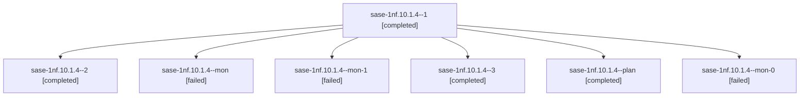

# Session: sase-1nf.10.1.4

[Agent Hoods](../README.md) / [bbugyi200](../users/bbugyi200/README.md) / [athena](../users/bbugyi200/machines/athena/README.md) / [sase-1nf](../users/bbugyi200/machines/athena/hoods/sase-1nf/README.md) / sase-1nf.10.1.4

Owner: `bbugyi200.athena` · Hood: `sase-1nf` · Members: 7 · Bead: [sase-1nf.10.1.4](https://github.com/sase-org/sase--beads/blob/main/pages/sase-1nf/sase-1nf.10.1.4.md)

## Lineage

The diagram is an optional enhancement; the ordered table below contains the same lineage in accessible text.

| Role | Agent | State | Model / provider | Timing | Commits | Prompt | Chat |
|---|---|---|---|---|---:|---|---|
| 1 | sase-1nf.10.1.4--1 | completed | grok-4.6 / grok | 2026-10-21T00:36:29.598976+00:00 → 2026-10-21T00:41:45.069933+00:00 | 0 | [Prompt](../agents/bbugyi200.athena.sase-1nf.10.1.4--1/prompt.md) | [Chat](../agents/bbugyi200.athena.sase-1nf.10.1.4--1/chat.md) |
| 2 | sase-1nf.10.1.4--2 | completed | grok-4.6 / grok | 2026-10-21T01:06:00.617674+00:00 → 2026-10-21T01:21:36.460742+00:00 | 0 | [Prompt](../agents/bbugyi200.athena.sase-1nf.10.1.4--2/prompt.md) | [Chat](../agents/bbugyi200.athena.sase-1nf.10.1.4--2/chat.md) |
| mon | sase-1nf.10.1.4--mon | failed | grok-4.6 / grok | 2026-10-21T00:11:34.006207+00:00 → 2026-10-21T00:34:54.064238+00:00 | 0 | — | [Chat](../agents/bbugyi200.athena.sase-1nf.10.1.4--mon/chat.md) |
| mon-1 | sase-1nf.10.1.4--mon-1 | failed | grok-4.6 / grok | 2026-10-21T01:21:03.193030+00:00 → 2026-10-21T01:31:41.315590+00:00 | 0 | — | [Chat](../agents/bbugyi200.athena.sase-1nf.10.1.4--mon-1/chat.md) |
| 3 | sase-1nf.10.1.4--3 | completed | grok-4.6 / grok | 2026-10-21T01:32:56.538363+00:00 → 2026-10-21T01:41:07.503866+00:00 | [1](../agents/bbugyi200.athena.sase-1nf.10.1.4--3/README.md#commits) | [Prompt](../agents/bbugyi200.athena.sase-1nf.10.1.4--3/prompt.md) | [Chat](../agents/bbugyi200.athena.sase-1nf.10.1.4--3/chat.md) |
| plan | sase-1nf.10.1.4--plan | completed | grok-4.6 / grok | 2026-10-20T23:50:42.373495+00:00 → 2026-10-21T00:12:04.563863+00:00 | 0 | [Prompt](../agents/bbugyi200.athena.sase-1nf.10.1.4--plan/prompt.md) | [Chat](../agents/bbugyi200.athena.sase-1nf.10.1.4--plan/chat.md) |
| mon-0 | sase-1nf.10.1.4--mon-0 | failed | grok-4.6 / grok | 2026-10-21T00:41:04.033493+00:00 → 2026-10-21T01:04:21.001054+00:00 | 0 | — | [Chat](../agents/bbugyi200.athena.sase-1nf.10.1.4--mon-0/chat.md) |

## Commits

| Role | Repo | Commit | Subject | Committed |
|---|---|---|---|---|
| 3 | sase | [`1f107c4`](https://github.com/sase-org/sase/commit/1f107c4a891953fc02c2276e1ae27c18002d5a61) | feat(agents-sync): scope inventory hydration to requested hoods | 2026-10-20 21:36:29 EDT |

## Neighbors

| Agent | Relation | State |
|---|---|---|
| [sase-1nf.10](bbugyi200.athena.sase-1nf.10.md) (session · 3) | ancestor | failed 3 |
| [sase-1nf.10.1.1](../agents/bbugyi200.athena.sase-1nf.10.1.1/README.md) | sase-1nf.10.1 hood | completed |
| [sase-1nf.10.1.2](../agents/bbugyi200.athena.sase-1nf.10.1.2/README.md) | sase-1nf.10.1 hood | completed |
| [sase-1nf.10.1.3](../agents/bbugyi200.athena.sase-1nf.10.1.3/README.md) | sase-1nf.10.1 hood | completed |
| [sase-1nf.10.1.5](../agents/bbugyi200.athena.sase-1nf.10.1.5/README.md) | sase-1nf.10.1 hood | completed |
| [sase-1nf.10.1.6](../agents/bbugyi200.athena.sase-1nf.10.1.6/README.md) | sase-1nf.10.1 hood | completed |
| [sase-1nf.10.1.7](bbugyi200.athena.sase-1nf.10.1.7.md) (session · 5) | sase-1nf.10.1 hood | completed 3, failed 2 |
| [sase-1nf.10.1.8](../agents/bbugyi200.athena.sase-1nf.10.1.8/README.md) | sase-1nf.10.1 hood | completed |
| [sase-1nf.10.1.9](bbugyi200.athena.sase-1nf.10.1.9.md) (session · 3) | sase-1nf.10.1 hood | failed 3 |
| [sase-1nf.10.1.9.1.1](../agents/bbugyi200.athena.sase-1nf.10.1.9.1.1/README.md) | sase-1nf.10.1 hood | completed |
| [sase-1nf.10.1.9.1.2](bbugyi200.athena.sase-1nf.10.1.9.1.2.md) (session · 3) | sase-1nf.10.1 hood | completed 2, failed 1 |
| [sase-1nf.10.1.9.1.3](bbugyi200.athena.sase-1nf.10.1.9.1.3.md) (session · 5) | sase-1nf.10.1 hood | completed 3, failed 2 |
| [sase-1nf.10.1.9.1.4](bbugyi200.athena.sase-1nf.10.1.9.1.4.md) (session · 5) | sase-1nf.10.1 hood | completed 3, failed 2 |
| [sase-1nf.10.1.9.1.5](../agents/bbugyi200.athena.sase-1nf.10.1.9.1.5/README.md) | sase-1nf.10.1 hood | completed |
| [sase-1nf.10.1.9.1.6.1](../agents/bbugyi200.athena.sase-1nf.10.1.9.1.6.1/README.md) | sase-1nf.10.1 hood | completed |
| [sase-1nf.10.1.9.1.6.2](../agents/bbugyi200.athena.sase-1nf.10.1.9.1.6.2/README.md) | sase-1nf.10.1 hood | completed |
| [sase-1nf.10.1.9.1.6.3](bbugyi200.athena.sase-1nf.10.1.9.1.6.3.md) (session · 2) | sase-1nf.10.1 hood | active 1, completed 1 |
| [sase-1nf.10.1.9.1.6.4](../agents/bbugyi200.athena.sase-1nf.10.1.9.1.6.4/README.md) | sase-1nf.10.1 hood | waiting |
| [sase-1nf.10.1.9.1.6.5](../agents/bbugyi200.athena.sase-1nf.10.1.9.1.6.5/README.md) | sase-1nf.10.1 hood | waiting |
| [sase-1nf.10.1.9.1.6.land](../agents/bbugyi200.athena.sase-1nf.10.1.9.1.6.land/README.md) | sase-1nf.10.1 hood | waiting |
| [sase-1nf.10.1.9.1.land](bbugyi200.athena.sase-1nf.10.1.9.1.land.md) (session · 3) | sase-1nf.10.1 hood | failed 3 |
| [sase-1nf.10.1.land](../agents/bbugyi200.athena.sase-1nf.10.1.land/README.md) | sase-1nf.10.1 hood | waiting |
| [sase-1nf.1](../agents/bbugyi200.athena.sase-1nf.1/README.md) | sase-1nf hood | completed |
| [sase-1nf.11](../agents/bbugyi200.athena.sase-1nf.11/README.md) | sase-1nf hood | waiting |
| [sase-1nf.12](../agents/bbugyi200.athena.sase-1nf.12/README.md) | sase-1nf hood | completed |
| [sase-1nf.13](bbugyi200.athena.sase-1nf.13.md) (session · 4) | sase-1nf hood | active 1, completed 2, failed 1 |
| [sase-1nf.14](../agents/bbugyi200.athena.sase-1nf.14/README.md) | sase-1nf hood | waiting |
| [sase-1nf.2](../agents/bbugyi200.athena.sase-1nf.2/README.md) | sase-1nf hood | completed |
| [sase-1nf.3](../agents/bbugyi200.athena.sase-1nf.3/README.md) | sase-1nf hood | completed |
| [sase-1nf.4](bbugyi200.athena.sase-1nf.4.md) (session · 2) | sase-1nf hood | completed 1, failed 1 |
| [sase-1nf.5](../agents/bbugyi200.athena.sase-1nf.5/README.md) | sase-1nf hood | completed |
| [sase-1nf.6](bbugyi200.athena.sase-1nf.6.md) (session · 9) | sase-1nf hood | completed 5, failed 4 |
| [sase-1nf.7](bbugyi200.athena.sase-1nf.7.md) (session · 5) | sase-1nf hood | completed 3, failed 2 |
| [sase-1nf.8](../agents/bbugyi200.athena.sase-1nf.8/README.md) | sase-1nf hood | completed |
| [sase-1nf.9](bbugyi200.athena.sase-1nf.9.md) (session · 5) | sase-1nf hood | completed 3, failed 2 |
| [sase-1nf.land](../agents/bbugyi200.athena.sase-1nf.land/README.md) | sase-1nf hood | waiting |
