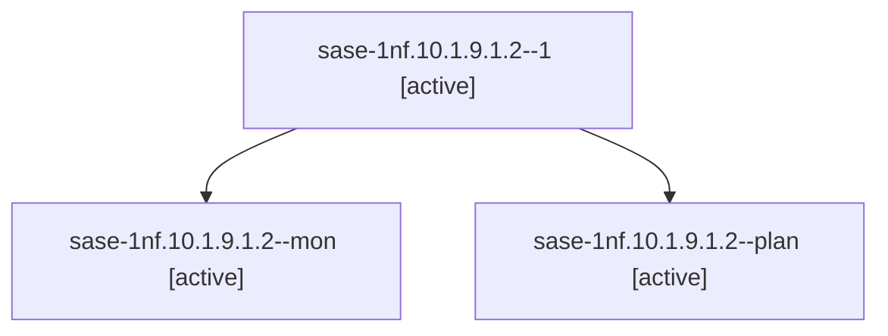

# Session: sase-1nf.10.1.9.1.2

[Agent Hoods](../README.md) / [bbugyi200](../users/bbugyi200/README.md) / [athena](../users/bbugyi200/machines/athena/README.md) / [sase-1nf](../users/bbugyi200/machines/athena/hoods/sase-1nf/README.md) / sase-1nf.10.1.9.1.2

Owner: `bbugyi200.athena` · Hood: `sase-1nf` · Members: 3 · Bead: [sase-1nf.10.1.9.1.2](https://github.com/sase-org/sase--beads/blob/main/pages/sase-1nf/sase-1nf.10.1.9.1.2.md)

## Lineage



The diagram is an optional enhancement; the ordered table below contains the same lineage in accessible text.

| Role | Agent | State | Model / provider | Timing | Commits | Prompt | Chat |
|---|---|---|---|---|---:|---|---|
| <a id="member-1"></a>1 | sase-1nf.10.1.9.1.2--1 | active | gpt-6-luna / codex | 2026-10-21T12:12:03.810621+00:00 | 0 | [Prompt](../agents/bbugyi200.athena.sase-1nf.10.1.9.1.2--1/prompt.md) | [Chat](../agents/bbugyi200.athena.sase-1nf.10.1.9.1.2--1/chat.md) |
| <a id="member-mon"></a>mon | sase-1nf.10.1.9.1.2--mon | active | gpt-6-luna / codex | 2026-10-21T12:08:07.840409+00:00 | 0 | — | [Chat](../agents/bbugyi200.athena.sase-1nf.10.1.9.1.2--mon/chat.md) |
| <a id="member-plan"></a>plan | sase-1nf.10.1.9.1.2--plan | active | gpt-6-luna / codex | 2026-10-21T11:57:47.201618+00:00 | 0 | [Prompt](../agents/bbugyi200.athena.sase-1nf.10.1.9.1.2--plan/prompt.md) | [Chat](../agents/bbugyi200.athena.sase-1nf.10.1.9.1.2--plan/chat.md) |

## Variables

| Role | Variable | Value |
|---|---|---|
| 1 | `artifacts` | \[{bead: sase-1nf.10.1.9.1.2, kind: markdown, label: Apollo manifest repair evidence, path: /home/bryan/.sase/artifacts/agents/gh\_sase-org\_\_sase/20261021080928/apollo-manifest-repair-evidence-0b40cbc9… |
| plan | `artifacts` | \[{bead: sase-1nf.10.1.9.1.2, kind: file, label: Apollo manifest pre-repair baseline, path: /home/bryan/.sase/artifacts/agents/gh\_sase-org\_\_sase/20261021074014/apollo-manifest-pre-625439d7f1d4.json, r… |

#### artifacts

**Role:** `1`

```yaml
- bead: sase-1nf.10.1.9.1.2
  kind: markdown
  label: Apollo manifest repair evidence
  path: /home/bryan/.sase/artifacts/agents/gh_sase-org__sase/20261021080928/apollo-manifest-repair-evidence-0b40cbc96417.md
  ref: file:explicit:9716cd258ececa76e94db280
  source_path: /tmp/apollo-manifest-repair-evidence.md
```

#### artifacts

**Role:** `plan`

```yaml
- bead: sase-1nf.10.1.9.1.2
  kind: file
  label: Apollo manifest pre-repair baseline
  path: /home/bryan/.sase/artifacts/agents/gh_sase-org__sase/20261021074014/apollo-manifest-pre-625439d7f1d4.json
  ref: file:explicit:9eb1a6f349ef6e14eb70c1db
  source_path: /tmp/apollo-manifest-pre.json
```

Values are truncated for display; see each member's agent meta.json for the full values.

## Neighbors

| Agent | Relation | State |
|---|---|---|
| [sase-1nf.10.1.9](bbugyi200.athena.sase-1nf.10.1.9.md) (session · 3) | ancestor | failed 3 |
| [sase-1nf.10](bbugyi200.athena.sase-1nf.10.md) (session · 3) | ancestor | failed 3 |
| [sase-1nf.10.1.9.1.1](../agents/bbugyi200.athena.sase-1nf.10.1.9.1.1/README.md) | sase-1nf.10.1.9.1 hood | active |
| [sase-1nf.10.1.9.1.3](bbugyi200.athena.sase-1nf.10.1.9.1.3.md) (session · 5) | sase-1nf.10.1.9.1 hood | active 5 |
| [sase-1nf.10.1.9.1.4](bbugyi200.athena.sase-1nf.10.1.9.1.4.md) (session · 5) | sase-1nf.10.1.9.1 hood | active 5 |
| [sase-1nf.10.1.9.1.5](../agents/bbugyi200.athena.sase-1nf.10.1.9.1.5/README.md) | sase-1nf.10.1.9.1 hood | active |
| [sase-1nf.10.1.9.1.6.1](../agents/bbugyi200.athena.sase-1nf.10.1.9.1.6.1/README.md) | sase-1nf.10.1.9.1 hood | completed |
| [sase-1nf.10.1.9.1.6.2](../agents/bbugyi200.athena.sase-1nf.10.1.9.1.6.2/README.md) | sase-1nf.10.1.9.1 hood | completed |
| [sase-1nf.10.1.9.1.6.3](bbugyi200.athena.sase-1nf.10.1.9.1.6.3.md) (session · 3) | sase-1nf.10.1.9.1 hood | completed 2, failed 1 |
| [sase-1nf.10.1.9.1.6.4](../agents/bbugyi200.athena.sase-1nf.10.1.9.1.6.4/README.md) | sase-1nf.10.1.9.1 hood | completed |
| [sase-1nf.10.1.9.1.6.5](../agents/bbugyi200.athena.sase-1nf.10.1.9.1.6.5/README.md) | sase-1nf.10.1.9.1 hood | completed |
| [sase-1nf.10.1.9.1.6.land](../agents/bbugyi200.athena.sase-1nf.10.1.9.1.6.land/README.md) | sase-1nf.10.1.9.1 hood | completed |
| [sase-1nf.10.1.9.1.land](bbugyi200.athena.sase-1nf.10.1.9.1.land.md) (session · 3) | sase-1nf.10.1.9.1 hood | active 3 |
| [sase-1nf.10.1.1](../agents/bbugyi200.athena.sase-1nf.10.1.1/README.md) | sase-1nf.10.1 hood | completed |
| [sase-1nf.10.1.2](../agents/bbugyi200.athena.sase-1nf.10.1.2/README.md) | sase-1nf.10.1 hood | completed |
| [sase-1nf.10.1.3](../agents/bbugyi200.athena.sase-1nf.10.1.3/README.md) | sase-1nf.10.1 hood | completed |
| [sase-1nf.10.1.4](bbugyi200.athena.sase-1nf.10.1.4.md) (session · 7) | sase-1nf.10.1 hood | completed 4, failed 3 |
| [sase-1nf.10.1.5](../agents/bbugyi200.athena.sase-1nf.10.1.5/README.md) | sase-1nf.10.1 hood | completed |
| [sase-1nf.10.1.6](../agents/bbugyi200.athena.sase-1nf.10.1.6/README.md) | sase-1nf.10.1 hood | completed |
| [sase-1nf.10.1.7](bbugyi200.athena.sase-1nf.10.1.7.md) (session · 5) | sase-1nf.10.1 hood | completed 3, failed 2 |
| [sase-1nf.10.1.8](../agents/bbugyi200.athena.sase-1nf.10.1.8/README.md) | sase-1nf.10.1 hood | completed |
| [sase-1nf.10.1.land](../agents/bbugyi200.athena.sase-1nf.10.1.land/README.md) | sase-1nf.10.1 hood | waiting |
| [sase-1nf.1](../agents/bbugyi200.athena.sase-1nf.1/README.md) | sase-1nf hood | completed |
| [sase-1nf.11](../agents/bbugyi200.athena.sase-1nf.11/README.md) | sase-1nf hood | waiting |
| [sase-1nf.12](../agents/bbugyi200.athena.sase-1nf.12/README.md) | sase-1nf hood | completed |
| [sase-1nf.13](bbugyi200.athena.sase-1nf.13.md) (session · 13) | sase-1nf hood | active 1, completed 5, failed 7 |
| [sase-1nf.13--5--1](../agents/bbugyi200.athena.sase-1nf.13--5--1/README.md) | sase-1nf hood | completed |
| [sase-1nf.13--5--mon](../agents/bbugyi200.athena.sase-1nf.13--5--mon/README.md) | sase-1nf hood | failed |
| [sase-1nf.13--5--plan](../agents/bbugyi200.athena.sase-1nf.13--5--plan/README.md) | sase-1nf hood | completed |
| [sase-1nf.14](../agents/bbugyi200.athena.sase-1nf.14/README.md) | sase-1nf hood | waiting |
| [sase-1nf.2](../agents/bbugyi200.athena.sase-1nf.2/README.md) | sase-1nf hood | completed |
| [sase-1nf.3](../agents/bbugyi200.athena.sase-1nf.3/README.md) | sase-1nf hood | completed |
| [sase-1nf.4](bbugyi200.athena.sase-1nf.4.md) (session · 2) | sase-1nf hood | completed 1, failed 1 |
| [sase-1nf.4](../agents/bbugyi200.athena.sase-1nf.4/README.md) | sase-1nf hood | completed |
| [sase-1nf.5](../agents/bbugyi200.athena.sase-1nf.5/README.md) | sase-1nf hood | completed |
| [sase-1nf.6](bbugyi200.athena.sase-1nf.6.md) (session · 9) | sase-1nf hood | completed 5, failed 4 |
| [sase-1nf.7](bbugyi200.athena.sase-1nf.7.md) (session · 5) | sase-1nf hood | completed 3, failed 2 |
| [sase-1nf.8](../agents/bbugyi200.athena.sase-1nf.8/README.md) | sase-1nf hood | completed |
| [sase-1nf.9](bbugyi200.athena.sase-1nf.9.md) (session · 5) | sase-1nf hood | completed 3, failed 2 |
| [sase-1nf.land](../agents/bbugyi200.athena.sase-1nf.land/README.md) | sase-1nf hood | waiting |
