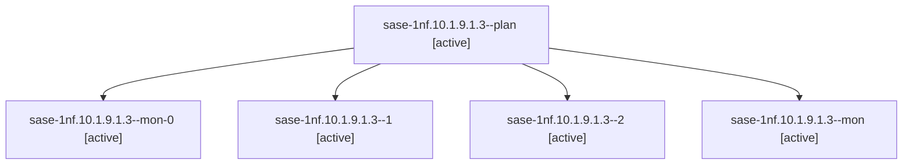

# Session: sase-1nf.10.1.9.1.3

[Agent Hoods](../README.md) / [bbugyi200](../users/bbugyi200/README.md) / [athena](../users/bbugyi200/machines/athena/README.md) / [sase-1nf](../users/bbugyi200/machines/athena/hoods/sase-1nf/README.md) / sase-1nf.10.1.9.1.3

Owner: `bbugyi200.athena` · Hood: `sase-1nf` · Members: 5 · Bead: [sase-1nf.10.1.9.1.3](https://github.com/sase-org/sase--beads/blob/main/pages/sase-1nf/sase-1nf.10.1.9.1.3.md)

## Lineage



The diagram is an optional enhancement; the ordered table below contains the same lineage in accessible text.

| Role | Agent | State | Model / provider | Timing | Commits | Prompt | Chat |
|---|---|---|---|---|---:|---|---|
| <a id="member-plan"></a>plan | sase-1nf.10.1.9.1.3--plan | active | gpt-6-luna / codex | 2026-10-21T12:23:31.947320+00:00 | 0 | [Prompt](../agents/bbugyi200.athena.sase-1nf.10.1.9.1.3--plan/prompt.md) | [Chat](../agents/bbugyi200.athena.sase-1nf.10.1.9.1.3--plan/chat.md) |
| <a id="member-mon-0"></a>mon-0 | sase-1nf.10.1.9.1.3--mon-0 | active | gpt-6-luna / codex | 2026-10-21T12:49:48.676111+00:00 | 0 | — | [Chat](../agents/bbugyi200.athena.sase-1nf.10.1.9.1.3--mon-0/chat.md) |
| <a id="member-1"></a>1 | sase-1nf.10.1.9.1.3--1 | active | gpt-6-luna / codex | 2026-10-21T12:39:23.461693+00:00 | 0 | [Prompt](../agents/bbugyi200.athena.sase-1nf.10.1.9.1.3--1/prompt.md) | [Chat](../agents/bbugyi200.athena.sase-1nf.10.1.9.1.3--1/chat.md) |
| <a id="member-2"></a>2 | sase-1nf.10.1.9.1.3--2 | active | gpt-6-luna / codex | 2026-10-21T12:55:12.618976+00:00 | 0 | [Prompt](../agents/bbugyi200.athena.sase-1nf.10.1.9.1.3--2/prompt.md) | [Chat](../agents/bbugyi200.athena.sase-1nf.10.1.9.1.3--2/chat.md) |
| <a id="member-mon"></a>mon | sase-1nf.10.1.9.1.3--mon | active | gpt-6-luna / codex | 2026-10-21T12:33:13.426173+00:00 | 0 | — | [Chat](../agents/bbugyi200.athena.sase-1nf.10.1.9.1.3--mon/chat.md) |

## Variables

| Role | Variable | Value |
|---|---|---|
| 1 | `artifacts` | \[{bead: sase-1nf.10.1.9.1.3, kind: file, label: Athena research profile raw capture, path: /home/bryan/.sase/artifacts/agents/gh\_sase-org\_\_sase/20261021083634/athena-profile-capture-6e5ee58d94b8.json… |
| 2 | `artifacts` | \[{bead: sase-1nf.10.1.9.1.3, kind: markdown, label: Athena canary evidence summary 2026-10-21, path: /home/bryan/.sase/artifacts/agents/gh\_sase-org\_\_sase/20261021085222/athena-canary-evidence-2026102… |

#### artifacts

**Role:** `1`

```yaml
- bead: sase-1nf.10.1.9.1.3
  kind: file
  label: Athena research profile raw capture
  path: /home/bryan/.sase/artifacts/agents/gh_sase-org__sase/20261021083634/athena-profile-capture-6e5ee58d94b8.json
  ref: file:explicit:1c43fbd0d690e6a7df686b52
  source_path: /tmp/athena-profile-capture.json
```

#### artifacts

**Role:** `2`

```yaml
- bead: sase-1nf.10.1.9.1.3
  kind: markdown
  label: Athena canary evidence summary 2026-10-21
  path: /home/bryan/.sase/artifacts/agents/gh_sase-org__sase/20261021085222/athena-canary-evidence-20261021-6b1f335adf30.md
  ref: file:explicit:c891f25f8c6e92bc1d7fa099
  source_path: /tmp/athena-canary-evidence-20261021.md
- bead: sase-1nf.10.1.9.1.3
  kind: file
  label: Raw targeted research profile command capture
  path: /home/bryan/.sase/artifacts/agents/gh_sase-org__sase/20261021085222/athena-profile-capture-6e5ee58d94b8.json
  ref: file:explicit:a378fe34f65102210a8fb7b0
  source_path: /tmp/athena-profile-capture.json
- bead: sase-1nf.10.1.9.1.3
  kind: markdown
  label: Research profile vs archived full baseline comparison
  path: /home/bryan/.sase/artifacts/agents/gh_sase-org__sase/20261021085222/athena-profile-comparison-20261021-954630ea26ff.md
  ref: file:explicit:c6b747b80129746156d979ec
  source_path: /tmp/athena-profile-comparison-20261021.md
- bead: sase-1nf.10.1.9.1.3
  kind: file
  label: Complete pre-canary lock-free publication queue and Rust selectors
  path: /home/bryan/.sase/artifacts/agents/gh_sase-org__sase/20261021085222/athena-queue-precanary-20261021-dfd58e44ba92.json
  ref: file:explicit:696eb3078287cfc1f2969ec5
  source_path: /tmp/athena-queue-precanary-20261021.json
- bead: sase-1nf.10.1.9.1.3
  kind: file
  label: Complete final lock-free publication queue and Rust selectors
  path: /home/bryan/.sase/artifacts/agents/gh_sase-org__sase/20261021085222/athena-queue-final-20261021-3023314372a7.json
  ref: file:explicit:0e081201ada8de38f248aba6
  source_path: /tmp/athena-queue-final-20261021.json
- bead: sase-1nf.10.1.9.1.3
  kind: file
  label: Raw command version doctor queue-diff timing and concurrency evidence bundle
  path: /home/bryan/.sase/artifacts/agents/gh_sase-org__sase/20261021085222/athena-canary-raw-evidence-20261021.tar-02e1ba29e67f.gz
  ref: file:explicit:78bab28f1683b5a88c97264e
  source_path: /tmp/athena-canary-raw-evidence-20261021.tar.gz
```

Values are truncated for display; see each member's agent meta.json for the full values.

## Neighbors

| Agent | Relation | State |
|---|---|---|
| [sase-1nf.10.1.9](bbugyi200.athena.sase-1nf.10.1.9.md) (session · 3) | ancestor | failed 3 |
| [sase-1nf.10](bbugyi200.athena.sase-1nf.10.md) (session · 3) | ancestor | failed 3 |
| [sase-1nf.10.1.9.1.1](../agents/bbugyi200.athena.sase-1nf.10.1.9.1.1/README.md) | sase-1nf.10.1.9.1 hood | active |
| [sase-1nf.10.1.9.1.2](bbugyi200.athena.sase-1nf.10.1.9.1.2.md) (session · 3) | sase-1nf.10.1.9.1 hood | active 3 |
| [sase-1nf.10.1.9.1.4](bbugyi200.athena.sase-1nf.10.1.9.1.4.md) (session · 5) | sase-1nf.10.1.9.1 hood | active 5 |
| [sase-1nf.10.1.9.1.5](../agents/bbugyi200.athena.sase-1nf.10.1.9.1.5/README.md) | sase-1nf.10.1.9.1 hood | active |
| [sase-1nf.10.1.9.1.6.1](../agents/bbugyi200.athena.sase-1nf.10.1.9.1.6.1/README.md) | sase-1nf.10.1.9.1 hood | active |
| [sase-1nf.10.1.9.1.6.2](../agents/bbugyi200.athena.sase-1nf.10.1.9.1.6.2/README.md) | sase-1nf.10.1.9.1 hood | active |
| [sase-1nf.10.1.9.1.6.3](bbugyi200.athena.sase-1nf.10.1.9.1.6.3.md) (session · 3) | sase-1nf.10.1.9.1 hood | active 3 |
| [sase-1nf.10.1.9.1.6.4](../agents/bbugyi200.athena.sase-1nf.10.1.9.1.6.4/README.md) | sase-1nf.10.1.9.1 hood | active |
| [sase-1nf.10.1.9.1.6.5](../agents/bbugyi200.athena.sase-1nf.10.1.9.1.6.5/README.md) | sase-1nf.10.1.9.1 hood | active |
| [sase-1nf.10.1.9.1.6.land](../agents/bbugyi200.athena.sase-1nf.10.1.9.1.6.land/README.md) | sase-1nf.10.1.9.1 hood | active |
| [sase-1nf.10.1.9.1.land](bbugyi200.athena.sase-1nf.10.1.9.1.land.md) (session · 3) | sase-1nf.10.1.9.1 hood | active 3 |
| [sase-1nf.10.1.1](../agents/bbugyi200.athena.sase-1nf.10.1.1/README.md) | sase-1nf.10.1 hood | completed |
| [sase-1nf.10.1.2](../agents/bbugyi200.athena.sase-1nf.10.1.2/README.md) | sase-1nf.10.1 hood | completed |
| [sase-1nf.10.1.3](../agents/bbugyi200.athena.sase-1nf.10.1.3/README.md) | sase-1nf.10.1 hood | completed |
| [sase-1nf.10.1.4](bbugyi200.athena.sase-1nf.10.1.4.md) (session · 7) | sase-1nf.10.1 hood | completed 4, failed 3 |
| [sase-1nf.10.1.5](../agents/bbugyi200.athena.sase-1nf.10.1.5/README.md) | sase-1nf.10.1 hood | completed |
| [sase-1nf.10.1.6](../agents/bbugyi200.athena.sase-1nf.10.1.6/README.md) | sase-1nf.10.1 hood | completed |
| [sase-1nf.10.1.7](bbugyi200.athena.sase-1nf.10.1.7.md) (session · 5) | sase-1nf.10.1 hood | completed 3, failed 2 |
| [sase-1nf.10.1.8](../agents/bbugyi200.athena.sase-1nf.10.1.8/README.md) | sase-1nf.10.1 hood | completed |
| [sase-1nf.10.1.land](../agents/bbugyi200.athena.sase-1nf.10.1.land/README.md) | sase-1nf.10.1 hood | waiting |
| [sase-1nf.1](../agents/bbugyi200.athena.sase-1nf.1/README.md) | sase-1nf hood | completed |
| [sase-1nf.11](../agents/bbugyi200.athena.sase-1nf.11/README.md) | sase-1nf hood | waiting |
| [sase-1nf.12](../agents/bbugyi200.athena.sase-1nf.12/README.md) | sase-1nf hood | completed |
| [sase-1nf.13](bbugyi200.athena.sase-1nf.13.md) (session · 13) | sase-1nf hood | completed 6, failed 7 |
| [sase-1nf.13](../agents/bbugyi200.athena.sase-1nf.13/README.md) | sase-1nf hood | completed |
| [sase-1nf.13--5--1](../agents/bbugyi200.athena.sase-1nf.13--5--1/README.md) | sase-1nf hood | completed |
| [sase-1nf.13--5--mon](../agents/bbugyi200.athena.sase-1nf.13--5--mon/README.md) | sase-1nf hood | failed |
| [sase-1nf.13--5--plan](../agents/bbugyi200.athena.sase-1nf.13--5--plan/README.md) | sase-1nf hood | completed |
| [sase-1nf.14](bbugyi200.athena.sase-1nf.14.md) (session · 3) | sase-1nf hood | failed 3 |
| [sase-1nf.14.1.1](../agents/bbugyi200.athena.sase-1nf.14.1.1/README.md) | sase-1nf hood | completed |
| [sase-1nf.14.1.2](../agents/bbugyi200.athena.sase-1nf.14.1.2/README.md) | sase-1nf hood | completed |
| [sase-1nf.14.1.3](../agents/bbugyi200.athena.sase-1nf.14.1.3/README.md) | sase-1nf hood | active |
| [sase-1nf.14.1.4](../agents/bbugyi200.athena.sase-1nf.14.1.4/README.md) | sase-1nf hood | completed |
| [sase-1nf.14.1.5](bbugyi200.athena.sase-1nf.14.1.5.md) (session · 5) | sase-1nf hood | completed 3, failed 2 |
| [sase-1nf.14.1.6](bbugyi200.athena.sase-1nf.14.1.6.md) (session · 3) | sase-1nf hood | completed 2, failed 1 |
| [sase-1nf.14.1.7](bbugyi200.athena.sase-1nf.14.1.7.md) (session · 3) | sase-1nf hood | completed 2, failed 1 |
| [sase-1nf.14.1.7](../agents/bbugyi200.athena.sase-1nf.14.1.7/README.md) | sase-1nf hood | waiting |
| [sase-1nf.14.1.8](bbugyi200.athena.sase-1nf.14.1.8.md) (session · 5) | sase-1nf hood | completed 3, failed 2 |
| [sase-1nf.14.1.land](bbugyi200.athena.sase-1nf.14.1.land.md) (session · 7) | sase-1nf hood | active 1, completed 3, failed 3 |
| [sase-1nf.2](../agents/bbugyi200.athena.sase-1nf.2/README.md) | sase-1nf hood | completed |
| [sase-1nf.3](../agents/bbugyi200.athena.sase-1nf.3/README.md) | sase-1nf hood | completed |
| [sase-1nf.4](bbugyi200.athena.sase-1nf.4.md) (session · 2) | sase-1nf hood | completed 1, failed 1 |
| [sase-1nf.4](../agents/bbugyi200.athena.sase-1nf.4/README.md) | sase-1nf hood | completed |
| [sase-1nf.5](../agents/bbugyi200.athena.sase-1nf.5/README.md) | sase-1nf hood | completed |
| [sase-1nf.6](bbugyi200.athena.sase-1nf.6.md) (session · 9) | sase-1nf hood | completed 5, failed 4 |
| [sase-1nf.7](bbugyi200.athena.sase-1nf.7.md) (session · 5) | sase-1nf hood | completed 3, failed 2 |
| [sase-1nf.8](../agents/bbugyi200.athena.sase-1nf.8/README.md) | sase-1nf hood | completed |
| [sase-1nf.9](bbugyi200.athena.sase-1nf.9.md) (session · 5) | sase-1nf hood | completed 3, failed 2 |
| [sase-1nf.land](../agents/bbugyi200.athena.sase-1nf.land/README.md) | sase-1nf hood | waiting |
