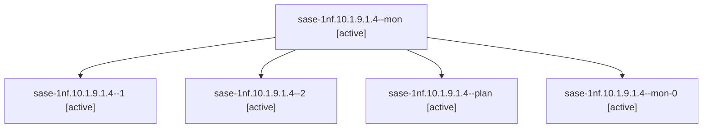

# Session: sase-1nf.10.1.9.1.4

[Agent Hoods](../README.md) / [bbugyi200](../users/bbugyi200/README.md) / [athena](../users/bbugyi200/machines/athena/README.md) / [sase-1nf](../users/bbugyi200/machines/athena/hoods/sase-1nf/README.md) / sase-1nf.10.1.9.1.4

Owner: `bbugyi200.athena` · Hood: `sase-1nf` · Members: 5 · Bead: [sase-1nf.10.1.9.1.4](https://github.com/sase-org/sase--beads/blob/main/pages/sase-1nf/sase-1nf.10.1.9.1.4.md)

## Lineage



The diagram is an optional enhancement; the ordered table below contains the same lineage in accessible text.

| Role | Agent | State | Model / provider | Timing | Commits | Prompt | Chat |
|---|---|---|---|---|---:|---|---|
| <a id="member-mon"></a>mon | sase-1nf.10.1.9.1.4--mon | active | gpt-6-luna / codex | 2026-10-21T13:24:16.512253+00:00 | 0 | — | [Chat](../agents/bbugyi200.athena.sase-1nf.10.1.9.1.4--mon/chat.md) |
| <a id="member-1"></a>1 | sase-1nf.10.1.9.1.4--1 | active | gpt-6-luna / codex | 2026-10-21T13:27:57.382256+00:00 | 0 | [Prompt](../agents/bbugyi200.athena.sase-1nf.10.1.9.1.4--1/prompt.md) | [Chat](../agents/bbugyi200.athena.sase-1nf.10.1.9.1.4--1/chat.md) |
| <a id="member-2"></a>2 | sase-1nf.10.1.9.1.4--2 | active | gpt-6-luna / codex | 2026-10-21T13:43:53.931128+00:00 | 0 | [Prompt](../agents/bbugyi200.athena.sase-1nf.10.1.9.1.4--2/prompt.md) | [Chat](../agents/bbugyi200.athena.sase-1nf.10.1.9.1.4--2/chat.md) |
| <a id="member-plan"></a>plan | sase-1nf.10.1.9.1.4--plan | active | gpt-6-luna / codex | 2026-10-21T13:09:54.365156+00:00 | 0 | [Prompt](../agents/bbugyi200.athena.sase-1nf.10.1.9.1.4--plan/prompt.md) | [Chat](../agents/bbugyi200.athena.sase-1nf.10.1.9.1.4--plan/chat.md) |
| <a id="member-mon-0"></a>mon-0 | sase-1nf.10.1.9.1.4--mon-0 | active | gpt-6-luna / codex | 2026-10-21T13:40:09.808709+00:00 | 0 | — | [Chat](../agents/bbugyi200.athena.sase-1nf.10.1.9.1.4--mon-0/chat.md) |

## Variables

| Role | Variable | Value |
|---|---|---|
| 1 | `artifacts` | \[{bead: sase-1nf.10.1.9.1.4, kind: file, label: Apollo bob-cli post-canary outbox snapshot, path: /home/bryan/.sase/artifacts/agents/gh\_sase-org\_\_sase/20261021092528/apollo-canary-after-91b814792095.… |
| 2 | `artifacts` | \[{bead: sase-1nf.10.1.9.1.4, kind: file, label: Apollo bob-cli canary monitor result, path: /home/bryan/.sase/artifacts/agents/gh\_sase-org\_\_sase/20261021094121/apollo-canary-monitor-706af791ac2c.json… |
| plan | `artifacts` | \[{bead: sase-1nf.10.1.9.1.4, kind: markdown, label: Apollo canary preflight 2026-10-21, path: /home/bryan/.sase/artifacts/agents/gh\_sase-org\_\_sase/20261021074016/apollo-canary-baseline-f2fbca4e327e.m… |

#### artifacts

**Role:** `1`

```yaml
- bead: sase-1nf.10.1.9.1.4
  kind: file
  label: Apollo bob-cli post-canary outbox snapshot
  path: /home/bryan/.sase/artifacts/agents/gh_sase-org__sase/20261021092528/apollo-canary-after-91b814792095.json
  ref: file:explicit:dd0fbaede0466d626da83b7f
  source_path: /tmp/apollo-canary-after.json
```

#### artifacts

**Role:** `2`

```yaml
- bead: sase-1nf.10.1.9.1.4
  kind: file
  label: Apollo bob-cli canary monitor result
  path: /home/bryan/.sase/artifacts/agents/gh_sase-org__sase/20261021094121/apollo-canary-monitor-706af791ac2c.json
  ref: file:explicit:ad889331c1dd2457a7a16946
  source_path: /tmp/apollo-canary-monitor.json
- bead: sase-1nf.10.1.9.1.4
  kind: file
  label: Apollo bob-cli canary revisions
  path: /home/bryan/.sase/artifacts/agents/gh_sase-org__sase/20261021094121/apollo-canary-revisions-a68a51869dfd.json
  ref: file:explicit:2442b859736833bda4338e01
  source_path: /tmp/apollo-canary-revisions.json
- bead: sase-1nf.10.1.9.1.4
  kind: markdown
  label: Apollo bob-cli canary evidence report
  path: /home/bryan/.sase/artifacts/agents/gh_sase-org__sase/20261021094121/apollo-canary-evidence-8413441d5394.md
  ref: file:explicit:24a51cfff990818ebfeee77d
  source_path: /tmp/apollo-canary-evidence.md
```

#### artifacts

**Role:** `plan`

```yaml
- bead: sase-1nf.10.1.9.1.4
  kind: markdown
  label: Apollo canary preflight 2026-10-21
  path: /home/bryan/.sase/artifacts/agents/gh_sase-org__sase/20261021074016/apollo-canary-baseline-f2fbca4e327e.md
  ref: file:explicit:fab55063151ed8e839d9958d
  source_path: /tmp/apollo-canary-baseline.md
- bead: sase-1nf.10.1.9.1.4
  kind: file
  label: Apollo full outbox snapshot before canaries
  path: /home/bryan/.sase/artifacts/agents/gh_sase-org__sase/20261021074016/apollo-canary-before-0bbc3ecd010d.json
  ref: file:explicit:9b5d34d8d0a2451778c37f55
  source_path: /tmp/apollo-canary-before.json
```

Values are truncated for display; see each member's agent meta.json for the full values.

## Neighbors

| Agent | Relation | State |
|---|---|---|
| [sase-1nf.10.1.9](bbugyi200.athena.sase-1nf.10.1.9.md) (session · 3) | ancestor | failed 3 |
| [sase-1nf.10](bbugyi200.athena.sase-1nf.10.md) (session · 3) | ancestor | failed 3 |
| [sase-1nf.10.1.9.1.1](../agents/bbugyi200.athena.sase-1nf.10.1.9.1.1/README.md) | sase-1nf.10.1.9.1 hood | active |
| [sase-1nf.10.1.9.1.2](bbugyi200.athena.sase-1nf.10.1.9.1.2.md) (session · 3) | sase-1nf.10.1.9.1 hood | active 3 |
| [sase-1nf.10.1.9.1.3](bbugyi200.athena.sase-1nf.10.1.9.1.3.md) (session · 5) | sase-1nf.10.1.9.1 hood | active 5 |
| [sase-1nf.10.1.9.1.5](../agents/bbugyi200.athena.sase-1nf.10.1.9.1.5/README.md) | sase-1nf.10.1.9.1 hood | active |
| [sase-1nf.10.1.9.1.6.1](../agents/bbugyi200.athena.sase-1nf.10.1.9.1.6.1/README.md) | sase-1nf.10.1.9.1 hood | completed |
| [sase-1nf.10.1.9.1.6.2](../agents/bbugyi200.athena.sase-1nf.10.1.9.1.6.2/README.md) | sase-1nf.10.1.9.1 hood | completed |
| [sase-1nf.10.1.9.1.6.3](bbugyi200.athena.sase-1nf.10.1.9.1.6.3.md) (session · 3) | sase-1nf.10.1.9.1 hood | completed 2, failed 1 |
| [sase-1nf.10.1.9.1.6.4](../agents/bbugyi200.athena.sase-1nf.10.1.9.1.6.4/README.md) | sase-1nf.10.1.9.1 hood | completed |
| [sase-1nf.10.1.9.1.6.5](../agents/bbugyi200.athena.sase-1nf.10.1.9.1.6.5/README.md) | sase-1nf.10.1.9.1 hood | active |
| [sase-1nf.10.1.9.1.6.land](../agents/bbugyi200.athena.sase-1nf.10.1.9.1.6.land/README.md) | sase-1nf.10.1.9.1 hood | waiting |
| [sase-1nf.10.1.9.1.land](bbugyi200.athena.sase-1nf.10.1.9.1.land.md) (session · 3) | sase-1nf.10.1.9.1 hood | active 3 |
| [sase-1nf.10.1.1](../agents/bbugyi200.athena.sase-1nf.10.1.1/README.md) | sase-1nf.10.1 hood | completed |
| [sase-1nf.10.1.2](../agents/bbugyi200.athena.sase-1nf.10.1.2/README.md) | sase-1nf.10.1 hood | completed |
| [sase-1nf.10.1.3](../agents/bbugyi200.athena.sase-1nf.10.1.3/README.md) | sase-1nf.10.1 hood | completed |
| [sase-1nf.10.1.4](bbugyi200.athena.sase-1nf.10.1.4.md) (session · 7) | sase-1nf.10.1 hood | completed 4, failed 3 |
| [sase-1nf.10.1.5](../agents/bbugyi200.athena.sase-1nf.10.1.5/README.md) | sase-1nf.10.1 hood | completed |
| [sase-1nf.10.1.6](../agents/bbugyi200.athena.sase-1nf.10.1.6/README.md) | sase-1nf.10.1 hood | completed |
| [sase-1nf.10.1.7](bbugyi200.athena.sase-1nf.10.1.7.md) (session · 5) | sase-1nf.10.1 hood | completed 3, failed 2 |
| [sase-1nf.10.1.8](../agents/bbugyi200.athena.sase-1nf.10.1.8/README.md) | sase-1nf.10.1 hood | completed |
| [sase-1nf.10.1.land](../agents/bbugyi200.athena.sase-1nf.10.1.land/README.md) | sase-1nf.10.1 hood | waiting |
| [sase-1nf.1](../agents/bbugyi200.athena.sase-1nf.1/README.md) | sase-1nf hood | completed |
| [sase-1nf.11](../agents/bbugyi200.athena.sase-1nf.11/README.md) | sase-1nf hood | waiting |
| [sase-1nf.12](../agents/bbugyi200.athena.sase-1nf.12/README.md) | sase-1nf hood | completed |
| [sase-1nf.13](bbugyi200.athena.sase-1nf.13.md) (session · 4) | sase-1nf hood | active 1, completed 2, failed 1 |
| [sase-1nf.14](../agents/bbugyi200.athena.sase-1nf.14/README.md) | sase-1nf hood | waiting |
| [sase-1nf.2](../agents/bbugyi200.athena.sase-1nf.2/README.md) | sase-1nf hood | completed |
| [sase-1nf.3](../agents/bbugyi200.athena.sase-1nf.3/README.md) | sase-1nf hood | completed |
| [sase-1nf.4](bbugyi200.athena.sase-1nf.4.md) (session · 2) | sase-1nf hood | completed 1, failed 1 |
| [sase-1nf.5](../agents/bbugyi200.athena.sase-1nf.5/README.md) | sase-1nf hood | completed |
| [sase-1nf.6](bbugyi200.athena.sase-1nf.6.md) (session · 9) | sase-1nf hood | completed 5, failed 4 |
| [sase-1nf.7](bbugyi200.athena.sase-1nf.7.md) (session · 5) | sase-1nf hood | completed 3, failed 2 |
| [sase-1nf.8](../agents/bbugyi200.athena.sase-1nf.8/README.md) | sase-1nf hood | completed |
| [sase-1nf.9](bbugyi200.athena.sase-1nf.9.md) (session · 5) | sase-1nf hood | completed 3, failed 2 |
| [sase-1nf.land](../agents/bbugyi200.athena.sase-1nf.land/README.md) | sase-1nf hood | waiting |
