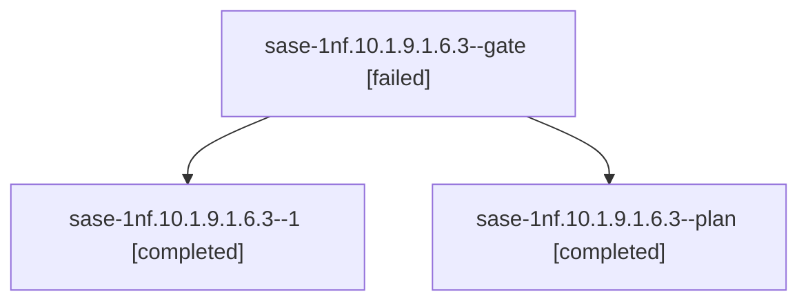

# Session: sase-1nf.10.1.9.1.6.3

[Agent Hoods](../README.md) / [bbugyi200](../users/bbugyi200/README.md) / [athena](../users/bbugyi200/machines/athena/README.md) / [sase-1nf](../users/bbugyi200/machines/athena/hoods/sase-1nf/README.md) / sase-1nf.10.1.9.1.6.3

Owner: `bbugyi200.athena` · Hood: `sase-1nf` · Members: 3 · Bead: [sase-1nf.10.1.9.1.6.3](https://github.com/sase-org/sase--beads/blob/main/pages/sase-1nf/sase-1nf.10.1.9.1.6.3.md)

## Lineage



The diagram is an optional enhancement; the ordered table below contains the same lineage in accessible text.

| Role | Agent | State | Model / provider | Timing | Commits | Prompt | Chat |
|---|---|---|---|---|---:|---|---|
| <a id="member-gate"></a>gate | sase-1nf.10.1.9.1.6.3--gate | failed | gpt-6-luna / codex | 2026-10-22T10:43:54.024933+00:00 → 2026-10-22T10:46:01.003870+00:00 | 0 | — | [Chat](../agents/bbugyi200.athena.sase-1nf.10.1.9.1.6.3--gate/chat.md) |
| <a id="member-1"></a>1 | sase-1nf.10.1.9.1.6.3--1 | completed | gpt-6-luna / codex | 2026-10-22T10:47:30.709597+00:00 → 2026-10-22T11:13:41.596161+00:00 | 0 | [Prompt](../agents/bbugyi200.athena.sase-1nf.10.1.9.1.6.3--1/prompt.md) | [Chat](../agents/bbugyi200.athena.sase-1nf.10.1.9.1.6.3--1/chat.md) |
| <a id="member-plan"></a>plan | sase-1nf.10.1.9.1.6.3--plan | completed | gpt-6-luna / codex | 2026-10-21T16:16:20.598515+00:00 → 2026-10-21T16:28:25.552959+00:00 | 0 | [Prompt](../agents/bbugyi200.athena.sase-1nf.10.1.9.1.6.3--plan/prompt.md) | [Chat](../agents/bbugyi200.athena.sase-1nf.10.1.9.1.6.3--plan/chat.md) |

## Variables

| Role | Variable | Value |
|---|---|---|
| 1 | `artifacts` | \[{bead: sase-1nf.10.1.9.1.6.3, kind: markdown, label: install-replay phase summary, path: /home/bryan/.sase/artifacts/agents/gh\_sase-org\_\_sase/20261022064600/sase-1nf.10.1.9.1.6.3-phase-summary-48ef8… |

#### artifacts

**Role:** `1`

```yaml
- bead: sase-1nf.10.1.9.1.6.3
  kind: markdown
  label: install-replay phase summary
  path: /home/bryan/.sase/artifacts/agents/gh_sase-org__sase/20261022064600/sase-1nf.10.1.9.1.6.3-phase-summary-48ef8f287c75.md
  ref: file:explicit:0a2f73e51e5d9337c3710d44
  source_path: /tmp/sase-1nf.10.1.9.1.6.3-phase-summary.md
- bead: sase-1nf.10.1.9.1.6.3
  kind: file
  label: loaded-version-athena
  path: /home/bryan/.sase/artifacts/agents/gh_sase-org__sase/20261022064600/sase-1nf.10.1.9.1.6.3-athena-version-a6d4711bbf1a.raw
  ref: file:explicit:f1176d53bef9cf9cc67f3d1d
  source_path: /tmp/sase-1nf.10.1.9.1.6.3-athena-version.raw
- bead: sase-1nf.10.1.9.1.6.3
  kind: file
  label: loaded-version-apollo
  path: /home/bryan/.sase/artifacts/agents/gh_sase-org__sase/20261022064600/sase-1nf.10.1.9.1.6.3-apollo-version-51fb769519c0.raw
  ref: file:explicit:6bb0a3bad7880c345c167024
  source_path: /tmp/sase-1nf.10.1.9.1.6.3-apollo-version.raw
- bead: sase-1nf.10.1.9.1.6.3
  kind: file
  label: implementation-revisions
  path: /home/bryan/.sase/artifacts/agents/gh_sase-org__sase/20261022064600/sase-1nf.10.1.9.1.6.3-code-revisions-e8178bdde0f5.raw
  ref: file:explicit:4b8203965ca7b80abdbb6cd4
  source_path: /tmp/sase-1nf.10.1.9.1.6.3-code-revisions.raw
- bead: sase-1nf.10.1.9.1.6.3
  kind: file
  label: replay-report-apply-repeat-raw
  path: /home/bryan/.sase/artifacts/agents/gh_sase-org__sase/20261022064600/sase-1nf.10.1.9.1.6.3-replay-workflow-e76ef7028d00.raw
  ref: file:explicit:2b39984b614454d0fad35467
  source_path: /tmp/sase-1nf.10.1.9.1.6.3-replay-workflow.raw
- bead: sase-1nf.10.1.9.1.6.3
  kind: file
  label: preapply-inventory-scoped
  path: /home/bryan/.sase/artifacts/agents/gh_sase-org__sase/20261022064600/sase-1nf.10.1.9.1.6.3-preapply-inventory-scoped-c316074eb813.json
  ref: file:explicit:9f2c23a8b3d9bd53371c40ad
  source_path: /tmp/sase-1nf.10.1.9.1.6.3-preapply-inventory-scoped.json
- bead: sase-1nf.10.1.9.1.6.3
  kind: file
  label: remote-publication-proof
  path: /home/bryan/.sase/artifacts/agents/gh_sase-org__sase/20261022064600/sase-1nf.10.1.9.1.6.3-remote-proof-d0fb3facc8c3.json
  ref: file:explicit:f3ae6ce054168755bc7f3a4a
  source_path: /tmp/sase-1nf.10.1.9.1.6.3-remote-proof.json
- bead: sase-1nf.10.1.9.1.6.3
  kind: file
  label: outbox-before-after-counts
  path: /home/bryan/.sase/artifacts/agents/gh_sase-org__sase/20261022064600/sase-1nf.10.1.9.1.6.3-outbox-counts-1b35609c1de1.json
  ref: file:explicit:6f0d4aa7c4fb0eb6a8ca3113
  source_path: /tmp/sase-1nf.10.1.9.1.6.3-outbox-counts.json
```

Values are truncated for display; see each member's agent meta.json for the full values.

## Neighbors

| Agent | Relation | State |
|---|---|---|
| [sase-1nf.10.1.9](bbugyi200.athena.sase-1nf.10.1.9.md) (session · 3) | ancestor | failed 3 |
| [sase-1nf.10](bbugyi200.athena.sase-1nf.10.md) (session · 3) | ancestor | failed 3 |
| [sase-1nf.10.1.9.1.6.1](../agents/bbugyi200.athena.sase-1nf.10.1.9.1.6.1/README.md) | sase-1nf.10.1.9.1.6 hood | completed |
| [sase-1nf.10.1.9.1.6.2](../agents/bbugyi200.athena.sase-1nf.10.1.9.1.6.2/README.md) | sase-1nf.10.1.9.1.6 hood | completed |
| [sase-1nf.10.1.9.1.6.4](../agents/bbugyi200.athena.sase-1nf.10.1.9.1.6.4/README.md) | sase-1nf.10.1.9.1.6 hood | completed |
| [sase-1nf.10.1.9.1.6.5](../agents/bbugyi200.athena.sase-1nf.10.1.9.1.6.5/README.md) | sase-1nf.10.1.9.1.6 hood | completed |
| [sase-1nf.10.1.9.1.6.land](../agents/bbugyi200.athena.sase-1nf.10.1.9.1.6.land/README.md) | sase-1nf.10.1.9.1.6 hood | completed |
| [sase-1nf.10.1.9.1.1](../agents/bbugyi200.athena.sase-1nf.10.1.9.1.1/README.md) | sase-1nf.10.1.9.1 hood | active |
| [sase-1nf.10.1.9.1.2](bbugyi200.athena.sase-1nf.10.1.9.1.2.md) (session · 3) | sase-1nf.10.1.9.1 hood | active 3 |
| [sase-1nf.10.1.9.1.3](bbugyi200.athena.sase-1nf.10.1.9.1.3.md) (session · 5) | sase-1nf.10.1.9.1 hood | active 5 |
| [sase-1nf.10.1.9.1.4](bbugyi200.athena.sase-1nf.10.1.9.1.4.md) (session · 5) | sase-1nf.10.1.9.1 hood | active 5 |
| [sase-1nf.10.1.9.1.5](../agents/bbugyi200.athena.sase-1nf.10.1.9.1.5/README.md) | sase-1nf.10.1.9.1 hood | active |
| [sase-1nf.10.1.9.1.land](bbugyi200.athena.sase-1nf.10.1.9.1.land.md) (session · 3) | sase-1nf.10.1.9.1 hood | active 3 |
| [sase-1nf.10.1.1](../agents/bbugyi200.athena.sase-1nf.10.1.1/README.md) | sase-1nf.10.1 hood | completed |
| [sase-1nf.10.1.2](../agents/bbugyi200.athena.sase-1nf.10.1.2/README.md) | sase-1nf.10.1 hood | completed |
| [sase-1nf.10.1.3](../agents/bbugyi200.athena.sase-1nf.10.1.3/README.md) | sase-1nf.10.1 hood | completed |
| [sase-1nf.10.1.4](bbugyi200.athena.sase-1nf.10.1.4.md) (session · 7) | sase-1nf.10.1 hood | completed 4, failed 3 |
| [sase-1nf.10.1.5](../agents/bbugyi200.athena.sase-1nf.10.1.5/README.md) | sase-1nf.10.1 hood | completed |
| [sase-1nf.10.1.6](../agents/bbugyi200.athena.sase-1nf.10.1.6/README.md) | sase-1nf.10.1 hood | completed |
| [sase-1nf.10.1.7](bbugyi200.athena.sase-1nf.10.1.7.md) (session · 5) | sase-1nf.10.1 hood | completed 3, failed 2 |
| [sase-1nf.10.1.8](../agents/bbugyi200.athena.sase-1nf.10.1.8/README.md) | sase-1nf.10.1 hood | completed |
| [sase-1nf.10.1.land](../agents/bbugyi200.athena.sase-1nf.10.1.land/README.md) | sase-1nf.10.1 hood | waiting |
| [sase-1nf.1](../agents/bbugyi200.athena.sase-1nf.1/README.md) | sase-1nf hood | completed |
| [sase-1nf.11](../agents/bbugyi200.athena.sase-1nf.11/README.md) | sase-1nf hood | waiting |
| [sase-1nf.12](../agents/bbugyi200.athena.sase-1nf.12/README.md) | sase-1nf hood | completed |
| [sase-1nf.13](bbugyi200.athena.sase-1nf.13.md) (session · 4) | sase-1nf hood | active 3, failed 1 |
| [sase-1nf.14](../agents/bbugyi200.athena.sase-1nf.14/README.md) | sase-1nf hood | waiting |
| [sase-1nf.2](../agents/bbugyi200.athena.sase-1nf.2/README.md) | sase-1nf hood | completed |
| [sase-1nf.3](../agents/bbugyi200.athena.sase-1nf.3/README.md) | sase-1nf hood | completed |
| [sase-1nf.4](bbugyi200.athena.sase-1nf.4.md) (session · 2) | sase-1nf hood | completed 1, failed 1 |
| [sase-1nf.4](../agents/bbugyi200.athena.sase-1nf.4/README.md) | sase-1nf hood | completed |
| [sase-1nf.5](../agents/bbugyi200.athena.sase-1nf.5/README.md) | sase-1nf hood | completed |
| [sase-1nf.6](bbugyi200.athena.sase-1nf.6.md) (session · 9) | sase-1nf hood | completed 5, failed 4 |
| [sase-1nf.7](bbugyi200.athena.sase-1nf.7.md) (session · 5) | sase-1nf hood | completed 3, failed 2 |
| [sase-1nf.8](../agents/bbugyi200.athena.sase-1nf.8/README.md) | sase-1nf hood | completed |
| [sase-1nf.9](bbugyi200.athena.sase-1nf.9.md) (session · 5) | sase-1nf hood | completed 3, failed 2 |
| [sase-1nf.land](../agents/bbugyi200.athena.sase-1nf.land/README.md) | sase-1nf hood | waiting |
