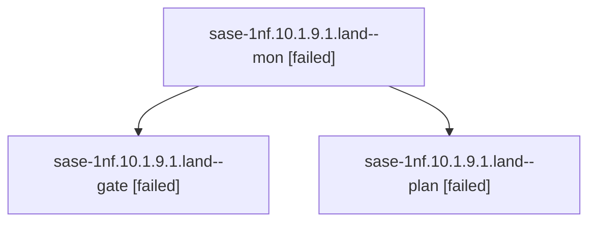

# Session: sase-1nf.10.1.9.1.land

[Agent Hoods](../README.md) / [bbugyi200](../users/bbugyi200/README.md) / [athena](../users/bbugyi200/machines/athena/README.md) / [sase-1nf](../users/bbugyi200/machines/athena/hoods/sase-1nf/README.md) / sase-1nf.10.1.9.1.land

Owner: `bbugyi200.athena` · Hood: `sase-1nf` · Members: 3 · Bead: [sase-1nf.10.1.9.1](https://github.com/sase-org/sase--beads/blob/main/pages/sase-1nf/sase-1nf.10.1.9.1.md)

## Lineage



The diagram is an optional enhancement; the ordered table below contains the same lineage in accessible text.

| Role | Agent | State | Model / provider | Timing | Commits | Prompt | Chat |
|---|---|---|---|---|---:|---|---|
| <a id="member-mon"></a>mon | sase-1nf.10.1.9.1.land--mon | failed | opus / claude | 2026-10-21T14:45:26.555259+00:00 → 2026-10-21T14:48:36.471468+00:00 | 0 | — | [Chat](../agents/bbugyi200.athena.sase-1nf.10.1.9.1.land--mon/chat.md) |
| <a id="member-gate"></a>gate | sase-1nf.10.1.9.1.land--gate | failed | opus / claude | 2026-10-21T14:43:54.764912+00:00 → 2026-10-21T14:45:27.411177+00:00 | 0 | — | [Chat](../agents/bbugyi200.athena.sase-1nf.10.1.9.1.land--gate/chat.md) |
| <a id="member-plan"></a>plan | sase-1nf.10.1.9.1.land--plan | failed | opus / claude | 2026-10-21T14:17:34.950640+00:00 → 2026-10-21T14:45:51.837178+00:00 | 0 | [Prompt](../agents/bbugyi200.athena.sase-1nf.10.1.9.1.land--plan/prompt.md) | [Chat](../agents/bbugyi200.athena.sase-1nf.10.1.9.1.land--plan/chat.md) |

## Variables

| Role | Variable | Value |
|---|---|---|
| plan | `artifacts` | \[{bead: sase-1nf.10.1.9.1, kind: markdown, label: sase-1nf.10.1.9.1 landing audit: drain digest-cache regression, quadratic name scan, replay blockers, path: /home/bryan/.sase/artifacts/agents/gh\_sas… |

#### artifacts

**Role:** `plan`

```yaml
- bead: sase-1nf.10.1.9.1
  kind: markdown
  label: sase-1nf.10.1.9.1 landing audit: drain digest-cache regression, quadratic name scan, replay blockers
  path: /home/bryan/.sase/artifacts/agents/gh_sase-org__sase/20261021074018/land-audit-evidence-11af89122048.md
  ref: file:explicit:684de02c487788fab67ad837
  source_path: /tmp/land-1nf91/land-audit-evidence.md
- bead: sase-1nf.10.1.9.1
  kind: file
  label: Apollo sase snapshot raw vs reserialized digest probe at agents b3da77e44a
  path: /home/bryan/.sase/artifacts/agents/gh_sase-org__sase/20261021074018/digest-probe-88a0c6539453.txt
  ref: file:explicit:b2ebf67eabeaef7b5e0a1265
  source_path: /tmp/land-1nf91/digest-probe.txt
- bead: sase-1nf.10.1.9.1
  kind: file
  label: agents_publication_profile --hood sase-1nf JSON under cProfile (athena)
  path: /home/bryan/.sase/artifacts/agents/gh_sase-org__sase/20261021074018/profile-df4e3133656c.json
  ref: file:explicit:1e757f4f4eadfca380da107c
  source_path: /tmp/land-1nf91/profile.json
- bead: sase-1nf.10.1.9.1
  kind: file
  label: Athena agent_publication_drains.jsonl tail 05:32-13:47Z 2026-10-21
  path: /home/bryan/.sase/artifacts/agents/gh_sase-org__sase/20261021074018/athena-drain-log-tail-b6a32b2de816.jsonl
  ref: file:explicit:f3576bf6104be8530cc534e2
  source_path: /tmp/land-1nf91/athena-drain-log-tail.jsonl
```

Values are truncated for display; see each member's agent meta.json for the full values.

## Neighbors

| Agent | Relation | State |
|---|---|---|
| [sase-1nf.10.1.9](bbugyi200.athena.sase-1nf.10.1.9.md) (session · 3) | ancestor | failed 3 |
| [sase-1nf.10](bbugyi200.athena.sase-1nf.10.md) (session · 3) | ancestor | failed 3 |
| [sase-1nf.10.1.9.1.1](../agents/bbugyi200.athena.sase-1nf.10.1.9.1.1/README.md) | sase-1nf.10.1.9.1 hood | completed |
| [sase-1nf.10.1.9.1.2](bbugyi200.athena.sase-1nf.10.1.9.1.2.md) (session · 3) | sase-1nf.10.1.9.1 hood | completed 2, failed 1 |
| [sase-1nf.10.1.9.1.3](bbugyi200.athena.sase-1nf.10.1.9.1.3.md) (session · 5) | sase-1nf.10.1.9.1 hood | completed 3, failed 2 |
| [sase-1nf.10.1.9.1.4](bbugyi200.athena.sase-1nf.10.1.9.1.4.md) (session · 5) | sase-1nf.10.1.9.1 hood | completed 3, failed 2 |
| [sase-1nf.10.1.9.1.5](../agents/bbugyi200.athena.sase-1nf.10.1.9.1.5/README.md) | sase-1nf.10.1.9.1 hood | completed |
| [sase-1nf.10.1.9.1.6.1](../agents/bbugyi200.athena.sase-1nf.10.1.9.1.6.1/README.md) | sase-1nf.10.1.9.1 hood | completed |
| [sase-1nf.10.1.9.1.6.2](../agents/bbugyi200.athena.sase-1nf.10.1.9.1.6.2/README.md) | sase-1nf.10.1.9.1 hood | active |
| [sase-1nf.10.1.9.1.6.3](../agents/bbugyi200.athena.sase-1nf.10.1.9.1.6.3/README.md) | sase-1nf.10.1.9.1 hood | waiting |
| [sase-1nf.10.1.9.1.6.4](../agents/bbugyi200.athena.sase-1nf.10.1.9.1.6.4/README.md) | sase-1nf.10.1.9.1 hood | waiting |
| [sase-1nf.10.1.9.1.6.5](../agents/bbugyi200.athena.sase-1nf.10.1.9.1.6.5/README.md) | sase-1nf.10.1.9.1 hood | waiting |
| [sase-1nf.10.1.9.1.6.land](../agents/bbugyi200.athena.sase-1nf.10.1.9.1.6.land/README.md) | sase-1nf.10.1.9.1 hood | waiting |
| [sase-1nf.10.1.1](../agents/bbugyi200.athena.sase-1nf.10.1.1/README.md) | sase-1nf.10.1 hood | completed |
| [sase-1nf.10.1.2](../agents/bbugyi200.athena.sase-1nf.10.1.2/README.md) | sase-1nf.10.1 hood | completed |
| [sase-1nf.10.1.3](../agents/bbugyi200.athena.sase-1nf.10.1.3/README.md) | sase-1nf.10.1 hood | completed |
| [sase-1nf.10.1.4](bbugyi200.athena.sase-1nf.10.1.4.md) (session · 7) | sase-1nf.10.1 hood | completed 4, failed 3 |
| [sase-1nf.10.1.5](../agents/bbugyi200.athena.sase-1nf.10.1.5/README.md) | sase-1nf.10.1 hood | completed |
| [sase-1nf.10.1.6](../agents/bbugyi200.athena.sase-1nf.10.1.6/README.md) | sase-1nf.10.1 hood | completed |
| [sase-1nf.10.1.7](bbugyi200.athena.sase-1nf.10.1.7.md) (session · 5) | sase-1nf.10.1 hood | completed 3, failed 2 |
| [sase-1nf.10.1.8](../agents/bbugyi200.athena.sase-1nf.10.1.8/README.md) | sase-1nf.10.1 hood | completed |
| [sase-1nf.10.1.land](../agents/bbugyi200.athena.sase-1nf.10.1.land/README.md) | sase-1nf.10.1 hood | waiting |
| [sase-1nf.1](../agents/bbugyi200.athena.sase-1nf.1/README.md) | sase-1nf hood | completed |
| [sase-1nf.11](../agents/bbugyi200.athena.sase-1nf.11/README.md) | sase-1nf hood | waiting |
| [sase-1nf.12](../agents/bbugyi200.athena.sase-1nf.12/README.md) | sase-1nf hood | completed |
| [sase-1nf.13](bbugyi200.athena.sase-1nf.13.md) (session · 4) | sase-1nf hood | active 1, completed 2, failed 1 |
| [sase-1nf.14](../agents/bbugyi200.athena.sase-1nf.14/README.md) | sase-1nf hood | waiting |
| [sase-1nf.2](../agents/bbugyi200.athena.sase-1nf.2/README.md) | sase-1nf hood | completed |
| [sase-1nf.3](../agents/bbugyi200.athena.sase-1nf.3/README.md) | sase-1nf hood | completed |
| [sase-1nf.4](bbugyi200.athena.sase-1nf.4.md) (session · 2) | sase-1nf hood | completed 1, failed 1 |
| [sase-1nf.5](../agents/bbugyi200.athena.sase-1nf.5/README.md) | sase-1nf hood | completed |
| [sase-1nf.6](bbugyi200.athena.sase-1nf.6.md) (session · 9) | sase-1nf hood | completed 5, failed 4 |
| [sase-1nf.7](bbugyi200.athena.sase-1nf.7.md) (session · 5) | sase-1nf hood | completed 3, failed 2 |
| [sase-1nf.8](../agents/bbugyi200.athena.sase-1nf.8/README.md) | sase-1nf hood | completed |
| [sase-1nf.9](bbugyi200.athena.sase-1nf.9.md) (session · 5) | sase-1nf hood | completed 3, failed 2 |
| [sase-1nf.land](../agents/bbugyi200.athena.sase-1nf.land/README.md) | sase-1nf hood | waiting |
