# Session: sase-1nf.13

[Agent Hoods](../README.md) / [bbugyi200](../users/bbugyi200/README.md) / [athena](../users/bbugyi200/machines/athena/README.md) / [sase-1nf](../users/bbugyi200/machines/athena/hoods/sase-1nf/README.md) / sase-1nf.13

Owner: `bbugyi200.athena` · Hood: `sase-1nf` · Members: 13 · Bead: [sase-1nf.13](https://github.com/sase-org/sase--beads/blob/main/pages/sase-1nf/sase-1nf.13.md)

## Lineage

```mermaid
flowchart TD
  n0["sase-1nf.13--3 [completed]"]
  n1["sase-1nf.13--6 [completed]"]
  n0 --> n1
  n2["sase-1nf.13--mon-2 [failed]"]
  n0 --> n2
  n3["sase-1nf.13--4 [completed]"]
  n0 --> n3
  n4["sase-1nf.13--2 [completed]"]
  n0 --> n4
  n5["sase-1nf.13--mon-3 [failed]"]
  n0 --> n5
  n6["sase-1nf.13--plan [completed]"]
  n0 --> n6
  n7["sase-1nf.13--mon [failed]"]
  n0 --> n7
  n8["sase-1nf.13--mon-0 [failed]"]
  n0 --> n8
  n9["sase-1nf.13--1 [completed]"]
  n0 --> n9
  n10["sase-1nf.13--mon-1 [failed]"]
  n0 --> n10
  n11["sase-1nf.13--gate [failed]"]
  n0 --> n11
  n12["sase-1nf.13--gate-0 [failed]"]
  n0 --> n12
```



The diagram is an optional enhancement; the ordered table below contains the same lineage in accessible text.

| Role | Agent | State | Model / provider | Timing | Commits | Prompt | Chat |
|---|---|---|---|---|---:|---|---|
| <a id="member-3"></a>3 | sase-1nf.13--3 | completed | gpt-6-astra / codex | 2026-10-23T14:43:05.328640+00:00 → 2026-10-23T14:57:25.207468+00:00 | 0 | [Prompt](../agents/bbugyi200.athena.sase-1nf.13--3/prompt.md) | [Chat](../agents/bbugyi200.athena.sase-1nf.13--3/chat.md) |
| <a id="member-6"></a>6 | sase-1nf.13--6 | completed | gpt-6-astra / codex | 2026-10-24T02:20:31.112438+00:00 → 2026-10-24T02:38:40.869739+00:00 | 0 | [Prompt](../agents/bbugyi200.athena.sase-1nf.13--6/prompt.md) | [Chat](../agents/bbugyi200.athena.sase-1nf.13--6/chat.md) |
| <a id="member-mon-2"></a>mon-2 | sase-1nf.13--mon-2 | failed | gpt-6-astra / codex | 2026-10-23T15:36:05.694428+00:00 → 2026-10-23T21:31:36.214040+00:00 | 0 | — | [Chat](../agents/bbugyi200.athena.sase-1nf.13--mon-2/chat.md) |
| <a id="member-4"></a>4 | sase-1nf.13--4 | completed | gpt-6-astra / codex | 2026-10-23T15:06:18.808639+00:00 → 2026-10-23T15:36:40.188497+00:00 | 0 | [Prompt](../agents/bbugyi200.athena.sase-1nf.13--4/prompt.md) | [Chat](../agents/bbugyi200.athena.sase-1nf.13--4/chat.md) |
| <a id="member-2"></a>2 | sase-1nf.13--2 | completed | gpt-6-astra / codex | 2026-10-23T14:13:39.100154+00:00 → 2026-10-23T14:24:31.978322+00:00 | 0 | [Prompt](../agents/bbugyi200.athena.sase-1nf.13--2/prompt.md) | [Chat](../agents/bbugyi200.athena.sase-1nf.13--2/chat.md) |
| <a id="member-mon-3"></a>mon-3 | sase-1nf.13--mon-3 | failed | gpt-6-astra / codex | 2026-10-23T22:22:53.959150+00:00 → 2026-10-24T02:18:49.523726+00:00 | 0 | — | [Chat](../agents/bbugyi200.athena.sase-1nf.13--mon-3/chat.md) |
| <a id="member-plan"></a>plan | sase-1nf.13--plan | completed | gpt-6-astra / codex | 2026-10-23T13:40:19.661670+00:00 → 2026-10-23T14:07:44.189655+00:00 | 0 | [Prompt](../agents/bbugyi200.athena.sase-1nf.13--plan/prompt.md) | [Chat](../agents/bbugyi200.athena.sase-1nf.13--plan/chat.md) |
| <a id="member-mon"></a>mon | sase-1nf.13--mon | failed | gpt-6-astra / codex | 2026-10-23T14:07:03.323438+00:00 → 2026-10-23T14:12:39.124865+00:00 | 0 | — | [Chat](../agents/bbugyi200.athena.sase-1nf.13--mon/chat.md) |
| <a id="member-mon-0"></a>mon-0 | sase-1nf.13--mon-0 | failed | gpt-6-astra / codex | 2026-10-23T14:23:42.088386+00:00 → 2026-10-23T14:41:58.644939+00:00 | 0 | — | [Chat](../agents/bbugyi200.athena.sase-1nf.13--mon-0/chat.md) |
| <a id="member-1"></a>1 | sase-1nf.13--1 | completed | gpt-6-astra / codex | 2026-10-23T13:53:27.808638+00:00 → 2026-10-23T14:07:44.189655+00:00 | 0 | — | [Chat](../agents/bbugyi200.athena.sase-1nf.13--1/chat.md) |
| <a id="member-mon-1"></a>mon-1 | sase-1nf.13--mon-1 | failed | gpt-6-astra / codex | 2026-10-23T14:55:40.158230+00:00 → 2026-10-23T15:05:22.461854+00:00 | 0 | — | [Chat](../agents/bbugyi200.athena.sase-1nf.13--mon-1/chat.md) |
| <a id="member-gate"></a>gate | sase-1nf.13--gate | failed | gpt-6-astra / codex | 2026-10-23T13:51:58.250749+00:00 → 2026-10-23T13:53:06.543444+00:00 | 0 | — | [Chat](../agents/bbugyi200.athena.sase-1nf.13--gate/chat.md) |
| <a id="member-gate-0"></a>gate-0 | sase-1nf.13--gate-0 | failed | gpt-6-astra / codex | 2026-10-23T22:07:55.452880+00:00 → 2026-10-23T22:08:56.669985+00:00 | 0 | — | [Chat](../agents/bbugyi200.athena.sase-1nf.13--gate-0/chat.md) |

## Variables

| Role | Variable | Value |
|---|---|---|
| 1 | `artifacts` | \[{bead: sase-1nf.13, kind: file, label: Verified GC census launch and capture setup 2026-10-23, path: /home/bryan/.sase/artifacts/agents/gh\_sase-org\_\_sase/20261023095327/gc-measure-20261023-start.tar… |
| 2 | `artifacts` | \[{bead: sase-1nf.13, kind: file, label: Interrupted GC census capture 2026-10-23; Athena instance changed at 14:11 UTC, path: /home/bryan/.sase/artifacts/agents/gh\_sase-org\_\_sase/20261023101138/gc-me… |
| 3 | `artifacts` | \[{bead: sase-1nf.13, kind: file, label: GC measurement r2 interrupted capture 2026-10-23, path: /home/bryan/.sase/artifacts/agents/gh\_sase-org\_\_sase/20261023104058/gc-measure-20261023-r2-capture.tar-… |
| 4 | `artifacts` | \[{bead: sase-1nf.13, kind: file, label: GC capture r3 interrupted by source revision change, path: /home/bryan/.sase/artifacts/agents/gh\_sase-org\_\_sase/20261023110421/gc-measure-20261023-r3-capture.t… |
| 6 | `artifacts` | \[{bead: sase-1nf.13, kind: file, label: Completed r5 two-host GC capture, path: /home/bryan/.sase/artifacts/agents/gh\_sase-org\_\_sase/20261023221748/gc-measure-20261023-r5-capture.tar-5d776f789c46.gz,… |

#### artifacts

**Role:** `1`

```yaml
- bead: sase-1nf.13
  kind: file
  label: Verified GC census launch and capture setup 2026-10-23
  path: /home/bryan/.sase/artifacts/agents/gh_sase-org__sase/20261023095327/gc-measure-20261023-start.tar-27247c09792d.gz
  ref: file:explicit:d54703bdfa49035878bd0bdd
  source_path: /home/bryan/.local/state/sase/workspaces/sase-org/sase/sase_11/.tmp/gc-measure-20261023-start.tar.gz
```

#### artifacts

**Role:** `2`

```yaml
- bead: sase-1nf.13
  kind: file
  label: Interrupted GC census capture 2026-10-23; Athena instance changed at 14:11 UTC
  path: /home/bryan/.sase/artifacts/agents/gh_sase-org__sase/20261023101138/gc-measure-20261023-capture.tar-f843a5d07131.gz
  ref: file:explicit:abd61985c8cb0cbb748a7c26
  source_path: /home/bryan/.local/state/sase/workspaces/sase-org/sase/sase_11/.tmp/gc-measure-20261023-capture.tar.gz
- bead: sase-1nf.13
  kind: file
  label: GC capture restart setup: same flags, new 14:09 UTC app instances and corrected exec-restart probe
  path: /home/bryan/.sase/artifacts/agents/gh_sase-org__sase/20261023101138/gc-measure-20261023-r2-start.tar-493bbc3a28d5.gz
  ref: file:explicit:0e0e91825f3fb985c3a2a953
  source_path: /home/bryan/.local/state/sase/workspaces/sase-org/sase/sase_11/.tmp/gc-measure-20261023-r2-start.tar.gz
```

#### artifacts

**Role:** `3`

```yaml
- bead: sase-1nf.13
  kind: file
  label: GC measurement r2 interrupted capture 2026-10-23
  path: /home/bryan/.sase/artifacts/agents/gh_sase-org__sase/20261023104058/gc-measure-20261023-r2-capture.tar-b37cbf1832e3.gz
  ref: file:explicit:564c89da176b9ee0c89b760b
  source_path: /home/bryan/.local/state/sase/workspaces/sase-org/sase/sase_11/.tmp/gc-measure-20261023-r2-capture.tar.gz
- bead: sase-1nf.13
  kind: file
  label: GC capture r3 independent instance coverage setup
  path: /home/bryan/.sase/artifacts/agents/gh_sase-org__sase/20261023104058/gc-measure-20261023-r3-setup.tar-2ab641854a3f.gz
  ref: file:explicit:2a8b4ccda43005b5ac42e5a3
  source_path: /home/bryan/.local/state/sase/workspaces/sase-org/sase/sase_11/.tmp/gc-measure-20261023-r3-setup.tar.gz
```

#### artifacts

**Role:** `4`

```yaml
- bead: sase-1nf.13
  kind: file
  label: GC capture r3 interrupted by source revision change
  path: /home/bryan/.sase/artifacts/agents/gh_sase-org__sase/20261023110421/gc-measure-20261023-r3-capture.tar-fd78c2fa2522.gz
  ref: file:explicit:dc86d3b302afb42ced69208b
  source_path: /home/bryan/.local/state/sase/workspaces/sase-org/sase/sase_11/.tmp/gc-measure-20261023-r3-capture.tar.gz
- bead: sase-1nf.13
  kind: file
  label: GC r4 recovery, producer experiments and partial findings
  path: /home/bryan/.sase/artifacts/agents/gh_sase-org__sase/20261023110421/gc-measure-20261023-r4-setup.tar-6ef75bf3b7df.gz
  ref: file:explicit:d350cd2049aee5ae9163a022
  source_path: /home/bryan/.local/state/sase/workspaces/sase-org/sase/sase_11/.tmp/gc-measure-20261023-r4-setup.tar.gz
```

#### artifacts

**Role:** `6`

```yaml
- bead: sase-1nf.13
  kind: file
  label: Completed r5 two-host GC capture
  path: /home/bryan/.sase/artifacts/agents/gh_sase-org__sase/20261023221748/gc-measure-20261023-r5-capture.tar-5d776f789c46.gz
  ref: file:explicit:0a6685051ab0553815b6d538
  source_path: /home/bryan/.local/state/sase/workspaces/sase-org/sase/sase_11/.tmp/gc-measure-20261023-r5-capture.tar.gz
- bead: sase-1nf.13
  kind: file
  label: Verified r5 four-hour metrics and action-separated navigation analysis
  path: /home/bryan/.sase/artifacts/agents/gh_sase-org__sase/20261023221748/gc-measure-20261023-r5-analysis.tar-2e204be56496.gz
  ref: file:explicit:48ab8282349c800464ca383e
  source_path: /home/bryan/.local/state/sase/workspaces/sase-org/sase/sase_11/.tmp/gc-measure-20261023-r5-analysis.tar.gz
- bead: sase-1nf.13
  kind: markdown
  label: TUI GC report with verified r5 duration and explicit busy-hour gap
  path: /home/bryan/.sase/artifacts/agents/gh_sase-org__sase/20261023221748/tui_gc_measurement_20261023-06c4ee9ecba7.md
  ref: file:explicit:a5b0ae10f3f82bb726fa9b4e
  source_path: /home/bryan/.local/state/sase/workspaces/sase-org/sase/sase_11/sase/repos/research/202610/tui_gc_measurement_20261023.md
```

Values are truncated for display; see each member's agent meta.json for the full values.

## Neighbors

| Agent | Relation | State |
|---|---|---|
| [sase-1nf.1](../agents/bbugyi200.athena.sase-1nf.1/README.md) | sase-1nf hood | completed |
| [sase-1nf.10](bbugyi200.athena.sase-1nf.10.md) (session · 3) | sase-1nf hood | failed 3 |
| [sase-1nf.10.1.1](../agents/bbugyi200.athena.sase-1nf.10.1.1/README.md) | sase-1nf hood | completed |
| [sase-1nf.10.1.2](../agents/bbugyi200.athena.sase-1nf.10.1.2/README.md) | sase-1nf hood | completed |
| [sase-1nf.10.1.3](../agents/bbugyi200.athena.sase-1nf.10.1.3/README.md) | sase-1nf hood | completed |
| [sase-1nf.10.1.4](bbugyi200.athena.sase-1nf.10.1.4.md) (session · 7) | sase-1nf hood | completed 4, failed 3 |
| [sase-1nf.10.1.5](../agents/bbugyi200.athena.sase-1nf.10.1.5/README.md) | sase-1nf hood | completed |
| [sase-1nf.10.1.6](../agents/bbugyi200.athena.sase-1nf.10.1.6/README.md) | sase-1nf hood | completed |
| [sase-1nf.10.1.7](bbugyi200.athena.sase-1nf.10.1.7.md) (session · 5) | sase-1nf hood | completed 3, failed 2 |
| [sase-1nf.10.1.8](../agents/bbugyi200.athena.sase-1nf.10.1.8/README.md) | sase-1nf hood | completed |
| [sase-1nf.10.1.9](bbugyi200.athena.sase-1nf.10.1.9.md) (session · 3) | sase-1nf hood | failed 3 |
| [sase-1nf.10.1.9.1.1](../agents/bbugyi200.athena.sase-1nf.10.1.9.1.1/README.md) | sase-1nf hood | active |
| [sase-1nf.10.1.9.1.2](bbugyi200.athena.sase-1nf.10.1.9.1.2.md) (session · 3) | sase-1nf hood | active 3 |
| [sase-1nf.10.1.9.1.3](bbugyi200.athena.sase-1nf.10.1.9.1.3.md) (session · 5) | sase-1nf hood | active 5 |
| [sase-1nf.10.1.9.1.4](bbugyi200.athena.sase-1nf.10.1.9.1.4.md) (session · 5) | sase-1nf hood | active 5 |
| [sase-1nf.10.1.9.1.5](../agents/bbugyi200.athena.sase-1nf.10.1.9.1.5/README.md) | sase-1nf hood | active |
| [sase-1nf.10.1.9.1.6.1](../agents/bbugyi200.athena.sase-1nf.10.1.9.1.6.1/README.md) | sase-1nf hood | active |
| [sase-1nf.10.1.9.1.6.2](../agents/bbugyi200.athena.sase-1nf.10.1.9.1.6.2/README.md) | sase-1nf hood | active |
| [sase-1nf.10.1.9.1.6.3](bbugyi200.athena.sase-1nf.10.1.9.1.6.3.md) (session · 3) | sase-1nf hood | active 3 |
| [sase-1nf.10.1.9.1.6.4](../agents/bbugyi200.athena.sase-1nf.10.1.9.1.6.4/README.md) | sase-1nf hood | active |
| [sase-1nf.10.1.9.1.6.5](../agents/bbugyi200.athena.sase-1nf.10.1.9.1.6.5/README.md) | sase-1nf hood | active |
| [sase-1nf.10.1.9.1.6.land](../agents/bbugyi200.athena.sase-1nf.10.1.9.1.6.land/README.md) | sase-1nf hood | active |
| [sase-1nf.10.1.9.1.land](bbugyi200.athena.sase-1nf.10.1.9.1.land.md) (session · 3) | sase-1nf hood | active 3 |
| [sase-1nf.10.1.land](../agents/bbugyi200.athena.sase-1nf.10.1.land/README.md) | sase-1nf hood | waiting |
| [sase-1nf.11](../agents/bbugyi200.athena.sase-1nf.11/README.md) | sase-1nf hood | waiting |
| [sase-1nf.12](../agents/bbugyi200.athena.sase-1nf.12/README.md) | sase-1nf hood | completed |
| [sase-1nf.13--5--1](../agents/bbugyi200.athena.sase-1nf.13--5--1/README.md) | sase-1nf hood | completed |
| [sase-1nf.13--5--mon](../agents/bbugyi200.athena.sase-1nf.13--5--mon/README.md) | sase-1nf hood | failed |
| [sase-1nf.13--5--plan](../agents/bbugyi200.athena.sase-1nf.13--5--plan/README.md) | sase-1nf hood | completed |
| [sase-1nf.14](bbugyi200.athena.sase-1nf.14.md) (session · 3) | sase-1nf hood | failed 3 |
| [sase-1nf.14.1.1](../agents/bbugyi200.athena.sase-1nf.14.1.1/README.md) | sase-1nf hood | completed |
| [sase-1nf.14.1.2](../agents/bbugyi200.athena.sase-1nf.14.1.2/README.md) | sase-1nf hood | completed |
| [sase-1nf.14.1.3](../agents/bbugyi200.athena.sase-1nf.14.1.3/README.md) | sase-1nf hood | active |
| [sase-1nf.14.1.4](../agents/bbugyi200.athena.sase-1nf.14.1.4/README.md) | sase-1nf hood | completed |
| [sase-1nf.14.1.5](bbugyi200.athena.sase-1nf.14.1.5.md) (session · 5) | sase-1nf hood | completed 3, failed 2 |
| [sase-1nf.14.1.6](bbugyi200.athena.sase-1nf.14.1.6.md) (session · 3) | sase-1nf hood | completed 2, failed 1 |
| [sase-1nf.14.1.7](bbugyi200.athena.sase-1nf.14.1.7.md) (session · 3) | sase-1nf hood | completed 2, failed 1 |
| [sase-1nf.14.1.7](../agents/bbugyi200.athena.sase-1nf.14.1.7/README.md) | sase-1nf hood | waiting |
| [sase-1nf.14.1.8](bbugyi200.athena.sase-1nf.14.1.8.md) (session · 5) | sase-1nf hood | completed 3, failed 2 |
| [sase-1nf.14.1.land](bbugyi200.athena.sase-1nf.14.1.land.md) (session · 7) | sase-1nf hood | completed 4, failed 3 |
| [sase-1nf.2](../agents/bbugyi200.athena.sase-1nf.2/README.md) | sase-1nf hood | completed |
| [sase-1nf.3](../agents/bbugyi200.athena.sase-1nf.3/README.md) | sase-1nf hood | completed |
| [sase-1nf.4](bbugyi200.athena.sase-1nf.4.md) (session · 2) | sase-1nf hood | completed 1, failed 1 |
| [sase-1nf.4](../agents/bbugyi200.athena.sase-1nf.4/README.md) | sase-1nf hood | completed |
| [sase-1nf.5](../agents/bbugyi200.athena.sase-1nf.5/README.md) | sase-1nf hood | completed |
| [sase-1nf.6](bbugyi200.athena.sase-1nf.6.md) (session · 9) | sase-1nf hood | completed 5, failed 4 |
| [sase-1nf.7](bbugyi200.athena.sase-1nf.7.md) (session · 5) | sase-1nf hood | completed 3, failed 2 |
| [sase-1nf.8](../agents/bbugyi200.athena.sase-1nf.8/README.md) | sase-1nf hood | completed |
| [sase-1nf.9](bbugyi200.athena.sase-1nf.9.md) (session · 5) | sase-1nf hood | completed 3, failed 2 |
| [sase-1nf.land](../agents/bbugyi200.athena.sase-1nf.land/README.md) | sase-1nf hood | waiting |
