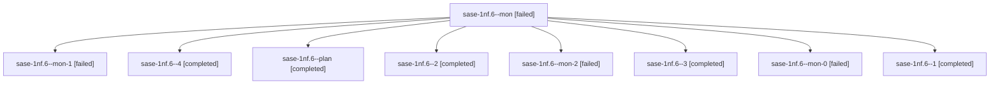

# Session: sase-1nf.6

[Agent Hoods](../README.md) / [bbugyi200](../users/bbugyi200/README.md) / [athena](../users/bbugyi200/machines/athena/README.md) / [sase-1nf](../users/bbugyi200/machines/athena/hoods/sase-1nf/README.md) / sase-1nf.6

Owner: `bbugyi200.athena` · Hood: `sase-1nf` · Members: 9 · Bead: [sase-1nf.6](https://github.com/sase-org/sase--beads/blob/main/pages/sase-1nf/sase-1nf.6.md)

## Lineage

The diagram is an optional enhancement; the ordered table below contains the same lineage in accessible text.

| Role | Agent | State | Model / provider | Timing | Commits | Prompt | Chat |
|---|---|---|---|---|---:|---|---|
| mon | sase-1nf.6--mon | failed | gpt-6-luna / codex | 2026-10-20T17:58:07.439878+00:00 → 2026-10-20T18:10:40.983890+00:00 | 0 | — | [Chat](../agents/bbugyi200.athena.sase-1nf.6--mon/chat.md) |
| mon-1 | sase-1nf.6--mon-1 | failed | gpt-6-luna / codex | 2026-10-20T18:27:31.071688+00:00 → 2026-10-20T18:38:47.125977+00:00 | 0 | — | [Chat](../agents/bbugyi200.athena.sase-1nf.6--mon-1/chat.md) |
| 4 | sase-1nf.6--4 | completed | gpt-6-luna / codex | 2026-10-20T19:08:01.536064+00:00 → 2026-10-20T19:17:17.086815+00:00 | 0 | [Prompt](../agents/bbugyi200.athena.sase-1nf.6--4/prompt.md) | [Chat](../agents/bbugyi200.athena.sase-1nf.6--4/chat.md) |
| plan | sase-1nf.6--plan | completed | gpt-6-luna / codex | 2026-10-20T17:49:24.360273+00:00 → 2026-10-20T17:58:40.540667+00:00 | 0 | [Prompt](../agents/bbugyi200.athena.sase-1nf.6--plan/prompt.md) | [Chat](../agents/bbugyi200.athena.sase-1nf.6--plan/chat.md) |
| 2 | sase-1nf.6--2 | completed | gpt-6-luna / codex | 2026-10-20T18:22:12.016450+00:00 → 2026-10-20T18:28:25.142245+00:00 | 0 | [Prompt](../agents/bbugyi200.athena.sase-1nf.6--2/prompt.md) | [Chat](../agents/bbugyi200.athena.sase-1nf.6--2/chat.md) |
| mon-2 | sase-1nf.6--mon-2 | failed | gpt-6-luna / codex | 2026-10-20T18:48:53.513154+00:00 → 2026-10-20T19:07:07.424517+00:00 | 0 | — | [Chat](../agents/bbugyi200.athena.sase-1nf.6--mon-2/chat.md) |
| 3 | sase-1nf.6--3 | completed | gpt-6-luna / codex | 2026-10-20T18:38:16.941459+00:00 → 2026-10-20T18:49:44.854627+00:00 | 0 | [Prompt](../agents/bbugyi200.athena.sase-1nf.6--3/prompt.md) | [Chat](../agents/bbugyi200.athena.sase-1nf.6--3/chat.md) |
| mon-0 | sase-1nf.6--mon-0 | failed | gpt-6-luna / codex | 2026-10-20T18:17:04.830816+00:00 → 2026-10-20T18:21:14.776117+00:00 | 0 | — | [Chat](../agents/bbugyi200.athena.sase-1nf.6--mon-0/chat.md) |
| 1 | sase-1nf.6--1 | completed | gpt-6-luna / codex | 2026-10-20T18:11:01.371034+00:00 → 2026-10-20T18:17:37.664622+00:00 | 0 | [Prompt](../agents/bbugyi200.athena.sase-1nf.6--1/prompt.md) | [Chat](../agents/bbugyi200.athena.sase-1nf.6--1/chat.md) |

## Neighbors

| Agent | Relation | State |
|---|---|---|
| [sase-1nf.1](../agents/bbugyi200.athena.sase-1nf.1/README.md) | sase-1nf hood | completed |
| [sase-1nf.10](bbugyi200.athena.sase-1nf.10.md) (session · 3) | sase-1nf hood | failed 3 |
| [sase-1nf.10.1.1](../agents/bbugyi200.athena.sase-1nf.10.1.1/README.md) | sase-1nf hood | completed |
| [sase-1nf.10.1.2](../agents/bbugyi200.athena.sase-1nf.10.1.2/README.md) | sase-1nf hood | completed |
| [sase-1nf.10.1.3](../agents/bbugyi200.athena.sase-1nf.10.1.3/README.md) | sase-1nf hood | completed |
| [sase-1nf.10.1.4](bbugyi200.athena.sase-1nf.10.1.4.md) (session · 7) | sase-1nf hood | completed 4, failed 3 |
| [sase-1nf.10.1.5](../agents/bbugyi200.athena.sase-1nf.10.1.5/README.md) | sase-1nf hood | completed |
| [sase-1nf.10.1.6](../agents/bbugyi200.athena.sase-1nf.10.1.6/README.md) | sase-1nf hood | completed |
| [sase-1nf.10.1.7](bbugyi200.athena.sase-1nf.10.1.7.md) (session · 5) | sase-1nf hood | completed 3, failed 2 |
| [sase-1nf.10.1.8](../agents/bbugyi200.athena.sase-1nf.10.1.8/README.md) | sase-1nf hood | completed |
| [sase-1nf.10.1.9](bbugyi200.athena.sase-1nf.10.1.9.md) (session · 3) | sase-1nf hood | failed 3 |
| [sase-1nf.10.1.9.1.1](../agents/bbugyi200.athena.sase-1nf.10.1.9.1.1/README.md) | sase-1nf hood | active |
| [sase-1nf.10.1.9.1.2](bbugyi200.athena.sase-1nf.10.1.9.1.2.md) (session · 3) | sase-1nf hood | active 3 |
| [sase-1nf.10.1.9.1.3](bbugyi200.athena.sase-1nf.10.1.9.1.3.md) (session · 5) | sase-1nf hood | active 5 |
| [sase-1nf.10.1.9.1.4](bbugyi200.athena.sase-1nf.10.1.9.1.4.md) (session · 5) | sase-1nf hood | active 5 |
| [sase-1nf.10.1.9.1.5](../agents/bbugyi200.athena.sase-1nf.10.1.9.1.5/README.md) | sase-1nf hood | active |
| [sase-1nf.10.1.9.1.6.1](../agents/bbugyi200.athena.sase-1nf.10.1.9.1.6.1/README.md) | sase-1nf hood | active |
| [sase-1nf.10.1.9.1.6.2](../agents/bbugyi200.athena.sase-1nf.10.1.9.1.6.2/README.md) | sase-1nf hood | active |
| [sase-1nf.10.1.9.1.6.3](bbugyi200.athena.sase-1nf.10.1.9.1.6.3.md) (session · 3) | sase-1nf hood | active 3 |
| [sase-1nf.10.1.9.1.6.4](../agents/bbugyi200.athena.sase-1nf.10.1.9.1.6.4/README.md) | sase-1nf hood | active |
| [sase-1nf.10.1.9.1.6.5](../agents/bbugyi200.athena.sase-1nf.10.1.9.1.6.5/README.md) | sase-1nf hood | active |
| [sase-1nf.10.1.9.1.6.land](../agents/bbugyi200.athena.sase-1nf.10.1.9.1.6.land/README.md) | sase-1nf hood | active |
| [sase-1nf.10.1.9.1.land](bbugyi200.athena.sase-1nf.10.1.9.1.land.md) (session · 3) | sase-1nf hood | active 3 |
| [sase-1nf.10.1.land](../agents/bbugyi200.athena.sase-1nf.10.1.land/README.md) | sase-1nf hood | waiting |
| [sase-1nf.11](../agents/bbugyi200.athena.sase-1nf.11/README.md) | sase-1nf hood | waiting |
| [sase-1nf.12](../agents/bbugyi200.athena.sase-1nf.12/README.md) | sase-1nf hood | completed |
| [sase-1nf.13](bbugyi200.athena.sase-1nf.13.md) (session · 13) | sase-1nf hood | completed 6, failed 7 |
| [sase-1nf.13](../agents/bbugyi200.athena.sase-1nf.13/README.md) | sase-1nf hood | completed |
| [sase-1nf.13--5--1](../agents/bbugyi200.athena.sase-1nf.13--5--1/README.md) | sase-1nf hood | completed |
| [sase-1nf.13--5--mon](../agents/bbugyi200.athena.sase-1nf.13--5--mon/README.md) | sase-1nf hood | failed |
| [sase-1nf.13--5--plan](../agents/bbugyi200.athena.sase-1nf.13--5--plan/README.md) | sase-1nf hood | completed |
| [sase-1nf.14](bbugyi200.athena.sase-1nf.14.md) (session · 3) | sase-1nf hood | failed 3 |
| [sase-1nf.14.1.1](../agents/bbugyi200.athena.sase-1nf.14.1.1/README.md) | sase-1nf hood | completed |
| [sase-1nf.14.1.2](../agents/bbugyi200.athena.sase-1nf.14.1.2/README.md) | sase-1nf hood | completed |
| [sase-1nf.14.1.3](../agents/bbugyi200.athena.sase-1nf.14.1.3/README.md) | sase-1nf hood | active |
| [sase-1nf.14.1.4](../agents/bbugyi200.athena.sase-1nf.14.1.4/README.md) | sase-1nf hood | completed |
| [sase-1nf.14.1.5](bbugyi200.athena.sase-1nf.14.1.5.md) (session · 5) | sase-1nf hood | completed 3, failed 2 |
| [sase-1nf.14.1.6](bbugyi200.athena.sase-1nf.14.1.6.md) (session · 3) | sase-1nf hood | active 1, completed 1, failed 1 |
| [sase-1nf.14.1.7](../agents/bbugyi200.athena.sase-1nf.14.1.7/README.md) | sase-1nf hood | waiting |
| [sase-1nf.14.1.8](../agents/bbugyi200.athena.sase-1nf.14.1.8/README.md) | sase-1nf hood | waiting |
| [sase-1nf.14.1.land](../agents/bbugyi200.athena.sase-1nf.14.1.land/README.md) | sase-1nf hood | waiting |
| [sase-1nf.2](../agents/bbugyi200.athena.sase-1nf.2/README.md) | sase-1nf hood | completed |
| [sase-1nf.3](../agents/bbugyi200.athena.sase-1nf.3/README.md) | sase-1nf hood | completed |
| [sase-1nf.4](bbugyi200.athena.sase-1nf.4.md) (session · 2) | sase-1nf hood | completed 1, failed 1 |
| [sase-1nf.4](../agents/bbugyi200.athena.sase-1nf.4/README.md) | sase-1nf hood | completed |
| [sase-1nf.5](../agents/bbugyi200.athena.sase-1nf.5/README.md) | sase-1nf hood | completed |
| [sase-1nf.7](bbugyi200.athena.sase-1nf.7.md) (session · 5) | sase-1nf hood | completed 3, failed 2 |
| [sase-1nf.8](../agents/bbugyi200.athena.sase-1nf.8/README.md) | sase-1nf hood | completed |
| [sase-1nf.9](bbugyi200.athena.sase-1nf.9.md) (session · 5) | sase-1nf hood | completed 3, failed 2 |
| [sase-1nf.land](../agents/bbugyi200.athena.sase-1nf.land/README.md) | sase-1nf hood | waiting |
